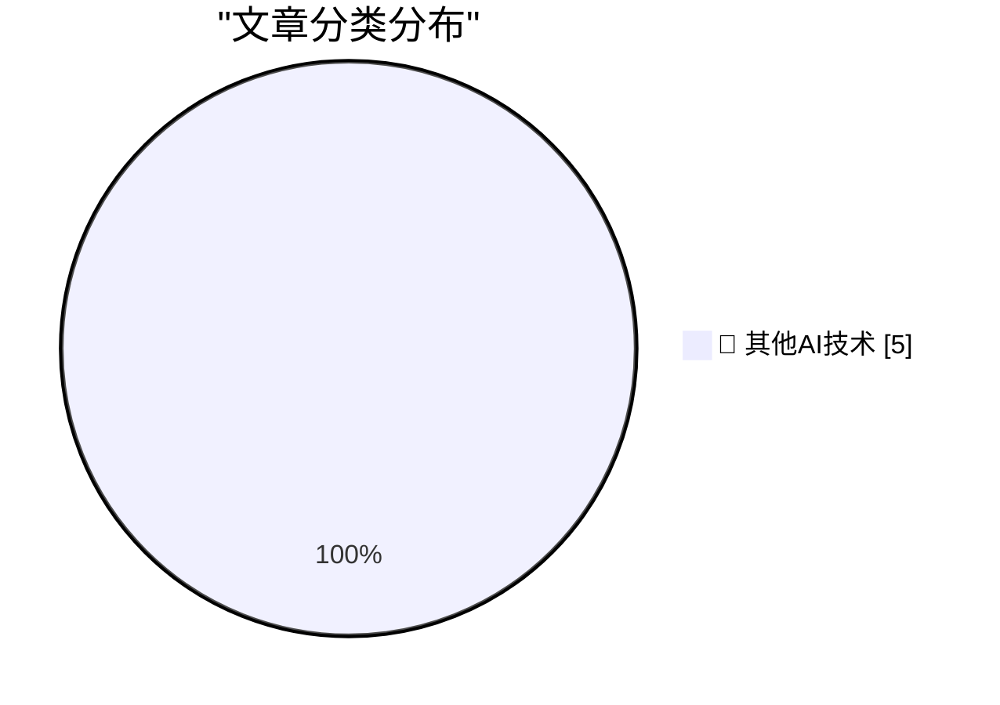

# 📰 AI 博客每日精选 — 2026-10-11

> 来自 98 个技术博客和社交媒体源，AI 精选 Top 5

## 🏆 今日必读

🥇 **Sunnny**

[Sunnny](https://sunnny.com/) — daringfireball.net · 7 小时前 · 🔬 其他AI技术

> Sunnny

🥈 **‘Proof-of-Human’**

[‘Proof-of-Human’](https://x.com/bzamayo/status/2108498107184934914) — daringfireball.net · 7 小时前 · 🔬 其他AI技术

> ‘Proof-of-Human’

🥉 **Some quick thoughts on Unit Testing ActivityPub**

[Some quick thoughts on Unit Testing ActivityPub](https://shkspr.mobi/blog/2026/10/some-thoughts-on-unit-testing-activitypub/) — shkspr.mobi · 12 小时前 · 🔬 其他AI技术

> Some quick thoughts on Unit Testing ActivityPub

4️⃣ **This Week in Package Management: 10 October 2026**

[This Week in Package Management: 10 October 2026](https://nesbitt.io/2026/10/10/this-week-in-package-management.html) — nesbitt.io · 14 小时前 · 🔬 其他AI技术

> This Week in Package Management: 10 October 2026

5️⃣ **The Infogrames-Atari merger of 2008**

[The Infogrames-Atari merger of 2008](https://dfarq.homeip.net/the-infogrames-atari-merger-of-2008/?utm_source=rss&#038;utm_medium=rss&#038;utm_campaign=the-infogrames-atari-merger-of-2008) — dfarq.homeip.net · 13 小时前 · 🔬 其他AI技术

> The Infogrames-Atari merger of 2008

---

## 📊 数据概览

| 扫描源 | 抓取文章 | 时间范围 | 精选 |
|:---:|:---:|:---:|:---:|
| 63/98 | 1800 篇 → 5 篇 | 24h | **5 篇** |

### 分类分布

---

====================

## 🔬 其他AI技术

### 1. Sunnny

[Sunnny](https://sunnny.com/) — **daringfireball.net** · 7 小时前 · ⭐ 15/25

> Sunnny

📌 其他AI技术

---

### 2. ‘Proof-of-Human’

[‘Proof-of-Human’](https://x.com/bzamayo/status/2108498107184934914) — **daringfireball.net** · 7 小时前 · ⭐ 15/25

> ‘Proof-of-Human’

📌 其他AI技术

---

### 3. Some quick thoughts on Unit Testing ActivityPub

[Some quick thoughts on Unit Testing ActivityPub](https://shkspr.mobi/blog/2026/10/some-thoughts-on-unit-testing-activitypub/) — **shkspr.mobi** · 12 小时前 · ⭐ 15/25

> Some quick thoughts on Unit Testing ActivityPub

📌 其他AI技术

---

### 4. This Week in Package Management: 10 October 2026

[This Week in Package Management: 10 October 2026](https://nesbitt.io/2026/10/10/this-week-in-package-management.html) — **nesbitt.io** · 14 小时前 · ⭐ 15/25

> This Week in Package Management: 10 October 2026

📌 其他AI技术

---

### 5. The Infogrames-Atari merger of 2008

[The Infogrames-Atari merger of 2008](https://dfarq.homeip.net/the-infogrames-atari-merger-of-2008/?utm_source=rss&#038;utm_medium=rss&#038;utm_campaign=the-infogrames-atari-merger-of-2008) — **dfarq.homeip.net** · 13 小时前 · ⭐ 15/25

> The Infogrames-Atari merger of 2008

📌 其他AI技术

---

====================

*生成于 2026-10-11 00:04 | 扫描 63 源 → 获取 1800 篇 → 精选 5 篇*
*基于 [Hacker News Popularity Contest 2025](https://refactoringenglish.com/tools/hn-popularity/) RSS 源列表，由 [Andrej Karpathy](https://x.com/karpathy) 推荐*
*由「懂点儿AI」制作，欢迎关注同名微信公众号获取更多 AI 实用技巧 💡*
