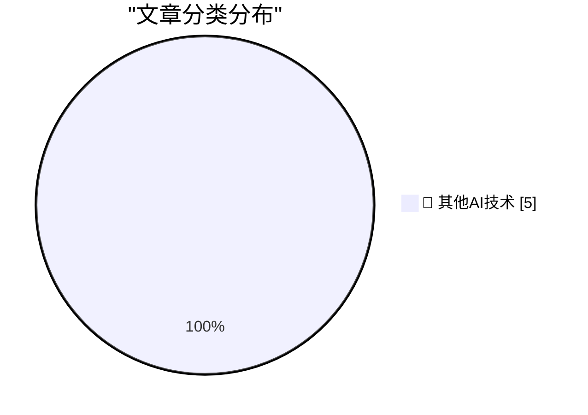

# 📰 AI 博客每日精选 — 2026-10-12

> 来自 98 个技术博客和社交媒体源，AI 精选 Top 5

## 🏆 今日必读

🥇 **★ X Once Again Marks the Spot**

[★ X Once Again Marks the Spot](https://daringfireball.net/2026/10/x_once_again_marks_the_spot) — daringfireball.net · 3 小时前 · 🔬 其他AI技术

> ★ X Once Again Marks the Spot

🥈 **Apple Only Started Suggesting iOS 26 Users Upgrade to 27 Three Days Ago**

[Apple Only Started Suggesting iOS 26 Users Upgrade to 27 Three Days Ago](https://www.macrumors.com/2026/10/08/apple-now-pushing-ios-27/) — daringfireball.net · 5 小时前 · 🔬 其他AI技术

> Apple Only Started Suggesting iOS 26 Users Upgrade to 27 Three Days Ago

🥉 **I paid people to try and follow my README**

[I paid people to try and follow my README](https://shkspr.mobi/blog/2026/10/i-paid-people-to-try-and-follow-my-readme/) — shkspr.mobi · 12 小时前 · 🔬 其他AI技术

> I paid people to try and follow my README

4️⃣ **Just say no to OpenAI and Anthropic**

[Just say no to OpenAI and Anthropic](https://micahflee.com/just-say-no-to-openai-and-anthropic/) — micahflee.com · 1 小时前 · 🔬 其他AI技术

> Just say no to OpenAI and Anthropic

5️⃣ **Ward Christensen, telecommunications pioneer**

[Ward Christensen, telecommunications pioneer](https://dfarq.homeip.net/ward-christensen-telecommunications-pioneer/?utm_source=rss&#038;utm_medium=rss&#038;utm_campaign=ward-christensen-telecommunications-pioneer) — dfarq.homeip.net · 13 小时前 · 🔬 其他AI技术

> Ward Christensen, telecommunications pioneer

---

## 📊 数据概览

| 扫描源 | 抓取文章 | 时间范围 | 精选 |
|:---:|:---:|:---:|:---:|
| 64/98 | 2019 篇 → 5 篇 | 24h | **5 篇** |

### 分类分布

---

====================

## 🔬 其他AI技术

### 1. ★ X Once Again Marks the Spot

[★ X Once Again Marks the Spot](https://daringfireball.net/2026/10/x_once_again_marks_the_spot) — **daringfireball.net** · 3 小时前 · ⭐ 15/25

> ★ X Once Again Marks the Spot

📌 其他AI技术

---

### 2. Apple Only Started Suggesting iOS 26 Users Upgrade to 27 Three Days Ago

[Apple Only Started Suggesting iOS 26 Users Upgrade to 27 Three Days Ago](https://www.macrumors.com/2026/10/08/apple-now-pushing-ios-27/) — **daringfireball.net** · 5 小时前 · ⭐ 15/25

> Apple Only Started Suggesting iOS 26 Users Upgrade to 27 Three Days Ago

📌 其他AI技术

---

### 3. I paid people to try and follow my README

[I paid people to try and follow my README](https://shkspr.mobi/blog/2026/10/i-paid-people-to-try-and-follow-my-readme/) — **shkspr.mobi** · 12 小时前 · ⭐ 15/25

> I paid people to try and follow my README

📌 其他AI技术

---

### 4. Just say no to OpenAI and Anthropic

[Just say no to OpenAI and Anthropic](https://micahflee.com/just-say-no-to-openai-and-anthropic/) — **micahflee.com** · 1 小时前 · ⭐ 15/25

> Just say no to OpenAI and Anthropic

📌 其他AI技术

---

### 5. Ward Christensen, telecommunications pioneer

[Ward Christensen, telecommunications pioneer](https://dfarq.homeip.net/ward-christensen-telecommunications-pioneer/?utm_source=rss&#038;utm_medium=rss&#038;utm_campaign=ward-christensen-telecommunications-pioneer) — **dfarq.homeip.net** · 13 小时前 · ⭐ 15/25

> Ward Christensen, telecommunications pioneer

📌 其他AI技术

---

====================

*生成于 2026-10-12 00:10 | 扫描 64 源 → 获取 2019 篇 → 精选 5 篇*
*基于 [Hacker News Popularity Contest 2025](https://refactoringenglish.com/tools/hn-popularity/) RSS 源列表，由 [Andrej Karpathy](https://x.com/karpathy) 推荐*
*由「懂点儿AI」制作，欢迎关注同名微信公众号获取更多 AI 实用技巧 💡*
