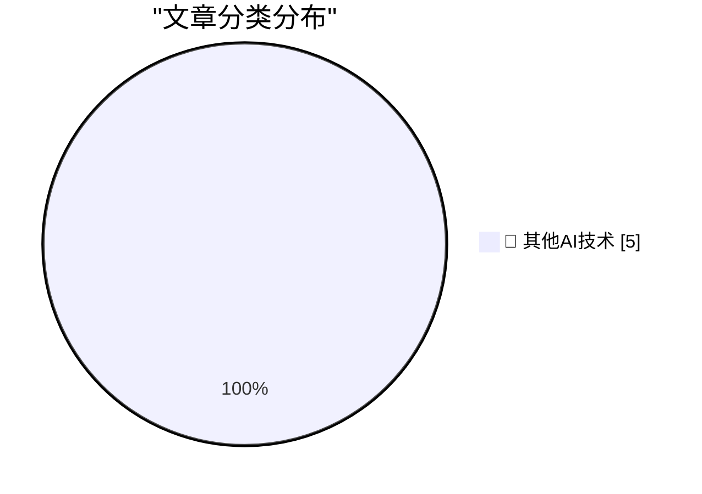

# 📰 AI 博客每日精选 — 2026-10-13

> 来自 98 个技术博客和社交媒体源，AI 精选 Top 5

## 🏆 今日必读

🥇 **Mark Stephens, a.k.a. Robert X. Cringely, Died at 73**

[Mark Stephens, a.k.a. Robert X. Cringely, Died at 73](https://www.facebook.com/story.php?story_fbid=pfbid0YbCLrAJfBirAWuPBy4a7pauaQ6gHkAPUwtbzyg2wAjeMcruFC7dWUZKQJKkNChP9l&amp;id=536506060&amp;_rdr) — daringfireball.net · 9 小时前 · 🔬 其他AI技术

> Mark Stephens, a.k.a. Robert X. Cringely, Died at 73

🥈 **Pluralistic: How labor rights rescued Ultima from a monopolist (12 Oct 2026)**

[Pluralistic: How labor rights rescued Ultima from a monopolist (12 Oct 2026)](https://pluralistic.net/2026/10/12/termination-of-transfer/) — pluralistic.net · 14 小时前 · 🔬 其他AI技术

> Pluralistic: How labor rights rescued Ultima from a monopolist (12 Oct 2026)

🥉 **Now That’s What I Call Technical Debt!**

[Now That’s What I Call Technical Debt!](https://nesbitt.io/2026/10/12/now-thats-what-i-call-technical-debt.html) — nesbitt.io · 17 小时前 · 🔬 其他AI技术

> Now That’s What I Call Technical Debt!

4️⃣ **The Dock on Mac, From OS 10 to macOS 27**

[The Dock on Mac, From OS 10 to macOS 27](https://blog.jim-nielsen.com/2026/macos-dock-icons-over-time/) — blog.jim-nielsen.com · 7 小时前 · 🔬 其他AI技术

> The Dock on Mac, From OS 10 to macOS 27

5️⃣ **Nvidia’s first GPU: GeForce 256**

[Nvidia’s first GPU: GeForce 256](https://dfarq.homeip.net/nvidias-first-gpu-geforce-256/?utm_source=rss&#038;utm_medium=rss&#038;utm_campaign=nvidias-first-gpu-geforce-256) — dfarq.homeip.net · 15 小时前 · 🔬 其他AI技术

> Nvidia’s first GPU: GeForce 256

---

## 📊 数据概览

| 扫描源 | 抓取文章 | 时间范围 | 精选 |
|:---:|:---:|:---:|:---:|
| 65/98 | 2029 篇 → 5 篇 | 24h | **5 篇** |

### 分类分布

---

====================

## 🔬 其他AI技术

### 1. Mark Stephens, a.k.a. Robert X. Cringely, Died at 73

[Mark Stephens, a.k.a. Robert X. Cringely, Died at 73](https://www.facebook.com/story.php?story_fbid=pfbid0YbCLrAJfBirAWuPBy4a7pauaQ6gHkAPUwtbzyg2wAjeMcruFC7dWUZKQJKkNChP9l&amp;id=536506060&amp;_rdr) — **daringfireball.net** · 9 小时前 · ⭐ 15/25

> Mark Stephens, a.k.a. Robert X. Cringely, Died at 73

📌 其他AI技术

---

### 2. Pluralistic: How labor rights rescued Ultima from a monopolist (12 Oct 2026)

[Pluralistic: How labor rights rescued Ultima from a monopolist (12 Oct 2026)](https://pluralistic.net/2026/10/12/termination-of-transfer/) — **pluralistic.net** · 14 小时前 · ⭐ 15/25

> Pluralistic: How labor rights rescued Ultima from a monopolist (12 Oct 2026)

📌 其他AI技术

---

### 3. Now That’s What I Call Technical Debt!

[Now That’s What I Call Technical Debt!](https://nesbitt.io/2026/10/12/now-thats-what-i-call-technical-debt.html) — **nesbitt.io** · 17 小时前 · ⭐ 15/25

> Now That’s What I Call Technical Debt!

📌 其他AI技术

---

### 4. The Dock on Mac, From OS 10 to macOS 27

[The Dock on Mac, From OS 10 to macOS 27](https://blog.jim-nielsen.com/2026/macos-dock-icons-over-time/) — **blog.jim-nielsen.com** · 7 小时前 · ⭐ 15/25

> The Dock on Mac, From OS 10 to macOS 27

📌 其他AI技术

---

### 5. Nvidia’s first GPU: GeForce 256

[Nvidia’s first GPU: GeForce 256](https://dfarq.homeip.net/nvidias-first-gpu-geforce-256/?utm_source=rss&#038;utm_medium=rss&#038;utm_campaign=nvidias-first-gpu-geforce-256) — **dfarq.homeip.net** · 15 小时前 · ⭐ 15/25

> Nvidia’s first GPU: GeForce 256

📌 其他AI技术

---

====================

*生成于 2026-10-13 02:23 | 扫描 65 源 → 获取 2029 篇 → 精选 5 篇*
*基于 [Hacker News Popularity Contest 2025](https://refactoringenglish.com/tools/hn-popularity/) RSS 源列表，由 [Andrej Karpathy](https://x.com/karpathy) 推荐*
*由「懂点儿AI」制作，欢迎关注同名微信公众号获取更多 AI 实用技巧 💡*
