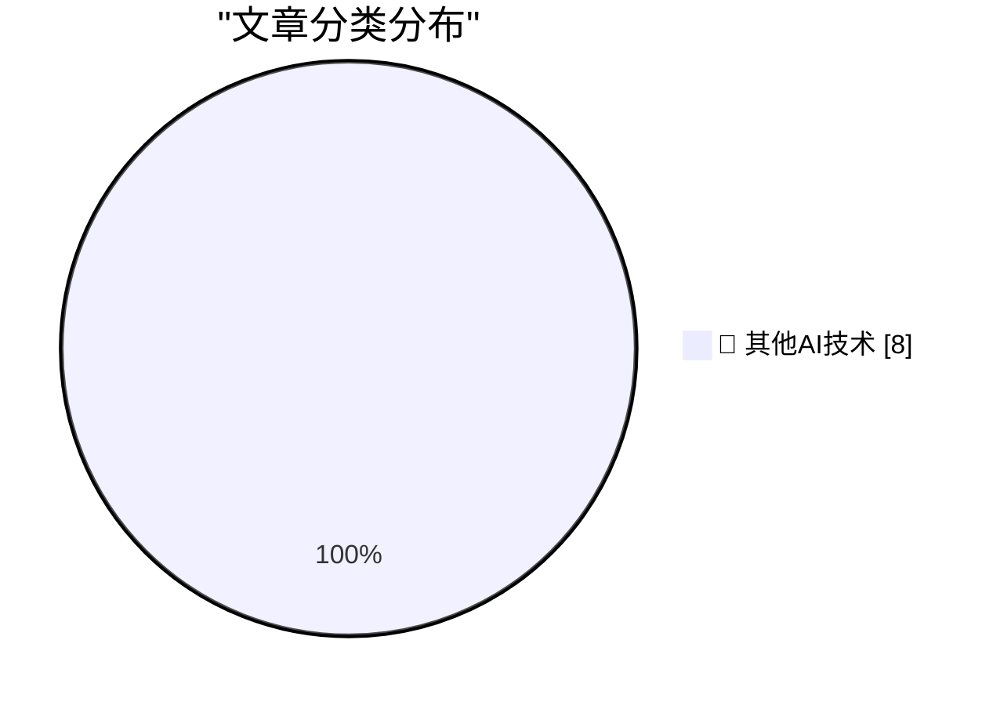

# 📰 AI 博客每日精选 — 2026-10-14

> 来自 98 个技术博客和社交媒体源，AI 精选 Top 8

## 🏆 今日必读

🥇 **Apple HomeView**

[Apple HomeView](https://www.apple.com/newsroom/2026/10/meet-apple-homeview-a-new-way-to-enjoy-entertainment-and-manage-the-home/) — daringfireball.net · 9 小时前 · 🔬 其他AI技术

> Apple HomeView

🥈 **The Last Answer**

[The Last Answer](https://idiallo.com/blog/the-last-answer) — idiallo.com · 14 小时前 · 🔬 其他AI技术

> The Last Answer

🥉 **Pluralistic: Bundestrojaner (13 Oct 2026)**

[Pluralistic: Bundestrojaner (13 Oct 2026)](https://pluralistic.net/2026/10/13/petards-r-us/) — pluralistic.net · 12 小时前 · 🔬 其他AI技术

> Pluralistic: Bundestrojaner (13 Oct 2026)

4️⃣ **Book Review: The Thousand Deaths of Romeo and Juliet - Caroline Finch ★★★★★**

[Book Review: The Thousand Deaths of Romeo and Juliet - Caroline Finch ★★★★★](https://shkspr.mobi/blog/2026/10/book-review-the-thousand-deaths-of-romeo-and-juliet-caroline-finch/) — shkspr.mobi · 12 小时前 · 🔬 其他AI技术

> Book Review: The Thousand Deaths of Romeo and Juliet - Caroline Finch ★★★★★

5️⃣ **C++ futures part 2: The mental model for std::promise, std::packaged_task**

[C++ futures part 2: The mental model for std::promise, std::packaged_task](https://devblogs.microsoft.com/oldnewthing/20261013-00/?p=112769/) — devblogs.microsoft.com/oldnewthing · 10 小时前 · 🔬 其他AI技术

> C++ futures part 2: The mental model for std::promise, std::packaged_task

---

## 📊 数据概览

| 扫描源 | 抓取文章 | 时间范围 | 精选 |
|:---:|:---:|:---:|:---:|
| 65/98 | 2029 篇 → 8 篇 | 24h | **8 篇** |

### 分类分布

---

====================

## 🔬 其他AI技术

### 1. Apple HomeView

[Apple HomeView](https://www.apple.com/newsroom/2026/10/meet-apple-homeview-a-new-way-to-enjoy-entertainment-and-manage-the-home/) — **daringfireball.net** · 9 小时前 · ⭐ 15/25

> Apple HomeView

📌 其他AI技术

---

### 2. The Last Answer

[The Last Answer](https://idiallo.com/blog/the-last-answer) — **idiallo.com** · 14 小时前 · ⭐ 15/25

> The Last Answer

📌 其他AI技术

---

### 3. Pluralistic: Bundestrojaner (13 Oct 2026)

[Pluralistic: Bundestrojaner (13 Oct 2026)](https://pluralistic.net/2026/10/13/petards-r-us/) — **pluralistic.net** · 12 小时前 · ⭐ 15/25

> Pluralistic: Bundestrojaner (13 Oct 2026)

📌 其他AI技术

---

### 4. Book Review: The Thousand Deaths of Romeo and Juliet - Caroline Finch ★★★★★

[Book Review: The Thousand Deaths of Romeo and Juliet - Caroline Finch ★★★★★](https://shkspr.mobi/blog/2026/10/book-review-the-thousand-deaths-of-romeo-and-juliet-caroline-finch/) — **shkspr.mobi** · 12 小时前 · ⭐ 15/25

> Book Review: The Thousand Deaths of Romeo and Juliet - Caroline Finch ★★★★★

📌 其他AI技术

---

### 5. C++ futures part 2: The mental model for std::promise, std::packaged_task

[C++ futures part 2: The mental model for std::promise, std::packaged_task](https://devblogs.microsoft.com/oldnewthing/20261013-00/?p=112769/) — **devblogs.microsoft.com/oldnewthing** · 10 小时前 · ⭐ 15/25

> C++ futures part 2: The mental model for std::promise, std::packaged_task

📌 其他AI技术

---

### 6. Annualized Enron Rate

[Annualized Enron Rate](https://www.wheresyoured.at/annualized-enron-rate/) — **wheresyoured.at** · 8 小时前 · ⭐ 15/25

> Annualized Enron Rate

📌 其他AI技术

---

### 7. What happened to Ashton-Tate and dBase

[What happened to Ashton-Tate and dBase](https://dfarq.homeip.net/what-happened-to-ashton-tate-and-dbase/?utm_source=rss&#038;utm_medium=rss&#038;utm_campaign=what-happened-to-ashton-tate-and-dbase) — **dfarq.homeip.net** · 13 小时前 · ⭐ 15/25

> What happened to Ashton-Tate and dBase

📌 其他AI技术

---

### 8. Subterranean Warfare – An Urgent DoW Need Without An Owner

[Subterranean Warfare – An Urgent DoW Need Without An Owner](https://steveblank.com/2026/10/13/subterranean-warfare-an-urgent-dow-need-without-an-owner/) — **steveblank.com** · 11 小时前 · ⭐ 15/25

> Subterranean Warfare – An Urgent DoW Need Without An Owner

📌 其他AI技术

---

====================

*生成于 2026-10-14 00:06 | 扫描 65 源 → 获取 2029 篇 → 精选 8 篇*
*基于 [Hacker News Popularity Contest 2025](https://refactoringenglish.com/tools/hn-popularity/) RSS 源列表，由 [Andrej Karpathy](https://x.com/karpathy) 推荐*
*由「懂点儿AI」制作，欢迎关注同名微信公众号获取更多 AI 实用技巧 💡*
