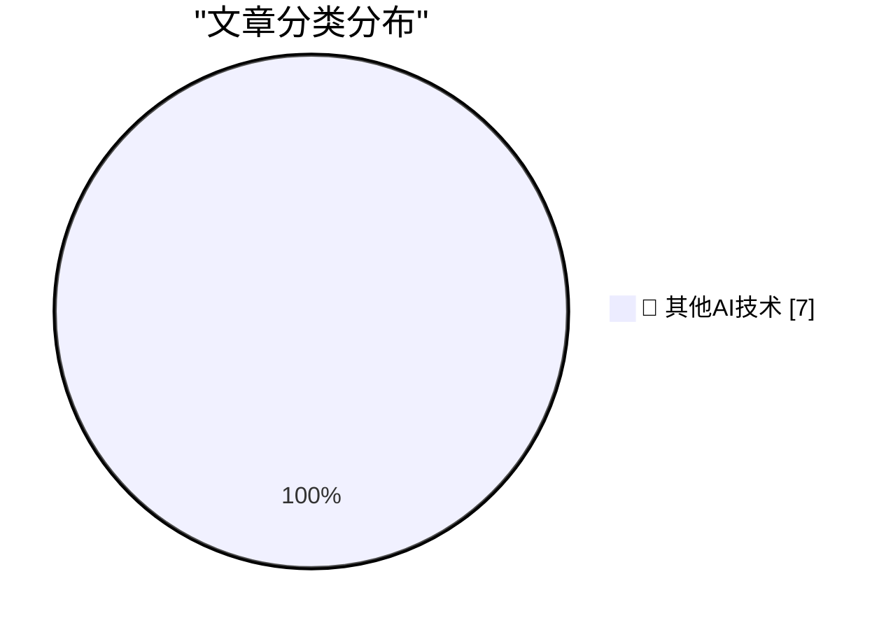

# 📰 AI 博客每日精选 — 2026-10-14

> 来自 98 个技术博客和社交媒体源，AI 精选 Top 7

## 🏆 今日必读

🥇 **Formlabs dropped the Raspberry Pi on the way to a $699 SLA printer**

[Formlabs dropped the Raspberry Pi on the way to a $699 SLA printer](https://www.jeffgeerling.com/blog/2026/formlabs-form-studio-1-resin-printer/) — jeffgeerling.com · 10 小时前 · 🔬 其他AI技术

> Formlabs dropped the Raspberry Pi on the way to a $699 SLA printer

🥈 **[Sponsor] WorkOS AuthKit: Auth for Your App, Free Up to 1M Monthly Active Users**

[[Sponsor] WorkOS AuthKit: Auth for Your App, Free Up to 1M Monthly Active Users](https://workos.com/?utm_source=daringfireball&amp;utm_medium=newsletter&amp;utm_campaign=q42026) — daringfireball.net · 2 小时前 · 🔬 其他AI技术

> [Sponsor] WorkOS AuthKit: Auth for Your App, Free Up to 1M Monthly Active Users

🥉 **The FBI Arrested a Saudi National OpenAI Employee for Planting a Recording Device in the Company’s Executive Conference Room**

[The FBI Arrested a Saudi National OpenAI Employee for Planting a Recording Device in the Company’s Executive Conference Room](https://www.justice.gov/opa/pr/saudi-national-arrested-installing-surreptitious-audio-recording-device-openai) — daringfireball.net · 2 小时前 · 🔬 其他AI技术

> The FBI Arrested a Saudi National OpenAI Employee for Planting a Recording Device in the Company’s Executive Conference Room

4️⃣ **The Internet of Very Cheap Things**

[The Internet of Very Cheap Things](https://shkspr.mobi/blog/2026/10/the-internet-of-very-cheap-things/) — shkspr.mobi · 12 小时前 · 🔬 其他AI技术

> The Internet of Very Cheap Things

5️⃣ **"No way to prevent this" say users of only language where this regularly happens**

["No way to prevent this" say users of only language where this regularly happens](https://xeiaso.net/shitposts/no-way-to-prevent-this/memory-safety/CVE-2026-92392/) — xeiaso.net · 23 小时前 · 🔬 其他AI技术

> "No way to prevent this" say users of only language where this regularly happens

---

## 📊 数据概览

| 扫描源 | 抓取文章 | 时间范围 | 精选 |
|:---:|:---:|:---:|:---:|
| 65/98 | 2030 篇 → 7 篇 | 24h | **7 篇** |

### 分类分布

---

====================

## 🔬 其他AI技术

### 1. Formlabs dropped the Raspberry Pi on the way to a $699 SLA printer

[Formlabs dropped the Raspberry Pi on the way to a $699 SLA printer](https://www.jeffgeerling.com/blog/2026/formlabs-form-studio-1-resin-printer/) — **jeffgeerling.com** · 10 小时前 · ⭐ 15/25

> Formlabs dropped the Raspberry Pi on the way to a $699 SLA printer

📌 其他AI技术

---

### 2. [Sponsor] WorkOS AuthKit: Auth for Your App, Free Up to 1M Monthly Active Users

[[Sponsor] WorkOS AuthKit: Auth for Your App, Free Up to 1M Monthly Active Users](https://workos.com/?utm_source=daringfireball&amp;utm_medium=newsletter&amp;utm_campaign=q42026) — **daringfireball.net** · 2 小时前 · ⭐ 15/25

> [Sponsor] WorkOS AuthKit: Auth for Your App, Free Up to 1M Monthly Active Users

📌 其他AI技术

---

### 3. The FBI Arrested a Saudi National OpenAI Employee for Planting a Recording Device in the Company’s Executive Conference Room

[The FBI Arrested a Saudi National OpenAI Employee for Planting a Recording Device in the Company’s Executive Conference Room](https://www.justice.gov/opa/pr/saudi-national-arrested-installing-surreptitious-audio-recording-device-openai) — **daringfireball.net** · 2 小时前 · ⭐ 15/25

> The FBI Arrested a Saudi National OpenAI Employee for Planting a Recording Device in the Company’s Executive Conference Room

📌 其他AI技术

---

### 4. The Internet of Very Cheap Things

[The Internet of Very Cheap Things](https://shkspr.mobi/blog/2026/10/the-internet-of-very-cheap-things/) — **shkspr.mobi** · 12 小时前 · ⭐ 15/25

> The Internet of Very Cheap Things

📌 其他AI技术

---

### 5. "No way to prevent this" say users of only language where this regularly happens

["No way to prevent this" say users of only language where this regularly happens](https://xeiaso.net/shitposts/no-way-to-prevent-this/memory-safety/CVE-2026-92392/) — **xeiaso.net** · 23 小时前 · ⭐ 15/25

> "No way to prevent this" say users of only language where this regularly happens

📌 其他AI技术

---

### 6. When SCO fired Darl McBride

[When SCO fired Darl McBride](https://dfarq.homeip.net/when-sco-fired-darl-mcbride/?utm_source=rss&#038;utm_medium=rss&#038;utm_campaign=when-sco-fired-darl-mcbride) — **dfarq.homeip.net** · 12 小时前 · ⭐ 15/25

> When SCO fired Darl McBride

📌 其他AI技术

---

### 7. The still unregulated solar power clouds: notes from 9th E.DSO – EE-ISAC - ENCS – ENISA Cybersecurity Forum

[The still unregulated solar power clouds: notes from 9th E.DSO – EE-ISAC - ENCS – ENISA Cybersecurity Forum](https://berthub.eu/articles/posts/solar-nightmare-at-the-conference/) — **berthub.eu** · 10 小时前 · ⭐ 15/25

> The still unregulated solar power clouds: notes from 9th E.DSO – EE-ISAC - ENCS – ENISA Cybersecurity Forum

📌 其他AI技术

---

====================

*生成于 2026-10-14 23:38 | 扫描 65 源 → 获取 2030 篇 → 精选 7 篇*
*基于 [Hacker News Popularity Contest 2025](https://refactoringenglish.com/tools/hn-popularity/) RSS 源列表，由 [Andrej Karpathy](https://x.com/karpathy) 推荐*
*由「懂点儿AI」制作，欢迎关注同名微信公众号获取更多 AI 实用技巧 💡*
