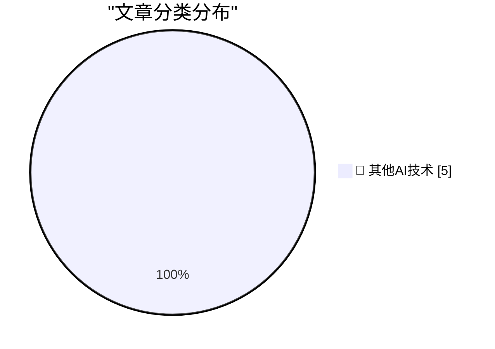

# 📰 AI 博客每日精选 — 2026-10-15

> 来自 98 个技术博客和社交媒体源，AI 精选 Top 5

## 🏆 今日必读

🥇 **Secret Documents Reveal Donors Behind $330 Million for Trump’s Ballroom — Apple and Nvidia Top the List at $25 Million Each**

[Secret Documents Reveal Donors Behind $330 Million for Trump’s Ballroom — Apple and Nvidia Top the List at $25 Million Each](https://www.washingtonpost.com/investigations/2026/10/15/secret-documents-reveal-donors-behind-330-million-trumps-ballroom/) — daringfireball.net · 7 小时前 · 🔬 其他AI技术

> Secret Documents Reveal Donors Behind $330 Million for Trump’s Ballroom — Apple and Nvidia Top the List at $25 Million Each

🥈 **Pluralistic: Expedia amazoned hotel rooms (15 Oct 2026)**

[Pluralistic: Expedia amazoned hotel rooms (15 Oct 2026)](https://pluralistic.net/2026/10/15/enshittipedia/) — pluralistic.net · 12 小时前 · 🔬 其他AI技术

> Pluralistic: Expedia amazoned hotel rooms (15 Oct 2026)

🥉 **C++ futures part 4: What if I want an immediate on-thread std::async?**

[C++ futures part 4: What if I want an immediate on-thread std::async?](https://devblogs.microsoft.com/oldnewthing/20261015-00/?p=112776/) — devblogs.microsoft.com/oldnewthing · 9 小时前 · 🔬 其他AI技术

> C++ futures part 4: What if I want an immediate on-thread std::async?

4️⃣ **We Need All the Disciplines**

[We Need All the Disciplines](https://blog.jim-nielsen.com/2026/we-need-all-disciplines/) — blog.jim-nielsen.com · 4 小时前 · 🔬 其他AI技术

> We Need All the Disciplines

5️⃣ **What was a Token Ring network?**

[What was a Token Ring network?](https://dfarq.homeip.net/what-was-a-token-ring-network/?utm_source=rss&#038;utm_medium=rss&#038;utm_campaign=what-was-a-token-ring-network) — dfarq.homeip.net · 12 小时前 · 🔬 其他AI技术

> What was a Token Ring network?

---

## 📊 数据概览

| 扫描源 | 抓取文章 | 时间范围 | 精选 |
|:---:|:---:|:---:|:---:|
| 65/98 | 2030 篇 → 5 篇 | 24h | **5 篇** |

### 分类分布

---

====================

## 🔬 其他AI技术

### 1. Secret Documents Reveal Donors Behind $330 Million for Trump’s Ballroom — Apple and Nvidia Top the List at $25 Million Each

[Secret Documents Reveal Donors Behind $330 Million for Trump’s Ballroom — Apple and Nvidia Top the List at $25 Million Each](https://www.washingtonpost.com/investigations/2026/10/15/secret-documents-reveal-donors-behind-330-million-trumps-ballroom/) — **daringfireball.net** · 7 小时前 · ⭐ 15/25

> Secret Documents Reveal Donors Behind $330 Million for Trump’s Ballroom — Apple and Nvidia Top the List at $25 Million Each

📌 其他AI技术

---

### 2. Pluralistic: Expedia amazoned hotel rooms (15 Oct 2026)

[Pluralistic: Expedia amazoned hotel rooms (15 Oct 2026)](https://pluralistic.net/2026/10/15/enshittipedia/) — **pluralistic.net** · 12 小时前 · ⭐ 15/25

> Pluralistic: Expedia amazoned hotel rooms (15 Oct 2026)

📌 其他AI技术

---

### 3. C++ futures part 4: What if I want an immediate on-thread std::async?

[C++ futures part 4: What if I want an immediate on-thread std::async?](https://devblogs.microsoft.com/oldnewthing/20261015-00/?p=112776/) — **devblogs.microsoft.com/oldnewthing** · 9 小时前 · ⭐ 15/25

> C++ futures part 4: What if I want an immediate on-thread std::async?

📌 其他AI技术

---

### 4. We Need All the Disciplines

[We Need All the Disciplines](https://blog.jim-nielsen.com/2026/we-need-all-disciplines/) — **blog.jim-nielsen.com** · 4 小时前 · ⭐ 15/25

> We Need All the Disciplines

📌 其他AI技术

---

### 5. What was a Token Ring network?

[What was a Token Ring network?](https://dfarq.homeip.net/what-was-a-token-ring-network/?utm_source=rss&#038;utm_medium=rss&#038;utm_campaign=what-was-a-token-ring-network) — **dfarq.homeip.net** · 12 小时前 · ⭐ 15/25

> What was a Token Ring network?

📌 其他AI技术

---

====================

*生成于 2026-10-15 23:31 | 扫描 65 源 → 获取 2030 篇 → 精选 5 篇*
*基于 [Hacker News Popularity Contest 2025](https://refactoringenglish.com/tools/hn-popularity/) RSS 源列表，由 [Andrej Karpathy](https://x.com/karpathy) 推荐*
*由「懂点儿AI」制作，欢迎关注同名微信公众号获取更多 AI 实用技巧 💡*
