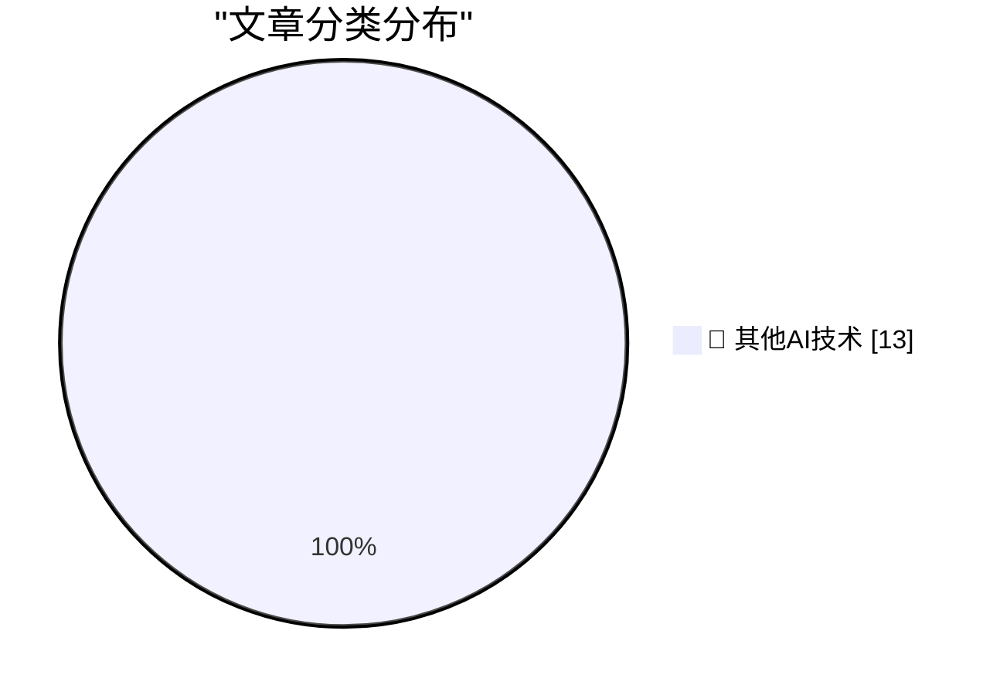

# 📰 AI 博客每日精选 — 2026-10-16

> 来自 98 个技术博客和社交媒体源，AI 精选 Top 13

## 🏆 今日必读

🥇 **AI is driving a boom in modestly successful software projects**

[AI is driving a boom in modestly successful software projects](https://seangoedecke.com/ai-is-driving-a-boom-in-modestly-successful-software/) — seangoedecke.com · 23 小时前 · 🔬 其他AI技术

> AI is driving a boom in modestly successful software projects

🥈 **How They Got Duo Support in NetNewsWire**

[How They Got Duo Support in NetNewsWire](https://netnewswire.blog/2026/10/16/how-we-got-duo-support.html) — daringfireball.net · 2 小时前 · 🔬 其他AI技术

> How They Got Duo Support in NetNewsWire

🥉 **★ Real Artists Ship, Tesla Edition**

[★ Real Artists Ship, Tesla Edition](https://daringfireball.net/2026/10/real_artists_ship_tesla_edition) — daringfireball.net · 3 小时前 · 🔬 其他AI技术

> ★ Real Artists Ship, Tesla Edition

4️⃣ **Shyam Sankar, CTO of Palantir, Says AI Researchers Have Started Smoking Because They’re Convinced AI (Claude, Probably) Is Going to Cure Cancer**

[Shyam Sankar, CTO of Palantir, Says AI Researchers Have Started Smoking Because They’re Convinced AI (Claude, Probably) Is Going to Cure Cancer](https://www.cbsnews.com/news/shyam-sankar-chief-technology-officer-palantir-face-the-nation-transcript-10-11-2026/) — daringfireball.net · 6 小时前 · 🔬 其他AI技术

> Shyam Sankar, CTO of Palantir, Says AI Researchers Have Started Smoking Because They’re Convinced AI (Claude, Probably) Is Going to Cure Cancer

5️⃣ **iPhone Duo Pre-Orders Launched, and Three Hours Later It’s Sold Out Through the End of January**

[iPhone Duo Pre-Orders Launched, and Three Hours Later It’s Sold Out Through the End of January](https://www.macrumors.com/2026/10/16/iphone-duo-sold-out-for-christmas/) — daringfireball.net · 7 小时前 · 🔬 其他AI技术

> iPhone Duo Pre-Orders Launched, and Three Hours Later It’s Sold Out Through the End of January

---

## 📊 数据概览

| 扫描源 | 抓取文章 | 时间范围 | 精选 |
|:---:|:---:|:---:|:---:|
| 64/98 | 2000 篇 → 13 篇 | 24h | **13 篇** |

### 分类分布

---

====================

## 🔬 其他AI技术

### 1. AI is driving a boom in modestly successful software projects

[AI is driving a boom in modestly successful software projects](https://seangoedecke.com/ai-is-driving-a-boom-in-modestly-successful-software/) — **seangoedecke.com** · 23 小时前 · ⭐ 15/25

> AI is driving a boom in modestly successful software projects

📌 其他AI技术

---

### 2. How They Got Duo Support in NetNewsWire

[How They Got Duo Support in NetNewsWire](https://netnewswire.blog/2026/10/16/how-we-got-duo-support.html) — **daringfireball.net** · 2 小时前 · ⭐ 15/25

> How They Got Duo Support in NetNewsWire

📌 其他AI技术

---

### 3. ★ Real Artists Ship, Tesla Edition

[★ Real Artists Ship, Tesla Edition](https://daringfireball.net/2026/10/real_artists_ship_tesla_edition) — **daringfireball.net** · 3 小时前 · ⭐ 15/25

> ★ Real Artists Ship, Tesla Edition

📌 其他AI技术

---

### 4. Shyam Sankar, CTO of Palantir, Says AI Researchers Have Started Smoking Because They’re Convinced AI (Claude, Probably) Is Going to Cure Cancer

[Shyam Sankar, CTO of Palantir, Says AI Researchers Have Started Smoking Because They’re Convinced AI (Claude, Probably) Is Going to Cure Cancer](https://www.cbsnews.com/news/shyam-sankar-chief-technology-officer-palantir-face-the-nation-transcript-10-11-2026/) — **daringfireball.net** · 6 小时前 · ⭐ 15/25

> Shyam Sankar, CTO of Palantir, Says AI Researchers Have Started Smoking Because They’re Convinced AI (Claude, Probably) Is Going to Cure Cancer

📌 其他AI技术

---

### 5. iPhone Duo Pre-Orders Launched, and Three Hours Later It’s Sold Out Through the End of January

[iPhone Duo Pre-Orders Launched, and Three Hours Later It’s Sold Out Through the End of January](https://www.macrumors.com/2026/10/16/iphone-duo-sold-out-for-christmas/) — **daringfireball.net** · 7 小时前 · ⭐ 15/25

> iPhone Duo Pre-Orders Launched, and Three Hours Later It’s Sold Out Through the End of January

📌 其他AI技术

---

### 6. ★ Initial Thoughts on This Week’s New Apple TV 4K (4th Generation) and HomePod Mini 2

[★ Initial Thoughts on This Week’s New Apple TV 4K (4th Generation) and HomePod Mini 2](https://daringfireball.net/2026/10/thoughts_on_new_apple_tv_4k_and_homepod_mini_2) — **daringfireball.net** · 21 小时前 · ⭐ 15/25

> ★ Initial Thoughts on This Week’s New Apple TV 4K (4th Generation) and HomePod Mini 2

📌 其他AI技术

---

### 7. This video is 2 minutes long

[This video is 2 minutes long](https://idiallo.com/byte-size/two-minutes-long-video) — **idiallo.com** · 17 小时前 · ⭐ 15/25

> This video is 2 minutes long

📌 其他AI技术

---

### 8. Pluralistic: Load-bearing (16 Oct 2026)

[Pluralistic: Load-bearing (16 Oct 2026)](https://pluralistic.net/2026/10/15/sovereign-it/) — **pluralistic.net** · 16 小时前 · ⭐ 15/25

> Pluralistic: Load-bearing (16 Oct 2026)

📌 其他AI技术

---

### 9. Book Review: Africa Is Not A Country - Breaking Stereotypes of Modern Africa by Dipo Faloyin ★★★★⯪

[Book Review: Africa Is Not A Country - Breaking Stereotypes of Modern Africa by Dipo Faloyin ★★★★⯪](https://shkspr.mobi/blog/2026/10/book-review-africa-is-not-a-country-breaking-stereotypes-of-modern-africa-by-dipo-faloyin/) — **shkspr.mobi** · 11 小时前 · ⭐ 15/25

> Book Review: Africa Is Not A Country - Breaking Stereotypes of Modern Africa by Dipo Faloyin ★★★★⯪

📌 其他AI技术

---

### 10. C++ futures part 5: std::future and std::shared_future

[C++ futures part 5: std::future and std::shared_future](https://devblogs.microsoft.com/oldnewthing/20261016-00/?p=112778/) — **devblogs.microsoft.com/oldnewthing** · 9 小时前 · ⭐ 15/25

> C++ futures part 5: std::future and std::shared_future

📌 其他AI技术

---

### 11. Premium: Venture Capital Is Killing Itself

[Premium: Venture Capital Is Killing Itself](https://www.wheresyoured.at/premium-venture-capital-is-killing-itself/) — **wheresyoured.at** · 7 小时前 · ⭐ 15/25

> Premium: Venture Capital Is Killing Itself

📌 其他AI技术

---

### 12. This Week on The Analog Antiquarian

[This Week on The Analog Antiquarian](https://www.filfre.net/2026/10/this-week-on-the-analog-antiquarian/) — **filfre.net** · 6 小时前 · ⭐ 15/25

> This Week on The Analog Antiquarian

📌 其他AI技术

---

### 13. Spyware invented October 16, 1995

[Spyware invented October 16, 1995](https://dfarq.homeip.net/spyware-invented-october-16-1995/?utm_source=rss&#038;utm_medium=rss&#038;utm_campaign=spyware-invented-october-16-1995) — **dfarq.homeip.net** · 12 小时前 · ⭐ 15/25

> Spyware invented October 16, 1995

📌 其他AI技术

---

====================

*生成于 2026-10-16 23:13 | 扫描 64 源 → 获取 2000 篇 → 精选 13 篇*
*基于 [Hacker News Popularity Contest 2025](https://refactoringenglish.com/tools/hn-popularity/) RSS 源列表，由 [Andrej Karpathy](https://x.com/karpathy) 推荐*
*由「懂点儿AI」制作，欢迎关注同名微信公众号获取更多 AI 实用技巧 💡*
