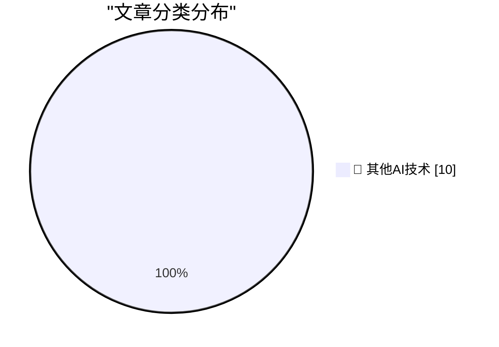

# 📰 AI 博客每日精选 — 2026-10-17

> 来自 98 个技术博客和社交媒体源，AI 精选 Top 10

## 🏆 今日必读

🥇 **★ HomeView Thoughts and Observations**

[★ HomeView Thoughts and Observations](https://daringfireball.net/2026/10/homeview_thoughts_and_observations) — daringfireball.net · 5 小时前 · 🔬 其他AI技术

> ★ HomeView Thoughts and Observations

🥈 **Apple TV Price History, Charted**

[Apple TV Price History, Charted](https://glog.glennf.com/blog/2026/10/17/apple-tv-price-history/) — daringfireball.net · 8 小时前 · 🔬 其他AI技术

> Apple TV Price History, Charted

🥉 **The Late Charlie Munger on Elon Musk and Tesla**

[The Late Charlie Munger on Elon Musk and Tesla](https://www.cnbc.com/make-it/2020/02/14/charlie-munger-shares-opinion-of-tesla-ceo-elon-musk.html) — daringfireball.net · 21 小时前 · 🔬 其他AI技术

> The Late Charlie Munger on Elon Musk and Tesla

4️⃣ **Apple: ‘Strengthening App Review Guidelines Against Nonconsensual Intimate Imagery and Bait-And-Switch Apps’**

[Apple: ‘Strengthening App Review Guidelines Against Nonconsensual Intimate Imagery and Bait-And-Switch Apps’](https://developer.apple.com/news/?id=vvzx6cul) — daringfireball.net · 21 小时前 · 🔬 其他AI技术

> Apple: ‘Strengthening App Review Guidelines Against Nonconsensual Intimate Imagery and Bait-And-Switch Apps’

5️⃣ **Apple TV Started at $69 in 2015**

[Apple TV Started at $69 in 2015](https://www.macrumors.com/2015/03/09/tim-cook-apple-tv-now-costs-69/) — daringfireball.net · 22 小时前 · 🔬 其他AI技术

> Apple TV Started at $69 in 2015

---

## 📊 数据概览

| 扫描源 | 抓取文章 | 时间范围 | 精选 |
|:---:|:---:|:---:|:---:|
| 65/98 | 2030 篇 → 10 篇 | 24h | **10 篇** |

### 分类分布

---

====================

## 🔬 其他AI技术

### 1. ★ HomeView Thoughts and Observations

[★ HomeView Thoughts and Observations](https://daringfireball.net/2026/10/homeview_thoughts_and_observations) — **daringfireball.net** · 5 小时前 · ⭐ 15/25

> ★ HomeView Thoughts and Observations

📌 其他AI技术

---

### 2. Apple TV Price History, Charted

[Apple TV Price History, Charted](https://glog.glennf.com/blog/2026/10/17/apple-tv-price-history/) — **daringfireball.net** · 8 小时前 · ⭐ 15/25

> Apple TV Price History, Charted

📌 其他AI技术

---

### 3. The Late Charlie Munger on Elon Musk and Tesla

[The Late Charlie Munger on Elon Musk and Tesla](https://www.cnbc.com/make-it/2020/02/14/charlie-munger-shares-opinion-of-tesla-ceo-elon-musk.html) — **daringfireball.net** · 21 小时前 · ⭐ 15/25

> The Late Charlie Munger on Elon Musk and Tesla

📌 其他AI技术

---

### 4. Apple: ‘Strengthening App Review Guidelines Against Nonconsensual Intimate Imagery and Bait-And-Switch Apps’

[Apple: ‘Strengthening App Review Guidelines Against Nonconsensual Intimate Imagery and Bait-And-Switch Apps’](https://developer.apple.com/news/?id=vvzx6cul) — **daringfireball.net** · 21 小时前 · ⭐ 15/25

> Apple: ‘Strengthening App Review Guidelines Against Nonconsensual Intimate Imagery and Bait-And-Switch Apps’

📌 其他AI技术

---

### 5. Apple TV Started at $69 in 2015

[Apple TV Started at $69 in 2015](https://www.macrumors.com/2015/03/09/tim-cook-apple-tv-now-costs-69/) — **daringfireball.net** · 22 小时前 · ⭐ 15/25

> Apple TV Started at $69 in 2015

📌 其他AI技术

---

### 6. Strange Times Make for Strange Bedfellows

[Strange Times Make for Strange Bedfellows](https://x.com/finkd/status/2110778025629347999) — **daringfireball.net** · 23 小时前 · ⭐ 15/25

> Strange Times Make for Strange Bedfellows

📌 其他AI技术

---

### 7. Pluralistic: Israeli ad-tech company was a delivery system for "mercenary spyware" (17 Oct 2026)

[Pluralistic: Israeli ad-tech company was a delivery system for "mercenary spyware" (17 Oct 2026)](https://pluralistic.net/2026/10/17/mercenary-spyware/) — **pluralistic.net** · 12 小时前 · ⭐ 15/25

> Pluralistic: Israeli ad-tech company was a delivery system for "mercenary spyware" (17 Oct 2026)

📌 其他AI技术

---

### 8. Book Review: Are You *Really* The Doctor? by Matthew Hutchinson ★★★⯪☆

[Book Review: Are You *Really* The Doctor? by Matthew Hutchinson ★★★⯪☆](https://shkspr.mobi/blog/2026/10/book-review-are-you-really-the-doctor-by-matthew-hutchinson/) — **shkspr.mobi** · 11 小时前 · ⭐ 15/25

> Book Review: Are You *Really* The Doctor? by Matthew Hutchinson ★★★⯪☆

📌 其他AI技术

---

### 9. This Week in Package Management: 17 October 2026

[This Week in Package Management: 17 October 2026](https://nesbitt.io/2026/10/17/this-week-in-package-management.html) — **nesbitt.io** · 12 小时前 · ⭐ 15/25

> This Week in Package Management: 17 October 2026

📌 其他AI技术

---

### 10. Intel 386 released October 17, 1985

[Intel 386 released October 17, 1985](https://dfarq.homeip.net/intel-386-released-october-17-1985/?utm_source=rss&#038;utm_medium=rss&#038;utm_campaign=intel-386-released-october-17-1985) — **dfarq.homeip.net** · 11 小时前 · ⭐ 15/25

> Intel 386 released October 17, 1985

📌 其他AI技术

---

====================

*生成于 2026-10-17 22:51 | 扫描 65 源 → 获取 2030 篇 → 精选 10 篇*
*基于 [Hacker News Popularity Contest 2025](https://refactoringenglish.com/tools/hn-popularity/) RSS 源列表，由 [Andrej Karpathy](https://x.com/karpathy) 推荐*
*由「懂点儿AI」制作，欢迎关注同名微信公众号获取更多 AI 实用技巧 💡*
