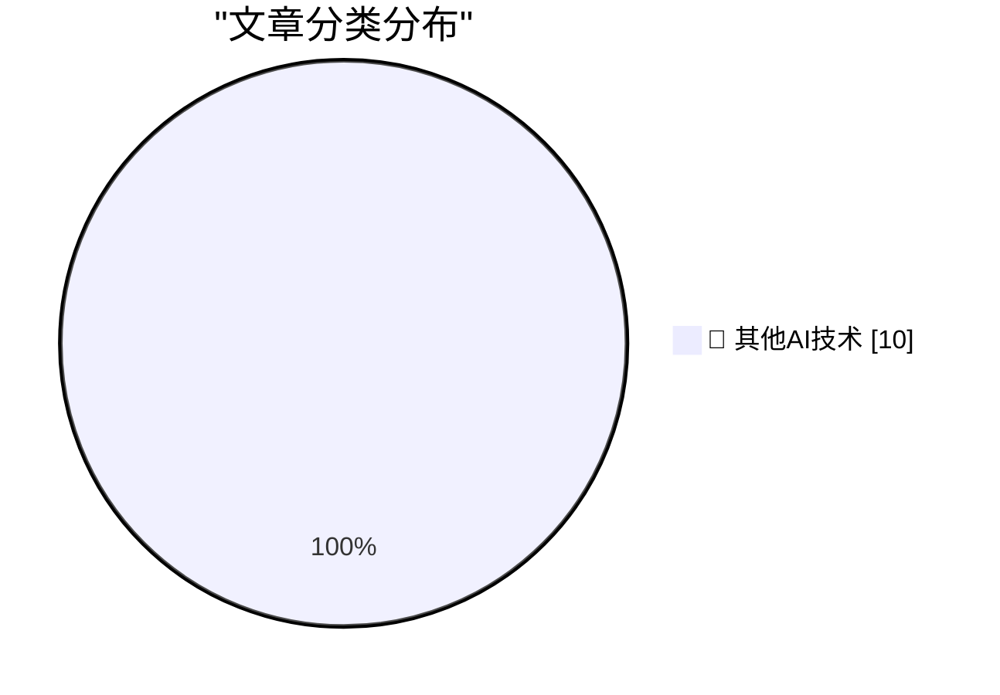

# 📰 AI 博客每日精选 — 2026-10-20

> 来自 98 个技术博客和社交媒体源，AI 精选 Top 10

## 🏆 今日必读

🥇 **From the DF Archive: Should a CEO Be a Nerd About Their Company’s Products?**

[From the DF Archive: Should a CEO Be a Nerd About Their Company’s Products?](https://daringfireball.net/linked/2022/10/11/ceos-as-nerds) — daringfireball.net · 1 小时前 · 🔬 其他AI技术

> From the DF Archive: Should a CEO Be a Nerd About Their Company’s Products?

🥈 **Apple Event, in Los Angeles, Next Week: ‘Pro and Tell’**

[Apple Event, in Los Angeles, Next Week: ‘Pro and Tell’](https://x.com/gregjoz/status/2112212372182249831) — daringfireball.net · 1 小时前 · 🔬 其他AI技术

> Apple Event, in Los Angeles, Next Week: ‘Pro and Tell’

🥉 **★ Estimated Arrival Dates for DF Readers’ Pre-Ordered iPhone Duos**

[★ Estimated Arrival Dates for DF Readers’ Pre-Ordered iPhone Duos](https://daringfireball.net/2026/10/estimated_arrival_dates_for_preordered_iphone_duos) — daringfireball.net · 2 小时前 · 🔬 其他AI技术

> ★ Estimated Arrival Dates for DF Readers’ Pre-Ordered iPhone Duos

4️⃣ **Netflix Shitcanned Film Chief Dan Lin Too**

[Netflix Shitcanned Film Chief Dan Lin Too](https://deadline.com/2026/10/netflix-dan-lin-out-1237167562/) — daringfireball.net · 2 小时前 · 🔬 其他AI技术

> Netflix Shitcanned Film Chief Dan Lin Too

5️⃣ **Ex-Apple Employee Fred Potter on HomeView**

[Ex-Apple Employee Fred Potter on HomeView](https://www.linkedin.com/posts/frpotter_tonight-im-looking-back-through-the-photo-share-7515791565718454272-ue-R/) — daringfireball.net · 5 小时前 · 🔬 其他AI技术

> Ex-Apple Employee Fred Potter on HomeView

---

## 📊 数据概览

| 扫描源 | 抓取文章 | 时间范围 | 精选 |
|:---:|:---:|:---:|:---:|
| 64/98 | 2001 篇 → 10 篇 | 24h | **10 篇** |

### 分类分布

---

====================

## 🔬 其他AI技术

### 1. From the DF Archive: Should a CEO Be a Nerd About Their Company’s Products?

[From the DF Archive: Should a CEO Be a Nerd About Their Company’s Products?](https://daringfireball.net/linked/2022/10/11/ceos-as-nerds) — **daringfireball.net** · 1 小时前 · ⭐ 15/25

> From the DF Archive: Should a CEO Be a Nerd About Their Company’s Products?

📌 其他AI技术

---

### 2. Apple Event, in Los Angeles, Next Week: ‘Pro and Tell’

[Apple Event, in Los Angeles, Next Week: ‘Pro and Tell’](https://x.com/gregjoz/status/2112212372182249831) — **daringfireball.net** · 1 小时前 · ⭐ 15/25

> Apple Event, in Los Angeles, Next Week: ‘Pro and Tell’

📌 其他AI技术

---

### 3. ★ Estimated Arrival Dates for DF Readers’ Pre-Ordered iPhone Duos

[★ Estimated Arrival Dates for DF Readers’ Pre-Ordered iPhone Duos](https://daringfireball.net/2026/10/estimated_arrival_dates_for_preordered_iphone_duos) — **daringfireball.net** · 2 小时前 · ⭐ 15/25

> ★ Estimated Arrival Dates for DF Readers’ Pre-Ordered iPhone Duos

📌 其他AI技术

---

### 4. Netflix Shitcanned Film Chief Dan Lin Too

[Netflix Shitcanned Film Chief Dan Lin Too](https://deadline.com/2026/10/netflix-dan-lin-out-1237167562/) — **daringfireball.net** · 2 小时前 · ⭐ 15/25

> Netflix Shitcanned Film Chief Dan Lin Too

📌 其他AI技术

---

### 5. Ex-Apple Employee Fred Potter on HomeView

[Ex-Apple Employee Fred Potter on HomeView](https://www.linkedin.com/posts/frpotter_tonight-im-looking-back-through-the-photo-share-7515791565718454272-ue-R/) — **daringfireball.net** · 5 小时前 · ⭐ 15/25

> Ex-Apple Employee Fred Potter on HomeView

📌 其他AI技术

---

### 6. Netflix Lays Off 6 Percent of Staff

[Netflix Lays Off 6 Percent of Staff](https://www.wsj.com/business/media/netflix-eliminates-about-6-of-staff-in-biggest-cuts-since-2022-0a2d8ec3?st=NtEg5v&amp;reflink=desktopwebshare_permalink) — **daringfireball.net** · 7 小时前 · ⭐ 15/25

> Netflix Lays Off 6 Percent of Staff

📌 其他AI技术

---

### 7. Time Magazine Profiles John Ternus

[Time Magazine Profiles John Ternus](https://time.com/collection/best-inventions/2026/apple-iphone-duo/) — **daringfireball.net** · 7 小时前 · ⭐ 15/25

> Time Magazine Profiles John Ternus

📌 其他AI技术

---

### 8. Pluralistic: The technopolitics of ad-tech (19 Oct 2026)

[Pluralistic: The technopolitics of ad-tech (19 Oct 2026)](https://pluralistic.net/2026/10/19/spying-v-context/) — **pluralistic.net** · 16 小时前 · ⭐ 15/25

> Pluralistic: The technopolitics of ad-tech (19 Oct 2026)

📌 其他AI技术

---

### 9. Who bought Gateway computers?

[Who bought Gateway computers?](https://dfarq.homeip.net/bought-gateway-computers/?utm_source=rss&#038;utm_medium=rss&#038;utm_campaign=bought-gateway-computers) — **dfarq.homeip.net** · 13 小时前 · ⭐ 15/25

> Who bought Gateway computers?

📌 其他AI技术

---

### 10. The Lean Educator Conference

[The Lean Educator Conference](https://steveblank.com/2026/10/19/the-lean-educator-conference/) — **steveblank.com** · 11 小时前 · ⭐ 15/25

> The Lean Educator Conference

📌 其他AI技术

---

====================

*生成于 2026-10-20 00:05 | 扫描 64 源 → 获取 2001 篇 → 精选 10 篇*
*基于 [Hacker News Popularity Contest 2025](https://refactoringenglish.com/tools/hn-popularity/) RSS 源列表，由 [Andrej Karpathy](https://x.com/karpathy) 推荐*
*由「懂点儿AI」制作，欢迎关注同名微信公众号获取更多 AI 实用技巧 💡*
