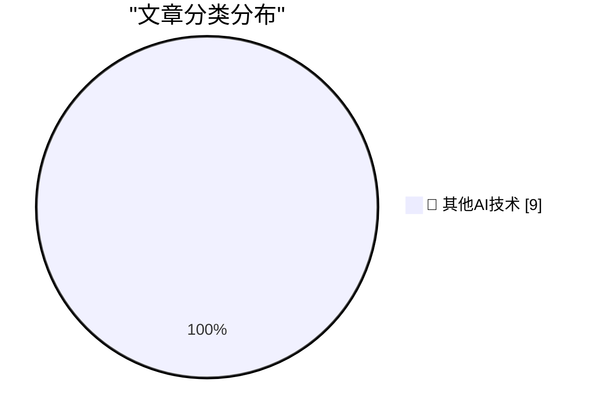

# 📰 AI 博客每日精选 — 2026-10-20

> 来自 98 个技术博客和社交媒体源，AI 精选 Top 9

## 🏆 今日必读

🥇 **Laypeople support technical fields for technology, not art**

[Laypeople support technical fields for technology, not art](https://seangoedecke.com/laypeople-support-technical-fields-for-technology-not-art/) — seangoedecke.com · 23 小时前 · 🔬 其他AI技术

> Laypeople support technical fields for technology, not art

🥈 **[Sponsor] Sunnny**

[[Sponsor] Sunnny](https://sunnny.com/) — daringfireball.net · 10 小时前 · 🔬 其他AI技术

> [Sponsor] Sunnny

🥉 **Barack Obama on the Trump Administration’s Intimidation Campaign Against Congresswoman Ilhan Omar**

[Barack Obama on the Trump Administration’s Intimidation Campaign Against Congresswoman Ilhan Omar](https://x.com/BarackObama/status/2111819687524774170) — daringfireball.net · 22 小时前 · 🔬 其他AI技术

> Barack Obama on the Trump Administration’s Intimidation Campaign Against Congresswoman Ilhan Omar

4️⃣ **Pluralistic: The death of history's most successful publisher (20 Oct 2026)**

[Pluralistic: The death of history's most successful publisher (20 Oct 2026)](https://pluralistic.net/2026/10/20/main-character-syndrome/) — pluralistic.net · 6 小时前 · 🔬 其他AI技术

> Pluralistic: The death of history's most successful publisher (20 Oct 2026)

5️⃣ **Book Review: Quackery - A Brief History of the Worst Ways to Cure Everything by Lydia Kang ★★★⯪☆**

[Book Review: Quackery - A Brief History of the Worst Ways to Cure Everything by Lydia Kang ★★★⯪☆](https://shkspr.mobi/blog/2026/10/book-review-quackery-a-brief-history-of-the-worst-ways-to-cure-everything-by-lydia-kang/) — shkspr.mobi · 12 小时前 · 🔬 其他AI技术

> Book Review: Quackery - A Brief History of the Worst Ways to Cure Everything by Lydia Kang ★★★⯪☆

---

## 📊 数据概览

| 扫描源 | 抓取文章 | 时间范围 | 精选 |
|:---:|:---:|:---:|:---:|
| 64/98 | 2001 篇 → 9 篇 | 24h | **9 篇** |

### 分类分布

---

====================

## 🔬 其他AI技术

### 1. Laypeople support technical fields for technology, not art

[Laypeople support technical fields for technology, not art](https://seangoedecke.com/laypeople-support-technical-fields-for-technology-not-art/) — **seangoedecke.com** · 23 小时前 · ⭐ 15/25

> Laypeople support technical fields for technology, not art

📌 其他AI技术

---

### 2. [Sponsor] Sunnny

[[Sponsor] Sunnny](https://sunnny.com/) — **daringfireball.net** · 10 小时前 · ⭐ 15/25

> [Sponsor] Sunnny

📌 其他AI技术

---

### 3. Barack Obama on the Trump Administration’s Intimidation Campaign Against Congresswoman Ilhan Omar

[Barack Obama on the Trump Administration’s Intimidation Campaign Against Congresswoman Ilhan Omar](https://x.com/BarackObama/status/2111819687524774170) — **daringfireball.net** · 22 小时前 · ⭐ 15/25

> Barack Obama on the Trump Administration’s Intimidation Campaign Against Congresswoman Ilhan Omar

📌 其他AI技术

---

### 4. Pluralistic: The death of history's most successful publisher (20 Oct 2026)

[Pluralistic: The death of history's most successful publisher (20 Oct 2026)](https://pluralistic.net/2026/10/20/main-character-syndrome/) — **pluralistic.net** · 6 小时前 · ⭐ 15/25

> Pluralistic: The death of history's most successful publisher (20 Oct 2026)

📌 其他AI技术

---

### 5. Book Review: Quackery - A Brief History of the Worst Ways to Cure Everything by Lydia Kang ★★★⯪☆

[Book Review: Quackery - A Brief History of the Worst Ways to Cure Everything by Lydia Kang ★★★⯪☆](https://shkspr.mobi/blog/2026/10/book-review-quackery-a-brief-history-of-the-worst-ways-to-cure-everything-by-lydia-kang/) — **shkspr.mobi** · 12 小时前 · ⭐ 15/25

> Book Review: Quackery - A Brief History of the Worst Ways to Cure Everything by Lydia Kang ★★★⯪☆

📌 其他AI技术

---

### 6. AI Had Better Work Out

[AI Had Better Work Out](https://www.wheresyoured.at/ai-had-better-work-out/) — **wheresyoured.at** · 7 小时前 · ⭐ 15/25

> AI Had Better Work Out

📌 其他AI技术

---

### 7. What happened to Epyx

[What happened to Epyx](https://dfarq.homeip.net/what-happened-to-epyx/?utm_source=rss&#038;utm_medium=rss&#038;utm_campaign=what-happened-to-epyx) — **dfarq.homeip.net** · 12 小时前 · ⭐ 15/25

> What happened to Epyx

📌 其他AI技术

---

### 8. ClickHouse Will Let You Be Wrong at Scale

[ClickHouse Will Let You Be Wrong at Scale](https://matduggan.com/clickhouse-will-let-you-be-wrong-at-scale/) — **matduggan.com** · 9 小时前 · ⭐ 15/25

> ClickHouse Will Let You Be Wrong at Scale

📌 其他AI技术

---

### 9. How to install an app on your Commodore 64

[How to install an app on your Commodore 64](https://anildash.com/2026/10/08/install-an-app-commodore-64/) — **anildash.com** · 5 小时前 · ⭐ 15/25

> How to install an app on your Commodore 64

📌 其他AI技术

---

====================

*生成于 2026-10-20 23:36 | 扫描 64 源 → 获取 2001 篇 → 精选 9 篇*
*基于 [Hacker News Popularity Contest 2025](https://refactoringenglish.com/tools/hn-popularity/) RSS 源列表，由 [Andrej Karpathy](https://x.com/karpathy) 推荐*
*由「懂点儿AI」制作，欢迎关注同名微信公众号获取更多 AI 实用技巧 💡*
