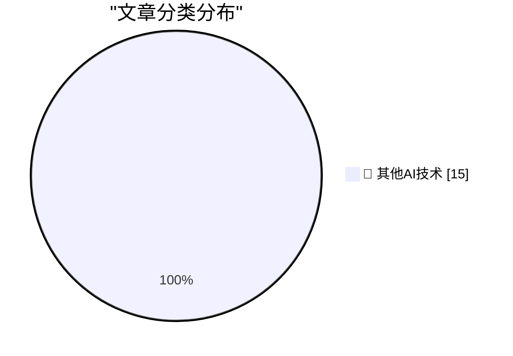

# 📰 AI 博客每日精选 — 2026-10-21

> 来自 98 个技术博客和社交媒体源，AI 精选 Top 15

## 🏆 今日必读

🥇 **Upgrade your PHP installs immediately to protect against php2shell**

[Upgrade your PHP installs immediately to protect against php2shell](https://www.jeffgeerling.com/blog/2026/php-vulnerability-php2shell/) — jeffgeerling.com · 9 小时前 · 🔬 其他AI技术

> Upgrade your PHP installs immediately to protect against php2shell

🥈 **★ The iPhone Duo**

[★ The iPhone Duo](https://daringfireball.net/2026/10/the_iphone_duo) — daringfireball.net · 54 分钟前 · 🔬 其他AI技术

> ★ The iPhone Duo

🥉 **Can they write a function?**

[Can they write a function?](https://idiallo.com/blog/can-they-write-a-function) — idiallo.com · 4 小时前 · 🔬 其他AI技术

> Can they write a function?

4️⃣ **Pluralistic: Adversarial interoperability is a team sport (21 Oct 2026)**

[Pluralistic: Adversarial interoperability is a team sport (21 Oct 2026)](https://pluralistic.net/2026/10/21/brittle-individualism/) — pluralistic.net · 3 小时前 · 🔬 其他AI技术

> Pluralistic: Adversarial interoperability is a team sport (21 Oct 2026)

5️⃣ **"No way to prevent this" say users of only language where this regularly happens**

["No way to prevent this" say users of only language where this regularly happens](https://xeiaso.net/shitposts/no-way-to-prevent-this/memory-safety/CVE-2026-94300/) — xeiaso.net · 23 小时前 · 🔬 其他AI技术

> "No way to prevent this" say users of only language where this regularly happens

---

## 📊 数据概览

| 扫描源 | 抓取文章 | 时间范围 | 精选 |
|:---:|:---:|:---:|:---:|
| 63/98 | 1976 篇 → 15 篇 | 24h | **15 篇** |

### 分类分布

---

====================

## 🔬 其他AI技术

### 1. Upgrade your PHP installs immediately to protect against php2shell

[Upgrade your PHP installs immediately to protect against php2shell](https://www.jeffgeerling.com/blog/2026/php-vulnerability-php2shell/) — **jeffgeerling.com** · 9 小时前 · ⭐ 15/25

> Upgrade your PHP installs immediately to protect against php2shell

📌 其他AI技术

---

### 2. ★ The iPhone Duo

[★ The iPhone Duo](https://daringfireball.net/2026/10/the_iphone_duo) — **daringfireball.net** · 54 分钟前 · ⭐ 15/25

> ★ The iPhone Duo

📌 其他AI技术

---

### 3. Can they write a function?

[Can they write a function?](https://idiallo.com/blog/can-they-write-a-function) — **idiallo.com** · 4 小时前 · ⭐ 15/25

> Can they write a function?

📌 其他AI技术

---

### 4. Pluralistic: Adversarial interoperability is a team sport (21 Oct 2026)

[Pluralistic: Adversarial interoperability is a team sport (21 Oct 2026)](https://pluralistic.net/2026/10/21/brittle-individualism/) — **pluralistic.net** · 3 小时前 · ⭐ 15/25

> Pluralistic: Adversarial interoperability is a team sport (21 Oct 2026)

📌 其他AI技术

---

### 5. "No way to prevent this" say users of only language where this regularly happens

["No way to prevent this" say users of only language where this regularly happens](https://xeiaso.net/shitposts/no-way-to-prevent-this/memory-safety/CVE-2026-94300/) — **xeiaso.net** · 23 小时前 · ⭐ 15/25

> "No way to prevent this" say users of only language where this regularly happens

📌 其他AI技术

---

### 6. "No way to prevent this" say users of only language where this regularly happens

["No way to prevent this" say users of only language where this regularly happens](https://xeiaso.net/shitposts/no-way-to-prevent-this/memory-safety/CVE-2026-111813/) — **xeiaso.net** · 23 小时前 · ⭐ 15/25

> "No way to prevent this" say users of only language where this regularly happens

📌 其他AI技术

---

### 7. "No way to prevent this" say users of only language where this regularly happens

["No way to prevent this" say users of only language where this regularly happens](https://xeiaso.net/shitposts/no-way-to-prevent-this/memory-safety/CVE-2026-111497/) — **xeiaso.net** · 23 小时前 · ⭐ 15/25

> "No way to prevent this" say users of only language where this regularly happens

📌 其他AI技术

---

### 8. "No way to prevent this" say users of only language where this regularly happens

["No way to prevent this" say users of only language where this regularly happens](https://xeiaso.net/shitposts/no-way-to-prevent-this/memory-safety/CVE-2026-107891/) — **xeiaso.net** · 23 小时前 · ⭐ 15/25

> "No way to prevent this" say users of only language where this regularly happens

📌 其他AI技术

---

### 9. Jesus Christ patch your shit now

[Jesus Christ patch your shit now](https://xeiaso.net/shitposts/no-way-to-prevent-this/memory-safety/CVE-2026-109618/) — **xeiaso.net** · 23 小时前 · ⭐ 15/25

> Jesus Christ patch your shit now

📌 其他AI技术

---

### 10. Why didn’t we use Ro­Register­For­Apartment­Shutdown to clean up the unmarshalable delegate?

[Why didn’t we use Ro­Register­For­Apartment­Shutdown to clean up the unmarshalable delegate?](https://devblogs.microsoft.com/oldnewthing/20261021-00/?p=112786/) — **devblogs.microsoft.com/oldnewthing** · 9 小时前 · ⭐ 15/25

> Why didn’t we use Ro­Register­For­Apartment­Shutdown to clean up the unmarshalable delegate?

📌 其他AI技术

---

### 11. Trust Stores Are Dependencies Too

[Trust Stores Are Dependencies Too](https://nesbitt.io/2026/10/21/trust-stores-are-dependencies-too.html) — **nesbitt.io** · 7 小时前 · ⭐ 15/25

> Trust Stores Are Dependencies Too

📌 其他AI技术

---

### 12. No Need for Retirement When Utopia Is Around the Corner

[No Need for Retirement When Utopia Is Around the Corner](https://blog.jim-nielsen.com/2026/skip-retirement-for-utopia/) — **blog.jim-nielsen.com** · 4 小时前 · ⭐ 15/25

> No Need for Retirement When Utopia Is Around the Corner

📌 其他AI技术

---

### 13. Creative Computing launched October 1974

[Creative Computing launched October 1974](https://dfarq.homeip.net/creative-computing-launched-october-1974/?utm_source=rss&#038;utm_medium=rss&#038;utm_campaign=creative-computing-launched-october-1974) — **dfarq.homeip.net** · 12 小时前 · ⭐ 15/25

> Creative Computing launched October 1974

📌 其他AI技术

---

### 14. Rails is a JIT compiler

[Rails is a JIT compiler](https://bernsteinbear.com/blog/rails-is-a-jit-compiler/?utm_source=rss) — **bernsteinbear.com** · 23 小时前 · ⭐ 15/25

> Rails is a JIT compiler

📌 其他AI技术

---

### 15. Objects, attributes, maps, oh my!

[Objects, attributes, maps, oh my!](https://bernsteinbear.com/blog/object-shapes/?utm_source=rss) — **bernsteinbear.com** · 23 小时前 · ⭐ 15/25

> Objects, attributes, maps, oh my!

📌 其他AI技术

---

====================

*生成于 2026-10-21 23:53 | 扫描 63 源 → 获取 1976 篇 → 精选 15 篇*
*基于 [Hacker News Popularity Contest 2025](https://refactoringenglish.com/tools/hn-popularity/) RSS 源列表，由 [Andrej Karpathy](https://x.com/karpathy) 推荐*
*由「懂点儿AI」制作，欢迎关注同名微信公众号获取更多 AI 实用技巧 💡*
