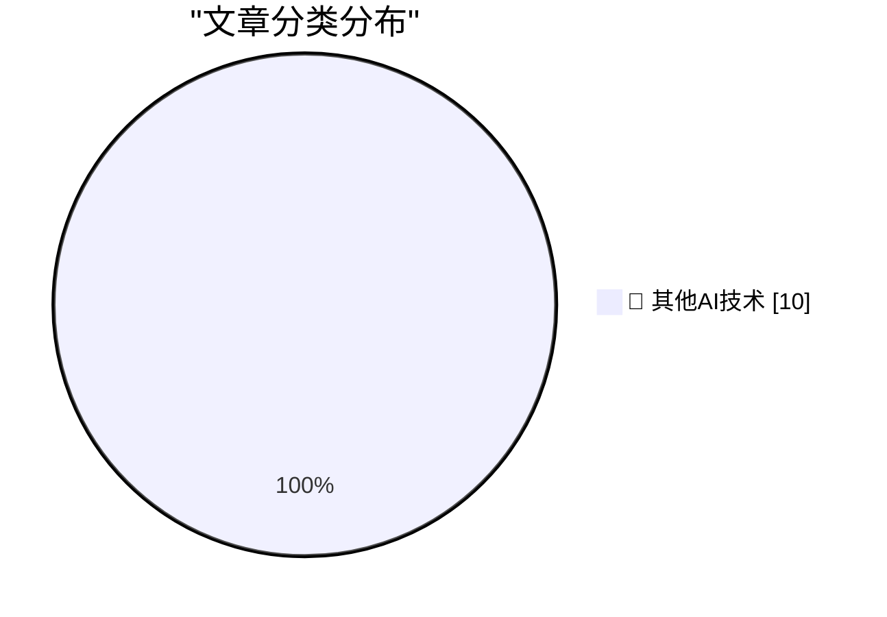

# 📰 AI 博客每日精选 — 2026-10-22

> 来自 98 个技术博客和社交媒体源，AI 精选 Top 10

## 🏆 今日必读

🥇 **Software is slow because of bad design, not slow languages**

[Software is slow because of bad design, not slow languages](https://seangoedecke.com/software-is-slow-because-of-bad-design-not-slow-languages/) — seangoedecke.com · -9 分钟前 · 🔬 其他AI技术

> Software is slow because of bad design, not slow languages

🥈 **Apple Highlights 50+ iPhone Apps That Have Already Been Optimized for the Duo**

[Apple Highlights 50+ iPhone Apps That Have Already Been Optimized for the Duo](https://www.apple.com/newsroom/2026/10/developers-bring-incredible-new-app-experiences-to-iphone-duo/) — daringfireball.net · 4 小时前 · 🔬 其他AI技术

> Apple Highlights 50+ iPhone Apps That Have Already Been Optimized for the Duo

🥉 **Updates to My iPhone Duo Review**

[Updates to My iPhone Duo Review](https://daringfireball.net/2026/10/the_iphone_duo) — daringfireball.net · 5 小时前 · 🔬 其他AI技术

> Updates to My iPhone Duo Review

4️⃣ **Productivity**

[Productivity](https://idiallo.com/byte-size/productivity-video) — idiallo.com · 6 小时前 · 🔬 其他AI技术

> Productivity

5️⃣ **Gadget Review: Mokin 17 Port USB-C Tower ★★☆☆☆**

[Gadget Review: Mokin 17 Port USB-C Tower ★★☆☆☆](https://shkspr.mobi/blog/2026/10/gadget-review-mokin-17-port-usb-c-tower/) — shkspr.mobi · 12 小时前 · 🔬 其他AI技术

> Gadget Review: Mokin 17 Port USB-C Tower ★★☆☆☆

---

## 📊 数据概览

| 扫描源 | 抓取文章 | 时间范围 | 精选 |
|:---:|:---:|:---:|:---:|
| 64/98 | 2001 篇 → 10 篇 | 24h | **10 篇** |

### 分类分布

---

====================

## 🔬 其他AI技术

### 1. Software is slow because of bad design, not slow languages

[Software is slow because of bad design, not slow languages](https://seangoedecke.com/software-is-slow-because-of-bad-design-not-slow-languages/) — **seangoedecke.com** · -9 分钟前 · ⭐ 15/25

> Software is slow because of bad design, not slow languages

📌 其他AI技术

---

### 2. Apple Highlights 50+ iPhone Apps That Have Already Been Optimized for the Duo

[Apple Highlights 50+ iPhone Apps That Have Already Been Optimized for the Duo](https://www.apple.com/newsroom/2026/10/developers-bring-incredible-new-app-experiences-to-iphone-duo/) — **daringfireball.net** · 4 小时前 · ⭐ 15/25

> Apple Highlights 50+ iPhone Apps That Have Already Been Optimized for the Duo

📌 其他AI技术

---

### 3. Updates to My iPhone Duo Review

[Updates to My iPhone Duo Review](https://daringfireball.net/2026/10/the_iphone_duo) — **daringfireball.net** · 5 小时前 · ⭐ 15/25

> Updates to My iPhone Duo Review

📌 其他AI技术

---

### 4. Productivity

[Productivity](https://idiallo.com/byte-size/productivity-video) — **idiallo.com** · 6 小时前 · ⭐ 15/25

> Productivity

📌 其他AI技术

---

### 5. Gadget Review: Mokin 17 Port USB-C Tower ★★☆☆☆

[Gadget Review: Mokin 17 Port USB-C Tower ★★☆☆☆](https://shkspr.mobi/blog/2026/10/gadget-review-mokin-17-port-usb-c-tower/) — **shkspr.mobi** · 12 小时前 · ⭐ 15/25

> Gadget Review: Mokin 17 Port USB-C Tower ★★☆☆☆

📌 其他AI技术

---

### 6. "No way to prevent this" say users of only language where this regularly happens

["No way to prevent this" say users of only language where this regularly happens](https://xeiaso.net/shitposts/no-way-to-prevent-this/memory-safety/CVE-2026-93479/) — **xeiaso.net** · 23 小时前 · ⭐ 15/25

> "No way to prevent this" say users of only language where this regularly happens

📌 其他AI技术

---

### 7. NYC, New Webinar, Differential Testing

[NYC, New Webinar, Differential Testing](https://buttondown.com/hillelwayne/archive/nyc-new-webinar-differential-testing/) — **buttondown.com/hillelwayne** · 8 小时前 · ⭐ 15/25

> NYC, New Webinar, Differential Testing

📌 其他AI技术

---

### 8. What will computer chips look like in 2045?

[What will computer chips look like in 2045?](https://www.dwarkesh.com/p/intel-tour) — **dwarkesh.com** · 8 小时前 · ⭐ 15/25

> What will computer chips look like in 2045?

📌 其他AI技术

---

### 9. Windows 7 released Oct 22, 2009

[Windows 7 released Oct 22, 2009](https://dfarq.homeip.net/windows-7-released-oct-22-2009/?utm_source=rss&#038;utm_medium=rss&#038;utm_campaign=windows-7-released-oct-22-2009) — **dfarq.homeip.net** · 12 小时前 · ⭐ 15/25

> Windows 7 released Oct 22, 2009

📌 其他AI技术

---

### 10. How to install an app on your Commodore 64

[How to install an app on your Commodore 64](https://anildash.com/2026/10/08/install-an-app-commodore-64/) — **anildash.com** · 17 小时前 · ⭐ 15/25

> How to install an app on your Commodore 64

📌 其他AI技术

---

====================

*生成于 2026-10-22 23:51 | 扫描 64 源 → 获取 2001 篇 → 精选 10 篇*
*基于 [Hacker News Popularity Contest 2025](https://refactoringenglish.com/tools/hn-popularity/) RSS 源列表，由 [Andrej Karpathy](https://x.com/karpathy) 推荐*
*由「懂点儿AI」制作，欢迎关注同名微信公众号获取更多 AI 实用技巧 💡*
