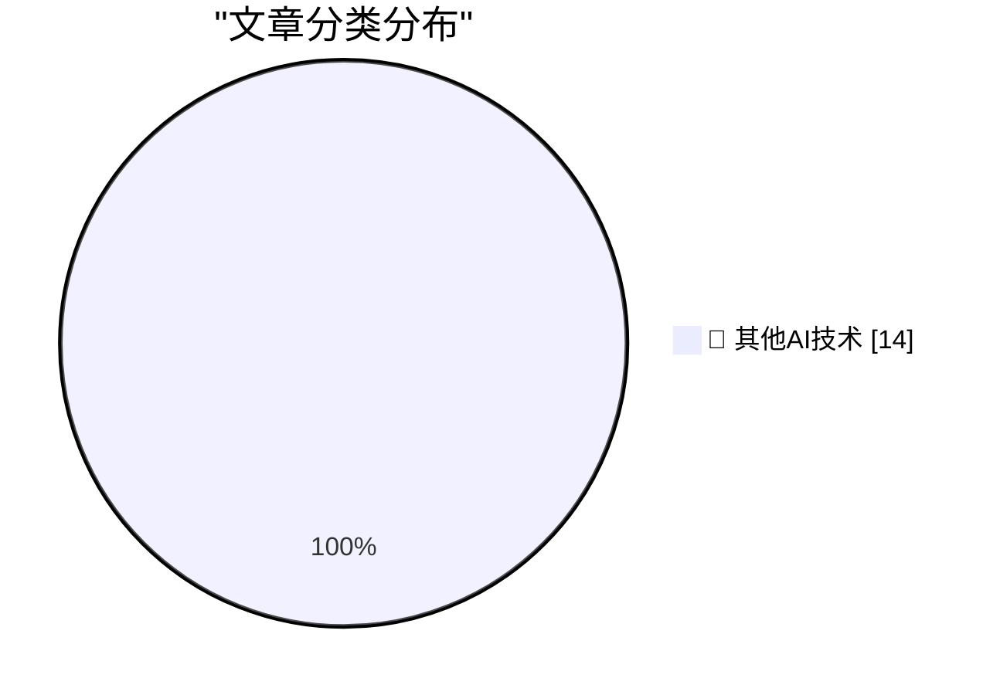

# 📰 AI 博客每日精选 — 2026-10-23

> 来自 98 个技术博客和社交媒体源，AI 精选 Top 14

## 🏆 今日必读

🥇 **Ubiquiti's $99 Vape Detector is actually pretty good**

[Ubiquiti's $99 Vape Detector is actually pretty good](https://www.jeffgeerling.com/blog/2026/ubiquiti-vape-detector-teardown/) — jeffgeerling.com · 10 小时前 · 🔬 其他AI技术

> Ubiquiti's $99 Vape Detector is actually pretty good

🥈 **Software is slow because of bad design, not slow languages**

[Software is slow because of bad design, not slow languages](https://seangoedecke.com/software-is-slow-because-of-bad-design-not-slow-languages/) — seangoedecke.com · 23 小时前 · 🔬 其他AI技术

> Software is slow because of bad design, not slow languages

🥉 **The Verge’s Duo Review: ‘Apple’s Folding Phone Is a Messy, Expensive Good Time’**

[The Verge’s Duo Review: ‘Apple’s Folding Phone Is a Messy, Expensive Good Time’](https://www.theverge.com/tech/1015028/iphone-duo-review) — daringfireball.net · 6 小时前 · 🔬 其他AI技术

> The Verge’s Duo Review: ‘Apple’s Folding Phone Is a Messy, Expensive Good Time’

4️⃣ **Joanna Stern Reviews the Duo: ‘The Good, the Bad, and the Buggy’**

[Joanna Stern Reviews the Duo: ‘The Good, the Bad, and the Buggy’](https://www.youtube.com/watch?v=bxDTWuL9GxY) — daringfireball.net · 9 小时前 · 🔬 其他AI技术

> Joanna Stern Reviews the Duo: ‘The Good, the Bad, and the Buggy’

5️⃣ **Pluralistic: Critique and writing (23 Oct 2026)**

[Pluralistic: Critique and writing (23 Oct 2026)](https://pluralistic.net/2026/10/23/better-to-give/) — pluralistic.net · 3 小时前 · 🔬 其他AI技术

> Pluralistic: Critique and writing (23 Oct 2026)

---

## 📊 数据概览

| 扫描源 | 抓取文章 | 时间范围 | 精选 |
|:---:|:---:|:---:|:---:|
| 64/98 | 2001 篇 → 14 篇 | 24h | **14 篇** |

### 分类分布

---

====================

## 🔬 其他AI技术

### 1. Ubiquiti's $99 Vape Detector is actually pretty good

[Ubiquiti's $99 Vape Detector is actually pretty good](https://www.jeffgeerling.com/blog/2026/ubiquiti-vape-detector-teardown/) — **jeffgeerling.com** · 10 小时前 · ⭐ 15/25

> Ubiquiti's $99 Vape Detector is actually pretty good

📌 其他AI技术

---

### 2. Software is slow because of bad design, not slow languages

[Software is slow because of bad design, not slow languages](https://seangoedecke.com/software-is-slow-because-of-bad-design-not-slow-languages/) — **seangoedecke.com** · 23 小时前 · ⭐ 15/25

> Software is slow because of bad design, not slow languages

📌 其他AI技术

---

### 3. The Verge’s Duo Review: ‘Apple’s Folding Phone Is a Messy, Expensive Good Time’

[The Verge’s Duo Review: ‘Apple’s Folding Phone Is a Messy, Expensive Good Time’](https://www.theverge.com/tech/1015028/iphone-duo-review) — **daringfireball.net** · 6 小时前 · ⭐ 15/25

> The Verge’s Duo Review: ‘Apple’s Folding Phone Is a Messy, Expensive Good Time’

📌 其他AI技术

---

### 4. Joanna Stern Reviews the Duo: ‘The Good, the Bad, and the Buggy’

[Joanna Stern Reviews the Duo: ‘The Good, the Bad, and the Buggy’](https://www.youtube.com/watch?v=bxDTWuL9GxY) — **daringfireball.net** · 9 小时前 · ⭐ 15/25

> Joanna Stern Reviews the Duo: ‘The Good, the Bad, and the Buggy’

📌 其他AI技术

---

### 5. Pluralistic: Critique and writing (23 Oct 2026)

[Pluralistic: Critique and writing (23 Oct 2026)](https://pluralistic.net/2026/10/23/better-to-give/) — **pluralistic.net** · 3 小时前 · ⭐ 15/25

> Pluralistic: Critique and writing (23 Oct 2026)

📌 其他AI技术

---

### 6. More phishing messages via Booking.com and Novotel

[More phishing messages via Booking.com and Novotel](https://shkspr.mobi/blog/2026/10/more-phishing-messages-via-booking-com-and-novotel/) — **shkspr.mobi** · 12 小时前 · ⭐ 15/25

> More phishing messages via Booking.com and Novotel

📌 其他AI技术

---

### 7. "No way to prevent this" say users of only language where this regularly happens

["No way to prevent this" say users of only language where this regularly happens](https://xeiaso.net/shitposts/no-way-to-prevent-this/memory-safety/CVE-2026-89078/) — **xeiaso.net** · 23 小时前 · ⭐ 15/25

> "No way to prevent this" say users of only language where this regularly happens

📌 其他AI技术

---

### 8. Why didn’t we use the COM static store to clean up the unmarshalable delegate?

[Why didn’t we use the COM static store to clean up the unmarshalable delegate?](https://devblogs.microsoft.com/oldnewthing/20261023-00/?p=112793/) — **devblogs.microsoft.com/oldnewthing** · 9 小时前 · ⭐ 15/25

> Why didn’t we use the COM static store to clean up the unmarshalable delegate?

📌 其他AI技术

---

### 9. RMSNorm

[RMSNorm](https://www.gilesthomas.com/2026/10/rmsnorm) — **gilesthomas.com** · 5 小时前 · ⭐ 15/25

> RMSNorm

📌 其他AI技术

---

### 10. One Small Bug

[One Small Bug](https://nesbitt.io/2026/10/23/one-small-bug.html) — **nesbitt.io** · 14 小时前 · ⭐ 15/25

> One Small Bug

📌 其他AI技术

---

### 11. Premium: The Hater's Guide To Blackstone

[Premium: The Hater's Guide To Blackstone](https://www.wheresyoured.at/premium-the-haters-guide-to-blackstone/) — **wheresyoured.at** · 7 小时前 · ⭐ 15/25

> Premium: The Hater's Guide To Blackstone

📌 其他AI技术

---

### 12. An Ion Storm!, Part 2: The Return to Ground Level

[An Ion Storm!, Part 2: The Return to Ground Level](https://www.filfre.net/2026/10/an-ion-storm-part-2-the-return-to-ground-level/) — **filfre.net** · 7 小时前 · ⭐ 15/25

> An Ion Storm!, Part 2: The Return to Ground Level

📌 其他AI技术

---

### 13. Windows XP released October 25, 2001

[Windows XP released October 25, 2001](https://dfarq.homeip.net/windows-xp-released-october-25-2001/?utm_source=rss&#038;utm_medium=rss&#038;utm_campaign=windows-xp-released-october-25-2001) — **dfarq.homeip.net** · 12 小时前 · ⭐ 15/25

> Windows XP released October 25, 2001

📌 其他AI技术

---

### 14. How to install an app on your Commodore 64

[How to install an app on your Commodore 64](https://anildash.com/2026/10/08/install-an-app-commodore-64/) — **anildash.com** · 2 小时前 · ⭐ 15/25

> How to install an app on your Commodore 64

📌 其他AI技术

---

====================

*生成于 2026-10-23 23:44 | 扫描 64 源 → 获取 2001 篇 → 精选 14 篇*
*基于 [Hacker News Popularity Contest 2025](https://refactoringenglish.com/tools/hn-popularity/) RSS 源列表，由 [Andrej Karpathy](https://x.com/karpathy) 推荐*
*由「懂点儿AI」制作，欢迎关注同名微信公众号获取更多 AI 实用技巧 💡*
