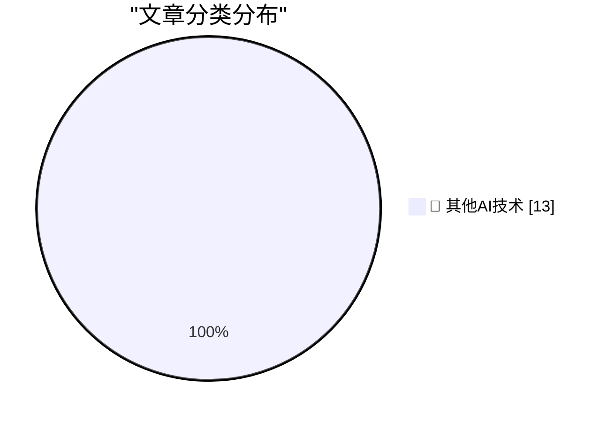

# 📰 AI 博客每日精选 — 2026-10-24

> 来自 98 个技术博客和社交媒体源，AI 精选 Top 13

## 🏆 今日必读

🥇 **Nicole Nguyen’s Duo Review for the WSJ**

[Nicole Nguyen’s Duo Review for the WSJ](https://www.wsj.com/tech/personal-tech/iphone-duo-review-cafcbbe7?st=GaYVMf) — daringfireball.net · 36 分钟前 · 🔬 其他AI技术

> Nicole Nguyen’s Duo Review for the WSJ

🥈 **Reuters and the WSJ on the Duo Launch**

[Reuters and the WSJ on the Duo Launch](https://www.reuters.com/business/retail-consumer/apple-bets-iphone-duo-can-remake-foldable-market-sales-begin-2026-10-22/) — daringfireball.net · 43 分钟前 · 🔬 其他AI技术

> Reuters and the WSJ on the Duo Launch

🥉 **Marion Barry Meets the iPhone Duo**

[Marion Barry Meets the iPhone Duo](https://www.theverge.com/tech/1017623/iphone-duo-broken-cracked-screen) — daringfireball.net · 1 小时前 · 🔬 其他AI技术

> Marion Barry Meets the iPhone Duo

4️⃣ **MKBHD’s Duo Review**

[MKBHD’s Duo Review](https://youtu.be/ESABTN4VtrA) — daringfireball.net · 2 小时前 · 🔬 其他AI技术

> MKBHD’s Duo Review

5️⃣ **Tim Pan’s iPhone Duo Review**

[Tim Pan’s iPhone Duo Review](https://www.youtube.com/watch?v=8pCccpKjjos) — daringfireball.net · 3 小时前 · 🔬 其他AI技术

> Tim Pan’s iPhone Duo Review

---

## 📊 数据概览

| 扫描源 | 抓取文章 | 时间范围 | 精选 |
|:---:|:---:|:---:|:---:|
| 64/98 | 2002 篇 → 13 篇 | 24h | **13 篇** |

### 分类分布

---

====================

## 🔬 其他AI技术

### 1. Nicole Nguyen’s Duo Review for the WSJ

[Nicole Nguyen’s Duo Review for the WSJ](https://www.wsj.com/tech/personal-tech/iphone-duo-review-cafcbbe7?st=GaYVMf) — **daringfireball.net** · 36 分钟前 · ⭐ 15/25

> Nicole Nguyen’s Duo Review for the WSJ

📌 其他AI技术

---

### 2. Reuters and the WSJ on the Duo Launch

[Reuters and the WSJ on the Duo Launch](https://www.reuters.com/business/retail-consumer/apple-bets-iphone-duo-can-remake-foldable-market-sales-begin-2026-10-22/) — **daringfireball.net** · 43 分钟前 · ⭐ 15/25

> Reuters and the WSJ on the Duo Launch

📌 其他AI技术

---

### 3. Marion Barry Meets the iPhone Duo

[Marion Barry Meets the iPhone Duo](https://www.theverge.com/tech/1017623/iphone-duo-broken-cracked-screen) — **daringfireball.net** · 1 小时前 · ⭐ 15/25

> Marion Barry Meets the iPhone Duo

📌 其他AI技术

---

### 4. MKBHD’s Duo Review

[MKBHD’s Duo Review](https://youtu.be/ESABTN4VtrA) — **daringfireball.net** · 2 小时前 · ⭐ 15/25

> MKBHD’s Duo Review

📌 其他AI技术

---

### 5. Tim Pan’s iPhone Duo Review

[Tim Pan’s iPhone Duo Review](https://www.youtube.com/watch?v=8pCccpKjjos) — **daringfireball.net** · 3 小时前 · ⭐ 15/25

> Tim Pan’s iPhone Duo Review

📌 其他AI技术

---

### 6. Apple Built a Photo-Realistic Functional Original iPod for Apple Music’s 404 Page

[Apple Built a Photo-Realistic Functional Original iPod for Apple Music’s 404 Page](https://music.apple.com/404) — **daringfireball.net** · 7 小时前 · ⭐ 15/25

> Apple Built a Photo-Realistic Functional Original iPod for Apple Music’s 404 Page

📌 其他AI技术

---

### 7. Chan Karunamuni on the Duo’s Open/Close Translucent Transition

[Chan Karunamuni on the Duo’s Open/Close Translucent Transition](https://x.com/chan_k/status/2113622379050246243) — **daringfireball.net** · 7 小时前 · ⭐ 15/25

> Chan Karunamuni on the Duo’s Open/Close Translucent Transition

📌 其他AI技术

---

### 8. Book Review: Get Ahead of Being Dead by Evie King ★★★★☆

[Book Review: Get Ahead of Being Dead by Evie King ★★★★☆](https://shkspr.mobi/blog/2026/10/book-review-get-ahead-of-being-dead-by-evie-king/) — **shkspr.mobi** · 11 小时前 · ⭐ 15/25

> Book Review: Get Ahead of Being Dead by Evie King ★★★★☆

📌 其他AI技术

---

### 9. List of Vim forks

[List of Vim forks](https://evanhahn.com/list-of-vim-forks/) — **evanhahn.com** · 5 小时前 · ⭐ 15/25

> List of Vim forks

📌 其他AI技术

---

### 10. This Week in Package Management: 24 October 2026

[This Week in Package Management: 24 October 2026](https://nesbitt.io/2026/10/24/this-week-in-package-management.html) — **nesbitt.io** · 12 小时前 · ⭐ 15/25

> This Week in Package Management: 24 October 2026

📌 其他AI技术

---

### 11. Commodore 1600 VICmodem

[Commodore 1600 VICmodem](https://dfarq.homeip.net/commodore-1600-vicmodem/?utm_source=rss&#038;utm_medium=rss&#038;utm_campaign=commodore-1600-vicmodem) — **dfarq.homeip.net** · 11 小时前 · ⭐ 15/25

> Commodore 1600 VICmodem

📌 其他AI技术

---

### 12. Elon Musk Just Gave Europe a Reason to Replace American Technology

[Elon Musk Just Gave Europe a Reason to Replace American Technology](https://steveblank.com/2026/10/24/europe-gets-a-wake-up-call/) — **steveblank.com** · 9 小时前 · ⭐ 15/25

> Elon Musk Just Gave Europe a Reason to Replace American Technology

📌 其他AI技术

---

### 13. Interesting systemd features you may not know about

[Interesting systemd features you may not know about](https://martinalderson.com/posts/interesting-systemd-features/?utm_source=rss&amp;utm_medium=rss&amp;utm_campaign=feed) — **martinalderson.com** · 22 小时前 · ⭐ 15/25

> Interesting systemd features you may not know about

📌 其他AI技术

---

====================

*生成于 2026-10-24 22:51 | 扫描 64 源 → 获取 2002 篇 → 精选 13 篇*
*基于 [Hacker News Popularity Contest 2025](https://refactoringenglish.com/tools/hn-popularity/) RSS 源列表，由 [Andrej Karpathy](https://x.com/karpathy) 推荐*
*由「懂点儿AI」制作，欢迎关注同名微信公众号获取更多 AI 实用技巧 💡*
