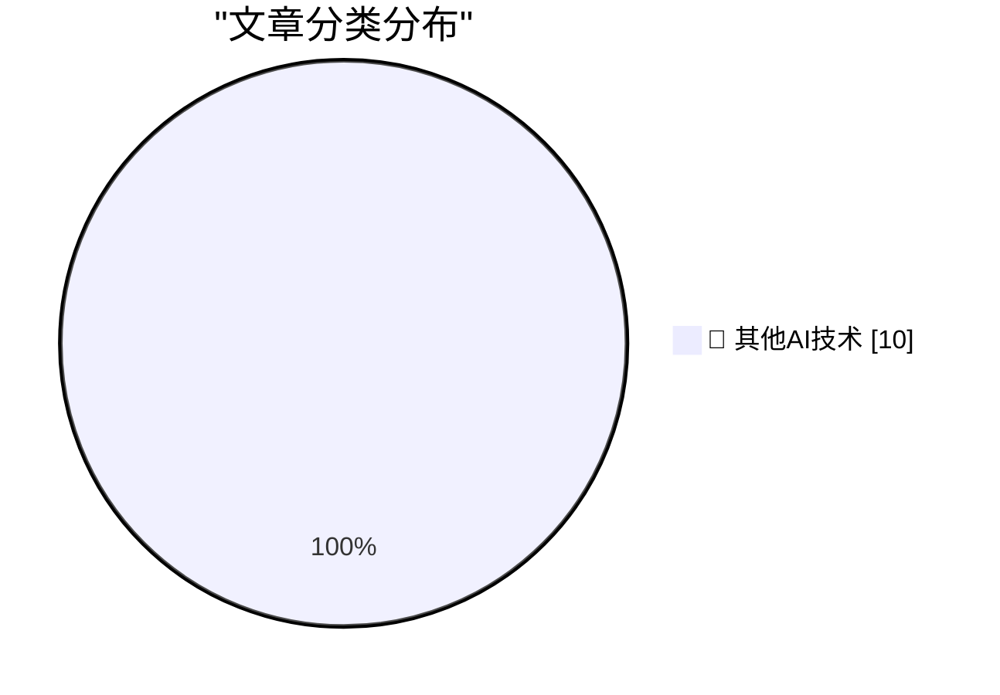

# 📰 AI 博客每日精选 — 2026-10-25

> 来自 98 个技术博客和社交媒体源，AI 精选 Top 10

## 🏆 今日必读

🥇 **Don't anthropomorphize big tech companies**

[Don't anthropomorphize big tech companies](https://seangoedecke.com/dont-anthropomorphize-big-tech-companies/) — seangoedecke.com · 23 小时前 · 🔬 其他AI技术

> Don't anthropomorphize big tech companies

🥈 **Sunnny**

[Sunnny](https://sunnny.com/) — daringfireball.net · 1 小时前 · 🔬 其他AI技术

> Sunnny

🥉 **Duo Users Are Registering the Base of Their Index Finger as a Touch ID Coping Strategy**

[Duo Users Are Registering the Base of Their Index Finger as a Touch ID Coping Strategy](https://www.reddit.com/r/iPhoneDuo/comments/1xehtcj/best_fingerprint_method/) — daringfireball.net · 1 小时前 · 🔬 其他AI技术

> Duo Users Are Registering the Base of Their Index Finger as a Touch ID Coping Strategy

4️⃣ **The Talk Show: ‘Lubricate the Inside of the Hinge’**

[The Talk Show: ‘Lubricate the Inside of the Hinge’](https://daringfireball.net/thetalkshow/2026/10/25/ep-456) — daringfireball.net · 3 小时前 · 🔬 其他AI技术

> The Talk Show: ‘Lubricate the Inside of the Hinge’

5️⃣ **iPhone Portrait Mode, 10 Years In**

[iPhone Portrait Mode, 10 Years In](https://x.com/johnnie/status/2114007844605612167) — daringfireball.net · 4 小时前 · 🔬 其他AI技术

> iPhone Portrait Mode, 10 Years In

---

## 📊 数据概览

| 扫描源 | 抓取文章 | 时间范围 | 精选 |
|:---:|:---:|:---:|:---:|
| 65/98 | 2029 篇 → 10 篇 | 24h | **10 篇** |

### 分类分布

---

====================

## 🔬 其他AI技术

### 1. Don't anthropomorphize big tech companies

[Don't anthropomorphize big tech companies](https://seangoedecke.com/dont-anthropomorphize-big-tech-companies/) — **seangoedecke.com** · 23 小时前 · ⭐ 15/25

> Don't anthropomorphize big tech companies

📌 其他AI技术

---

### 2. Sunnny

[Sunnny](https://sunnny.com/) — **daringfireball.net** · 1 小时前 · ⭐ 15/25

> Sunnny

📌 其他AI技术

---

### 3. Duo Users Are Registering the Base of Their Index Finger as a Touch ID Coping Strategy

[Duo Users Are Registering the Base of Their Index Finger as a Touch ID Coping Strategy](https://www.reddit.com/r/iPhoneDuo/comments/1xehtcj/best_fingerprint_method/) — **daringfireball.net** · 1 小时前 · ⭐ 15/25

> Duo Users Are Registering the Base of Their Index Finger as a Touch ID Coping Strategy

📌 其他AI技术

---

### 4. The Talk Show: ‘Lubricate the Inside of the Hinge’

[The Talk Show: ‘Lubricate the Inside of the Hinge’](https://daringfireball.net/thetalkshow/2026/10/25/ep-456) — **daringfireball.net** · 3 小时前 · ⭐ 15/25

> The Talk Show: ‘Lubricate the Inside of the Hinge’

📌 其他AI技术

---

### 5. iPhone Portrait Mode, 10 Years In

[iPhone Portrait Mode, 10 Years In](https://x.com/johnnie/status/2114007844605612167) — **daringfireball.net** · 4 小时前 · ⭐ 15/25

> iPhone Portrait Mode, 10 Years In

📌 其他AI技术

---

### 6. Gadget Review: LiberNovo Omni - the USB-C powered office chair ★★★★⯪

[Gadget Review: LiberNovo Omni - the USB-C powered office chair ★★★★⯪](https://shkspr.mobi/blog/2026/10/gadget-review-libernovo-omni-chair/) — **shkspr.mobi** · 10 小时前 · ⭐ 15/25

> Gadget Review: LiberNovo Omni - the USB-C powered office chair ★★★★⯪

📌 其他AI技术

---

### 7. OpenAI and Anthropic cut their LLM prices by up to 80% within a few months. Why?

[OpenAI and Anthropic cut their LLM prices by up to 80% within a few months. Why?](https://minimaxir.com/2026/10/cheap-llms/) — **minimaxir.com** · 2 小时前 · ⭐ 15/25

> OpenAI and Anthropic cut their LLM prices by up to 80% within a few months. Why?

📌 其他AI技术

---

### 8. How much you can make in an entry level cyber security job

[How much you can make in an entry level cyber security job](https://dfarq.homeip.net/how-much-you-can-make-in-an-entry-level-cyber-security-job/?utm_source=rss&#038;utm_medium=rss&#038;utm_campaign=how-much-you-can-make-in-an-entry-level-cyber-security-job) — **dfarq.homeip.net** · 11 小时前 · ⭐ 15/25

> How much you can make in an entry level cyber security job

📌 其他AI技术

---

### 9. A rising tide raises all rents

[A rising tide raises all rents](https://jyn.dev/rising-tide-raises-rents/) — **jyn.dev** · 23 小时前 · ⭐ 15/25

> A rising tide raises all rents

📌 其他AI技术

---

### 10. lighting the skies

[lighting the skies](https://computer.rip/2026-10-25-searchlights.html) — **computer.rip** · 23 小时前 · ⭐ 15/25

> lighting the skies

📌 其他AI技术

---

====================

*生成于 2026-10-25 23:00 | 扫描 65 源 → 获取 2029 篇 → 精选 10 篇*
*基于 [Hacker News Popularity Contest 2025](https://refactoringenglish.com/tools/hn-popularity/) RSS 源列表，由 [Andrej Karpathy](https://x.com/karpathy) 推荐*
*由「懂点儿AI」制作，欢迎关注同名微信公众号获取更多 AI 实用技巧 💡*
