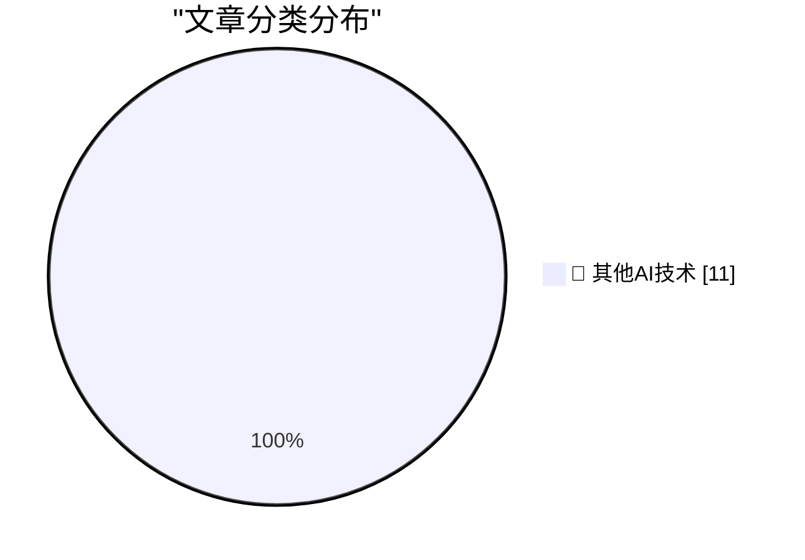

# 📰 AI 博客每日精选 — 2026-10-27

> 来自 98 个技术博客和社交媒体源，AI 精选 Top 11

## 🏆 今日必读

🥇 **Apple Issues Statement on iPhone Duo’s Crack Problem**

[Apple Issues Statement on iPhone Duo’s Crack Problem](https://9to5mac.com/2026/10/26/apple-responds-to-reports-of-iphone-duos-inner-display-cracking/) — daringfireball.net · 18 分钟前 · 🔬 其他AI技术

> Apple Issues Statement on iPhone Duo’s Crack Problem

🥈 **Glenn Fleishman on Apple Notes and Markdown**

[Glenn Fleishman on Apple Notes and Markdown](https://sixcolors.com/post/2026/10/why-notes-will-never-let-us-edit-markdown/) — daringfireball.net · 4 小时前 · 🔬 其他AI技术

> Glenn Fleishman on Apple Notes and Markdown

🥉 **★ Apple Announces New A20 Pro iPad Mini**

[★ Apple Announces New A20 Pro iPad Mini](https://daringfireball.net/2026/10/apple_announces_new_a20_pro_ipad_mini) — daringfireball.net · 6 小时前 · 🔬 其他AI技术

> ★ Apple Announces New A20 Pro iPad Mini

4️⃣ **A Simple Two-Step Shortcuts Shortcut Lets You Lock the iPhone Duo When You Close It**

[A Simple Two-Step Shortcuts Shortcut Lets You Lock the iPhone Duo When You Close It](https://x.com/viticci/status/2113888099784638932) — daringfireball.net · 7 小时前 · 🔬 其他AI技术

> A Simple Two-Step Shortcuts Shortcut Lets You Lock the iPhone Duo When You Close It

5️⃣ **Tiny Computers for iPhone Duo**

[Tiny Computers for iPhone Duo](https://www.fountaininteractive.com/TinyComputers/) — daringfireball.net · 9 小时前 · 🔬 其他AI技术

> Tiny Computers for iPhone Duo

---

## 📊 数据概览

| 扫描源 | 抓取文章 | 时间范围 | 精选 |
|:---:|:---:|:---:|:---:|
| 65/98 | 2030 篇 → 11 篇 | 24h | **11 篇** |

### 分类分布

---

====================

## 🔬 其他AI技术

### 1. Apple Issues Statement on iPhone Duo’s Crack Problem

[Apple Issues Statement on iPhone Duo’s Crack Problem](https://9to5mac.com/2026/10/26/apple-responds-to-reports-of-iphone-duos-inner-display-cracking/) — **daringfireball.net** · 18 分钟前 · ⭐ 15/25

> Apple Issues Statement on iPhone Duo’s Crack Problem

📌 其他AI技术

---

### 2. Glenn Fleishman on Apple Notes and Markdown

[Glenn Fleishman on Apple Notes and Markdown](https://sixcolors.com/post/2026/10/why-notes-will-never-let-us-edit-markdown/) — **daringfireball.net** · 4 小时前 · ⭐ 15/25

> Glenn Fleishman on Apple Notes and Markdown

📌 其他AI技术

---

### 3. ★ Apple Announces New A20 Pro iPad Mini

[★ Apple Announces New A20 Pro iPad Mini](https://daringfireball.net/2026/10/apple_announces_new_a20_pro_ipad_mini) — **daringfireball.net** · 6 小时前 · ⭐ 15/25

> ★ Apple Announces New A20 Pro iPad Mini

📌 其他AI技术

---

### 4. A Simple Two-Step Shortcuts Shortcut Lets You Lock the iPhone Duo When You Close It

[A Simple Two-Step Shortcuts Shortcut Lets You Lock the iPhone Duo When You Close It](https://x.com/viticci/status/2113888099784638932) — **daringfireball.net** · 7 小时前 · ⭐ 15/25

> A Simple Two-Step Shortcuts Shortcut Lets You Lock the iPhone Duo When You Close It

📌 其他AI技术

---

### 5. Tiny Computers for iPhone Duo

[Tiny Computers for iPhone Duo](https://www.fountaininteractive.com/TinyComputers/) — **daringfireball.net** · 9 小时前 · ⭐ 15/25

> Tiny Computers for iPhone Duo

📌 其他AI技术

---

### 6. Pluralistic: Sovereign citizens, but for news (26 Oct 2026)

[Pluralistic: Sovereign citizens, but for news (26 Oct 2026)](https://pluralistic.net/2026/10/26/abandon-hope/) — **pluralistic.net** · 8 小时前 · ⭐ 15/25

> Pluralistic: Sovereign citizens, but for news (26 Oct 2026)

📌 其他AI技术

---

### 7. Theatre Review: Opera UnTouched's "The Telephone" ★★★★★

[Theatre Review: Opera UnTouched's "The Telephone" ★★★★★](https://shkspr.mobi/blog/2026/10/theatre-review-opera-untoucheds-the-telephone/) — **shkspr.mobi** · 11 小时前 · ⭐ 15/25

> Theatre Review: Opera UnTouched's "The Telephone" ★★★★★

📌 其他AI技术

---

### 8. Puzzling out why a program doesn’t work when run from a batch file, but works when double-clicked from Explorer

[Puzzling out why a program doesn’t work when run from a batch file, but works when double-clicked from Explorer](https://devblogs.microsoft.com/oldnewthing/20261026-00/?p=112797/) — **devblogs.microsoft.com/oldnewthing** · 10 小时前 · ⭐ 15/25

> Puzzling out why a program doesn’t work when run from a batch file, but works when double-clicked from Explorer

📌 其他AI技术

---

### 9. Package Management Devroom at FOSDEM 2027: Call for Participation

[Package Management Devroom at FOSDEM 2027: Call for Participation](https://nesbitt.io/2026/10/26/package-management-devroom-at-fosdem-2027-call-for-participation.html) — **nesbitt.io** · 14 小时前 · ⭐ 15/25

> Package Management Devroom at FOSDEM 2027: Call for Participation

📌 其他AI技术

---

### 10. Windows 8 released Oct 26, 2012

[Windows 8 released Oct 26, 2012](https://dfarq.homeip.net/windows-8-released-oct-26-2012/?utm_source=rss&#038;utm_medium=rss&#038;utm_campaign=windows-8-released-oct-26-2012) — **dfarq.homeip.net** · 13 小时前 · ⭐ 15/25

> Windows 8 released Oct 26, 2012

📌 其他AI技术

---

### 11. De IT-onmacht van de Nederlandse overheid

[De IT-onmacht van de Nederlandse overheid](https://berthub.eu/articles/posts/de-it-onmacht-van-de-nederlands-overheid/) — **berthub.eu** · 9 小时前 · ⭐ 15/25

> De IT-onmacht van de Nederlandse overheid

📌 其他AI技术

---

====================

*生成于 2026-10-27 00:13 | 扫描 65 源 → 获取 2030 篇 → 精选 11 篇*
*基于 [Hacker News Popularity Contest 2025](https://refactoringenglish.com/tools/hn-popularity/) RSS 源列表，由 [Andrej Karpathy](https://x.com/karpathy) 推荐*
*由「懂点儿AI」制作，欢迎关注同名微信公众号获取更多 AI 实用技巧 💡*
