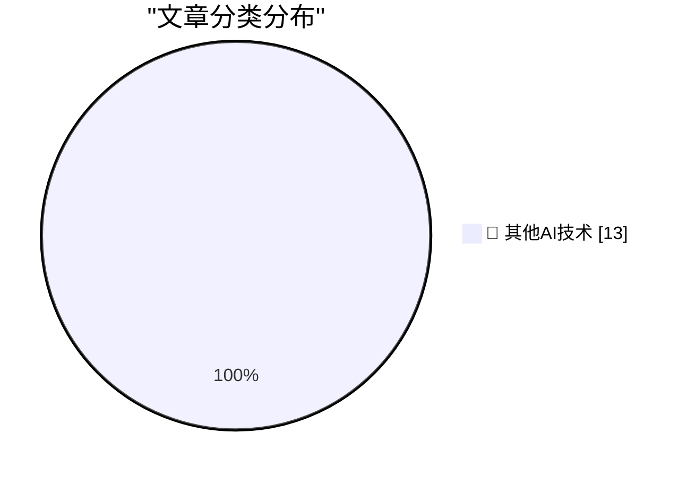

# 📰 AI 博客每日精选 — 2026-10-28

> 来自 98 个技术博客和社交媒体源，AI 精选 Top 13

## 🏆 今日必读

🥇 **Noctua Fan Swap on a Calnex Rb/GPS Frequency Reference**

[Noctua Fan Swap on a Calnex Rb/GPS Frequency Reference](https://www.jeffgeerling.com/blog/2026/noctua-fan-swap-calnex-rb-gps-frequency-reference/) — jeffgeerling.com · 7 小时前 · 🔬 其他AI技术

> Noctua Fan Swap on a Calnex Rb/GPS Frequency Reference

🥈 **Siri AI Expands to More Languages in OS 27.2**

[Siri AI Expands to More Languages in OS 27.2](https://nr.apple.com/Du9G9W8Nq1) — daringfireball.net · 1 小时前 · 🔬 其他AI技术

> Siri AI Expands to More Languages in OS 27.2

🥉 **Apple Creator Studio Updated With a Slew of AI Features, Along With a New Open JSON File Format for Keynote**

[Apple Creator Studio Updated With a Slew of AI Features, Along With a New Open JSON File Format for Keynote](https://www.apple.com/newsroom/2026/10/apple-creator-studio-adds-powerful-new-ai-features-and-even-more-creative-tools/) — daringfireball.net · 2 小时前 · 🔬 其他AI技术

> Apple Creator Studio Updated With a Slew of AI Features, Along With a New Open JSON File Format for Keynote

4️⃣ **★ Prestructured WYSIWYG**

[★ Prestructured WYSIWYG](https://daringfireball.net/2026/10/prestructured_wysiwyg) — daringfireball.net · 2 小时前 · 🔬 其他AI技术

> ★ Prestructured WYSIWYG

5️⃣ **What’s Left for ‘Pro and Tell’ Week: Touch-Enabled OLED MacBooks**

[What’s Left for ‘Pro and Tell’ Week: Touch-Enabled OLED MacBooks](https://www.macrumors.com/2026/10/27/macbook-pro-with-touchscreen-tomorrow/) — daringfireball.net · 6 小时前 · 🔬 其他AI技术

> What’s Left for ‘Pro and Tell’ Week: Touch-Enabled OLED MacBooks

---

## 📊 数据概览

| 扫描源 | 抓取文章 | 时间范围 | 精选 |
|:---:|:---:|:---:|:---:|
| 64/98 | 2000 篇 → 13 篇 | 24h | **13 篇** |

### 分类分布

---

====================

## 🔬 其他AI技术

### 1. Noctua Fan Swap on a Calnex Rb/GPS Frequency Reference

[Noctua Fan Swap on a Calnex Rb/GPS Frequency Reference](https://www.jeffgeerling.com/blog/2026/noctua-fan-swap-calnex-rb-gps-frequency-reference/) — **jeffgeerling.com** · 7 小时前 · ⭐ 15/25

> Noctua Fan Swap on a Calnex Rb/GPS Frequency Reference

📌 其他AI技术

---

### 2. Siri AI Expands to More Languages in OS 27.2

[Siri AI Expands to More Languages in OS 27.2](https://nr.apple.com/Du9G9W8Nq1) — **daringfireball.net** · 1 小时前 · ⭐ 15/25

> Siri AI Expands to More Languages in OS 27.2

📌 其他AI技术

---

### 3. Apple Creator Studio Updated With a Slew of AI Features, Along With a New Open JSON File Format for Keynote

[Apple Creator Studio Updated With a Slew of AI Features, Along With a New Open JSON File Format for Keynote](https://www.apple.com/newsroom/2026/10/apple-creator-studio-adds-powerful-new-ai-features-and-even-more-creative-tools/) — **daringfireball.net** · 2 小时前 · ⭐ 15/25

> Apple Creator Studio Updated With a Slew of AI Features, Along With a New Open JSON File Format for Keynote

📌 其他AI技术

---

### 4. ★ Prestructured WYSIWYG

[★ Prestructured WYSIWYG](https://daringfireball.net/2026/10/prestructured_wysiwyg) — **daringfireball.net** · 2 小时前 · ⭐ 15/25

> ★ Prestructured WYSIWYG

📌 其他AI技术

---

### 5. What’s Left for ‘Pro and Tell’ Week: Touch-Enabled OLED MacBooks

[What’s Left for ‘Pro and Tell’ Week: Touch-Enabled OLED MacBooks](https://www.macrumors.com/2026/10/27/macbook-pro-with-touchscreen-tomorrow/) — **daringfireball.net** · 6 小时前 · ⭐ 15/25

> What’s Left for ‘Pro and Tell’ Week: Touch-Enabled OLED MacBooks

📌 其他AI技术

---

### 6. Apple Also Announces iMac With M6

[Apple Also Announces iMac With M6](https://www.apple.com/newsroom/2026/10/apple-unveils-new-imac-with-m6/) — **daringfireball.net** · 7 小时前 · ⭐ 15/25

> Apple Also Announces iMac With M6

📌 其他AI技术

---

### 7. [Sponsor] WorkOS: Let Agents Sign Up for Your App Without a Browser

[[Sponsor] WorkOS: Let Agents Sign Up for Your App Without a Browser](https://workos.com/auth-md?utm_source=daringfireball&amp;utm_medium=newsletter&amp;utm_campaign=q42026) — **daringfireball.net** · 8 小时前 · ⭐ 15/25

> [Sponsor] WorkOS: Let Agents Sign Up for Your App Without a Browser

📌 其他AI技术

---

### 8. Apple Introduces New Base MacBook Pro With M6, 14-Inch-Only

[Apple Introduces New Base MacBook Pro With M6, 14-Inch-Only](https://www.apple.com/newsroom/2026/10/apple-introduces-the-new-14-inch-macbook-pro-with-m6/) — **daringfireball.net** · 8 小时前 · ⭐ 15/25

> Apple Introduces New Base MacBook Pro With M6, 14-Inch-Only

📌 其他AI技术

---

### 9. The NYT Seemingly Does Marissa Mayer Dirty

[The NYT Seemingly Does Marissa Mayer Dirty](https://www.nytimes.com/2026/10/25/style/marissa-mayer-ai-assistants-women.html?unlocked_article_code=1.L1E.xBwx.X_EjBGNsRNqr) — **daringfireball.net** · 23 小时前 · ⭐ 15/25

> The NYT Seemingly Does Marissa Mayer Dirty

📌 其他AI技术

---

### 10. Pluralistic: History is something you do (27 Oct 2026)

[Pluralistic: History is something you do (27 Oct 2026)](https://pluralistic.net/2026/10/27/tied-to-the-tracks/) — **pluralistic.net** · 15 小时前 · ⭐ 15/25

> Pluralistic: History is something you do (27 Oct 2026)

📌 其他AI技术

---

### 11. Book Review: You Could Do Something Amazing with Your Life [You Are Raoul Moat] - Andrew Hankinson ★★★★☆

[Book Review: You Could Do Something Amazing with Your Life [You Are Raoul Moat] - Andrew Hankinson ★★★★☆](https://shkspr.mobi/blog/2026/10/book-review-you-could-do-something-amazing-with-your-life-you-are-raoul-moat-andrew-hankinson/) — **shkspr.mobi** · 11 小时前 · ⭐ 15/25

> Book Review: You Could Do Something Amazing with Your Life [You Are Raoul Moat] - Andrew Hankinson ★★★★☆

📌 其他AI技术

---

### 12. IBM PC 5150 Revision A vs Revision B

[IBM PC 5150 Revision A vs Revision B](https://dfarq.homeip.net/ibm-pc-5150-revision-a-vs-revision-b/?utm_source=rss&#038;utm_medium=rss&#038;utm_campaign=ibm-pc-5150-revision-a-vs-revision-b) — **dfarq.homeip.net** · 13 小时前 · ⭐ 15/25

> IBM PC 5150 Revision A vs Revision B

📌 其他AI技术

---

### 13. I'm Full-Time Open Source Developer Now

[I'm Full-Time Open Source Developer Now](https://blog.miguelgrinberg.com/post/i-m-full-time-open-source-developer-now) — **miguelgrinberg.com** · 8 小时前 · ⭐ 15/25

> I'm Full-Time Open Source Developer Now

📌 其他AI技术

---

====================

*生成于 2026-10-28 00:13 | 扫描 64 源 → 获取 2000 篇 → 精选 13 篇*
*基于 [Hacker News Popularity Contest 2025](https://refactoringenglish.com/tools/hn-popularity/) RSS 源列表，由 [Andrej Karpathy](https://x.com/karpathy) 推荐*
*由「懂点儿AI」制作，欢迎关注同名微信公众号获取更多 AI 实用技巧 💡*
