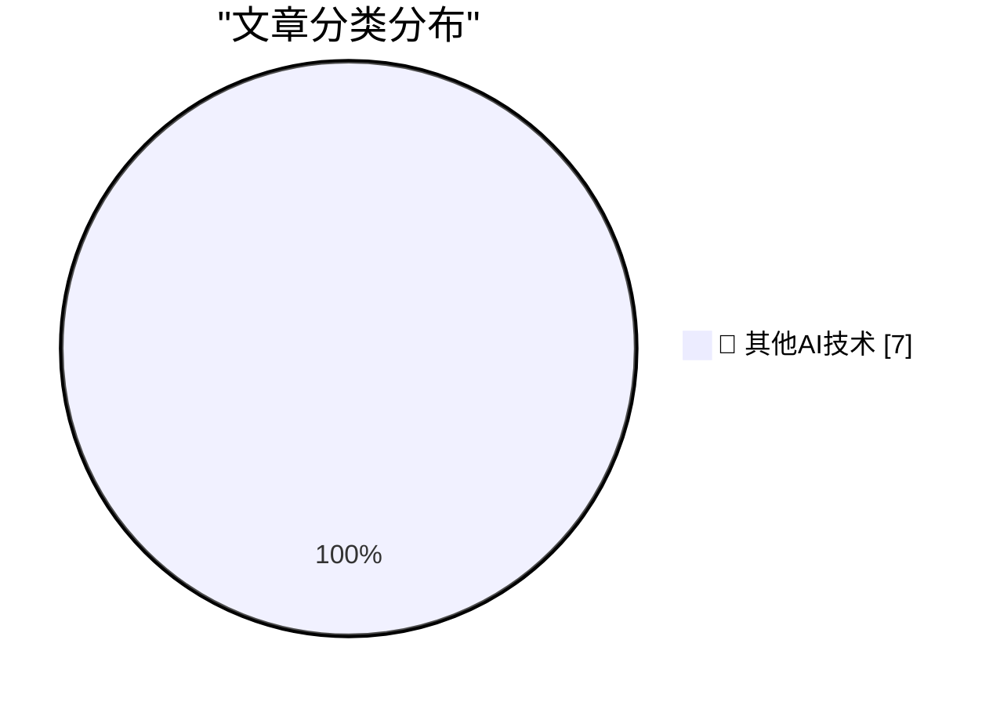

# 📰 AI 博客每日精选 — 2026-10-29

> 来自 98 个技术博客和社交媒体源，AI 精选 Top 7

## 🏆 今日必读

🥇 **Guessing the Name: MacBook Studio?**

[Guessing the Name: MacBook Studio?](https://www.macrumors.com/2026/10/28/macbook-studio/) — daringfireball.net · 9 小时前 · 🔬 其他AI技术

> Guessing the Name: MacBook Studio?

🥈 **Pluralistic: Agents vs ecommerce (28 Oct 2026)**

[Pluralistic: Agents vs ecommerce (28 Oct 2026)](https://pluralistic.net/2026/10/28/principle-agent-problem/) — pluralistic.net · 13 小时前 · 🔬 其他AI技术

> Pluralistic: Agents vs ecommerce (28 Oct 2026)

🥉 **Gadget Review: SoundPEATS CC3 Pro Bluetooth Headphones ★★★★⯪**

[Gadget Review: SoundPEATS CC3 Pro Bluetooth Headphones ★★★★⯪](https://shkspr.mobi/blog/2026/10/gadget-review-soundpeats-cc3-pro-bluetooth-headphones/) — shkspr.mobi · 11 小时前 · 🔬 其他AI技术

> Gadget Review: SoundPEATS CC3 Pro Bluetooth Headphones ★★★★⯪

4️⃣ **C++/WinRT overcorrection: Using make_self and immediately converting it to the projected interface**

[C++/WinRT overcorrection: Using make_self and immediately converting it to the projected interface](https://devblogs.microsoft.com/oldnewthing/20261028-00/?p=112803/) — devblogs.microsoft.com/oldnewthing · 10 小时前 · 🔬 其他AI技术

> C++/WinRT overcorrection: Using make_self and immediately converting it to the projected interface

5️⃣ **This Week in Source Control: 28 October 2026**

[This Week in Source Control: 28 October 2026](https://nesbitt.io/2026/10/28/this-week-in-source-control.html) — nesbitt.io · 14 小时前 · 🔬 其他AI技术

> This Week in Source Control: 28 October 2026

---

## 📊 数据概览

| 扫描源 | 抓取文章 | 时间范围 | 精选 |
|:---:|:---:|:---:|:---:|
| 64/98 | 2000 篇 → 7 篇 | 24h | **7 篇** |

### 分类分布

---

====================

## 🔬 其他AI技术

### 1. Guessing the Name: MacBook Studio?

[Guessing the Name: MacBook Studio?](https://www.macrumors.com/2026/10/28/macbook-studio/) — **daringfireball.net** · 9 小时前 · ⭐ 15/25

> Guessing the Name: MacBook Studio?

📌 其他AI技术

---

### 2. Pluralistic: Agents vs ecommerce (28 Oct 2026)

[Pluralistic: Agents vs ecommerce (28 Oct 2026)](https://pluralistic.net/2026/10/28/principle-agent-problem/) — **pluralistic.net** · 13 小时前 · ⭐ 15/25

> Pluralistic: Agents vs ecommerce (28 Oct 2026)

📌 其他AI技术

---

### 3. Gadget Review: SoundPEATS CC3 Pro Bluetooth Headphones ★★★★⯪

[Gadget Review: SoundPEATS CC3 Pro Bluetooth Headphones ★★★★⯪](https://shkspr.mobi/blog/2026/10/gadget-review-soundpeats-cc3-pro-bluetooth-headphones/) — **shkspr.mobi** · 11 小时前 · ⭐ 15/25

> Gadget Review: SoundPEATS CC3 Pro Bluetooth Headphones ★★★★⯪

📌 其他AI技术

---

### 4. C++/WinRT overcorrection: Using make_self and immediately converting it to the projected interface

[C++/WinRT overcorrection: Using make_self and immediately converting it to the projected interface](https://devblogs.microsoft.com/oldnewthing/20261028-00/?p=112803/) — **devblogs.microsoft.com/oldnewthing** · 10 小时前 · ⭐ 15/25

> C++/WinRT overcorrection: Using make_self and immediately converting it to the projected interface

📌 其他AI技术

---

### 5. This Week in Source Control: 28 October 2026

[This Week in Source Control: 28 October 2026](https://nesbitt.io/2026/10/28/this-week-in-source-control.html) — **nesbitt.io** · 14 小时前 · ⭐ 15/25

> This Week in Source Control: 28 October 2026

📌 其他AI技术

---

### 6. Exit Liquidity

[Exit Liquidity](https://www.wheresyoured.at/exit-liquidity/) — **wheresyoured.at** · 6 小时前 · ⭐ 15/25

> Exit Liquidity

📌 其他AI技术

---

### 7. TI-99/4A discontinued October 28, 1983

[TI-99/4A discontinued October 28, 1983](https://dfarq.homeip.net/ti-99-4a-discontinued-october-28-1983/?utm_source=rss&#038;utm_medium=rss&#038;utm_campaign=ti-99-4a-discontinued-october-28-1983) — **dfarq.homeip.net** · 13 小时前 · ⭐ 15/25

> TI-99/4A discontinued October 28, 1983

📌 其他AI技术

---

====================

*生成于 2026-10-29 00:34 | 扫描 64 源 → 获取 2000 篇 → 精选 7 篇*
*基于 [Hacker News Popularity Contest 2025](https://refactoringenglish.com/tools/hn-popularity/) RSS 源列表，由 [Andrej Karpathy](https://x.com/karpathy) 推荐*
*由「懂点儿AI」制作，欢迎关注同名微信公众号获取更多 AI 实用技巧 💡*
