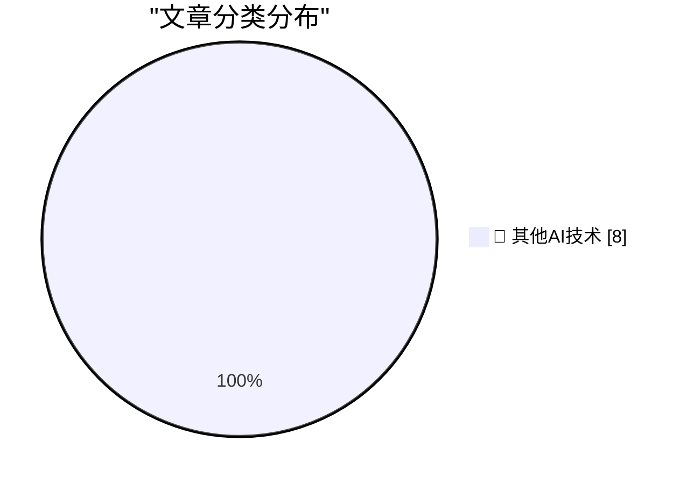

# 📰 AI 博客每日精选 — 2026-10-30

> 来自 98 个技术博客和社交媒体源，AI 精选 Top 8

## 🏆 今日必读

🥇 **Apple Drops App Store Commission by a Whopping 4 Percentage Points in Taiwan**

[Apple Drops App Store Commission by a Whopping 4 Percentage Points in Taiwan](https://developer.apple.com/news/?id=w9mxlhek) — daringfireball.net · 3 小时前 · 🔬 其他AI技术

> Apple Drops App Store Commission by a Whopping 4 Percentage Points in Taiwan

🥈 **A Health Update From Craig Hockenberry**

[A Health Update From Craig Hockenberry](https://furbo.org/2026/10/28/a-health-update/) — daringfireball.net · 4 小时前 · 🔬 其他AI技术

> A Health Update From Craig Hockenberry

🥉 **Rolfe Winkler at The WSJ: ‘The Beleaguered Chip Sellers Getting Their Revenge on Apple’**

[Rolfe Winkler at The WSJ: ‘The Beleaguered Chip Sellers Getting Their Revenge on Apple’](https://www.wsj.com/tech/apple-iphone-memory-chips-ai-c0084cc9?st=FNAyaT) — daringfireball.net · 4 小时前 · 🔬 其他AI技术

> Rolfe Winkler at The WSJ: ‘The Beleaguered Chip Sellers Getting Their Revenge on Apple’

4️⃣ **The Space Shuttle Discovery’s Starboard Side ‘s’ Is Upside Down**

[The Space Shuttle Discovery’s Starboard Side ‘s’ Is Upside Down](https://www.theautopian.com/a-typography-geek-pointed-out-something-about-the-space-shuttle-discovery-and-now-i-cant-unsee-it/) — daringfireball.net · 9 小时前 · 🔬 其他AI技术

> The Space Shuttle Discovery’s Starboard Side ‘s’ Is Upside Down

5️⃣ **Steven Levy on the New MacBook Pro, With, Yes, a Touchscreen**

[Steven Levy on the New MacBook Pro, With, Yes, a Touchscreen](https://www.wired.com/story/the-inside-story-of-why-apple-finally-brought-a-touch-display-to-the-mac/) — daringfireball.net · 20 小时前 · 🔬 其他AI技术

> Steven Levy on the New MacBook Pro, With, Yes, a Touchscreen

---

## 📊 数据概览

| 扫描源 | 抓取文章 | 时间范围 | 精选 |
|:---:|:---:|:---:|:---:|
| 65/98 | 2031 篇 → 8 篇 | 24h | **8 篇** |

### 分类分布

---

====================

## 🔬 其他AI技术

### 1. Apple Drops App Store Commission by a Whopping 4 Percentage Points in Taiwan

[Apple Drops App Store Commission by a Whopping 4 Percentage Points in Taiwan](https://developer.apple.com/news/?id=w9mxlhek) — **daringfireball.net** · 3 小时前 · ⭐ 15/25

> Apple Drops App Store Commission by a Whopping 4 Percentage Points in Taiwan

📌 其他AI技术

---

### 2. A Health Update From Craig Hockenberry

[A Health Update From Craig Hockenberry](https://furbo.org/2026/10/28/a-health-update/) — **daringfireball.net** · 4 小时前 · ⭐ 15/25

> A Health Update From Craig Hockenberry

📌 其他AI技术

---

### 3. Rolfe Winkler at The WSJ: ‘The Beleaguered Chip Sellers Getting Their Revenge on Apple’

[Rolfe Winkler at The WSJ: ‘The Beleaguered Chip Sellers Getting Their Revenge on Apple’](https://www.wsj.com/tech/apple-iphone-memory-chips-ai-c0084cc9?st=FNAyaT) — **daringfireball.net** · 4 小时前 · ⭐ 15/25

> Rolfe Winkler at The WSJ: ‘The Beleaguered Chip Sellers Getting Their Revenge on Apple’

📌 其他AI技术

---

### 4. The Space Shuttle Discovery’s Starboard Side ‘s’ Is Upside Down

[The Space Shuttle Discovery’s Starboard Side ‘s’ Is Upside Down](https://www.theautopian.com/a-typography-geek-pointed-out-something-about-the-space-shuttle-discovery-and-now-i-cant-unsee-it/) — **daringfireball.net** · 9 小时前 · ⭐ 15/25

> The Space Shuttle Discovery’s Starboard Side ‘s’ Is Upside Down

📌 其他AI技术

---

### 5. Steven Levy on the New MacBook Pro, With, Yes, a Touchscreen

[Steven Levy on the New MacBook Pro, With, Yes, a Touchscreen](https://www.wired.com/story/the-inside-story-of-why-apple-finally-brought-a-touch-display-to-the-mac/) — **daringfireball.net** · 20 小时前 · ⭐ 15/25

> Steven Levy on the New MacBook Pro, With, Yes, a Touchscreen

📌 其他AI技术

---

### 6. What I learned about power from LBJ and Robert Moses

[What I learned about power from LBJ and Robert Moses](https://www.dwarkesh.com/p/lessons-in-power) — **dwarkesh.com** · 7 小时前 · ⭐ 15/25

> What I learned about power from LBJ and Robert Moses

📌 其他AI技术

---

### 7. Celebrating SIM Cards

[Celebrating SIM Cards](https://blog.jim-nielsen.com/2026/celebrating-sim-cards/) — **blog.jim-nielsen.com** · 5 小时前 · ⭐ 15/25

> Celebrating SIM Cards

📌 其他AI技术

---

### 8. IBM’s 2018 Red Hat acquisition

[IBM’s 2018 Red Hat acquisition](https://dfarq.homeip.net/ibms-2018-red-hat-acquisition/?utm_source=rss&#038;utm_medium=rss&#038;utm_campaign=ibms-2018-red-hat-acquisition) — **dfarq.homeip.net** · 13 小时前 · ⭐ 15/25

> IBM’s 2018 Red Hat acquisition

📌 其他AI技术

---

====================

*生成于 2026-10-30 00:33 | 扫描 65 源 → 获取 2031 篇 → 精选 8 篇*
*基于 [Hacker News Popularity Contest 2025](https://refactoringenglish.com/tools/hn-popularity/) RSS 源列表，由 [Andrej Karpathy](https://x.com/karpathy) 推荐*
*由「懂点儿AI」制作，欢迎关注同名微信公众号获取更多 AI 实用技巧 💡*
