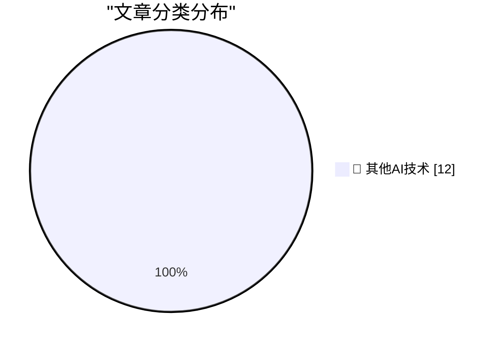

# 📰 AI 博客每日精选 — 2026-10-31

> 来自 98 个技术博客和社交媒体源，AI 精选 Top 12

## 🏆 今日必读

🥇 **Rejoice, leap seconds are dead!**

[Rejoice, leap seconds are dead!](https://www.jeffgeerling.com/blog/2026/rejoice-the-utc-leap-second-is-dead/) — jeffgeerling.com · 10 小时前 · 🔬 其他AI技术

> Rejoice, leap seconds are dead!

🥈 **Sponsorship Openings for Daring Fireball (Including The Talk Show)**

[Sponsorship Openings for Daring Fireball (Including The Talk Show)](https://daringfireball.net/feeds/sponsors/) — daringfireball.net · 1 小时前 · 🔬 其他AI技术

> Sponsorship Openings for Daring Fireball (Including The Talk Show)

🥉 **★ MacBook Pro Pricing and Configurations for M6, M5 Pro, and M5 Max**

[★ MacBook Pro Pricing and Configurations for M6, M5 Pro, and M5 Max](https://daringfireball.net/2026/10/macbook_pro_pricing_and_configurations_for_m6_m5_pro_and_m5_max) — daringfireball.net · 2 小时前 · 🔬 其他AI技术

> ★ MacBook Pro Pricing and Configurations for M6, M5 Pro, and M5 Max

4️⃣ **The Only Good Easter Eggs Are Whole-Assed Easter Eggs**

[The Only Good Easter Eggs Are Whole-Assed Easter Eggs](https://unsung.aresluna.org/apples-ipod-recreation/) — daringfireball.net · 6 小时前 · 🔬 其他AI技术

> The Only Good Easter Eggs Are Whole-Assed Easter Eggs

5️⃣ **GM to Pay $220 Million After Betraying Their Own Drivers’ Privacy**

[GM to Pay $220 Million After Betraying Their Own Drivers’ Privacy](https://www.reuters.com/business/autos-transportation/gm-pay-220-million-settle-allegations-it-violated-consumers-privacy-2026-10-29/) — daringfireball.net · 7 小时前 · 🔬 其他AI技术

> GM to Pay $220 Million After Betraying Their Own Drivers’ Privacy

---

## 📊 数据概览

| 扫描源 | 抓取文章 | 时间范围 | 精选 |
|:---:|:---:|:---:|:---:|
| 64/98 | 1986 篇 → 12 篇 | 24h | **12 篇** |

### 分类分布

---

====================

## 🔬 其他AI技术

### 1. Rejoice, leap seconds are dead!

[Rejoice, leap seconds are dead!](https://www.jeffgeerling.com/blog/2026/rejoice-the-utc-leap-second-is-dead/) — **jeffgeerling.com** · 10 小时前 · ⭐ 15/25

> Rejoice, leap seconds are dead!

📌 其他AI技术

---

### 2. Sponsorship Openings for Daring Fireball (Including The Talk Show)

[Sponsorship Openings for Daring Fireball (Including The Talk Show)](https://daringfireball.net/feeds/sponsors/) — **daringfireball.net** · 1 小时前 · ⭐ 15/25

> Sponsorship Openings for Daring Fireball (Including The Talk Show)

📌 其他AI技术

---

### 3. ★ MacBook Pro Pricing and Configurations for M6, M5 Pro, and M5 Max

[★ MacBook Pro Pricing and Configurations for M6, M5 Pro, and M5 Max](https://daringfireball.net/2026/10/macbook_pro_pricing_and_configurations_for_m6_m5_pro_and_m5_max) — **daringfireball.net** · 2 小时前 · ⭐ 15/25

> ★ MacBook Pro Pricing and Configurations for M6, M5 Pro, and M5 Max

📌 其他AI技术

---

### 4. The Only Good Easter Eggs Are Whole-Assed Easter Eggs

[The Only Good Easter Eggs Are Whole-Assed Easter Eggs](https://unsung.aresluna.org/apples-ipod-recreation/) — **daringfireball.net** · 6 小时前 · ⭐ 15/25

> The Only Good Easter Eggs Are Whole-Assed Easter Eggs

📌 其他AI技术

---

### 5. GM to Pay $220 Million After Betraying Their Own Drivers’ Privacy

[GM to Pay $220 Million After Betraying Their Own Drivers’ Privacy](https://www.reuters.com/business/autos-transportation/gm-pay-220-million-settle-allegations-it-violated-consumers-privacy-2026-10-29/) — **daringfireball.net** · 7 小时前 · ⭐ 15/25

> GM to Pay $220 Million After Betraying Their Own Drivers’ Privacy

📌 其他AI技术

---

### 6. Patrick Stewart Dies at 86

[Patrick Stewart Dies at 86](https://www.hollywoodreporter.com/movies/movie-news/patrick-stewart-dead-star-trek-x-men-1236742932/) — **daringfireball.net** · 7 小时前 · ⭐ 15/25

> Patrick Stewart Dies at 86

📌 其他AI技术

---

### 7. College will only cost $20 a month

[College will only cost $20 a month](https://idiallo.com/blog/college-will-cost-20-dollars) — **idiallo.com** · 44 分钟前 · ⭐ 15/25

> College will only cost $20 a month

📌 其他AI技术

---

### 8. Book Review: The God of Small Things by Arundhati Roy ★★☆☆☆

[Book Review: The God of Small Things by Arundhati Roy ★★☆☆☆](https://shkspr.mobi/blog/2026/10/book-review-the-god-of-small-things-by-arundhati-roy/) — **shkspr.mobi** · 11 小时前 · ⭐ 15/25

> Book Review: The God of Small Things by Arundhati Roy ★★☆☆☆

📌 其他AI技术

---

### 9. Signing and Attestations Across Package Registries

[Signing and Attestations Across Package Registries](https://nesbitt.io/2026/10/30/signing-and-attestations-across-package-registries.html) — **nesbitt.io** · 14 小时前 · ⭐ 15/25

> Signing and Attestations Across Package Registries

📌 其他AI技术

---

### 10. Robert Caro – The master biographer reflects at 91

[Robert Caro – The master biographer reflects at 91](https://www.dwarkesh.com/p/robert-caro) — **dwarkesh.com** · 7 小时前 · ⭐ 15/25

> Robert Caro – The master biographer reflects at 91

📌 其他AI技术

---

### 11. This Week on The Analog Antiquarian

[This Week on The Analog Antiquarian](https://www.filfre.net/2026/10/this-week-on-the-analog-antiquarian/) — **filfre.net** · 7 小时前 · ⭐ 15/25

> This Week on The Analog Antiquarian

📌 其他AI技术

---

### 12. When Federico Faggin left Intel

[When Federico Faggin left Intel](https://dfarq.homeip.net/when-federico-faggin-left-intel/?utm_source=rss&#038;utm_medium=rss&#038;utm_campaign=when-federico-faggin-left-intel) — **dfarq.homeip.net** · 13 小时前 · ⭐ 15/25

> When Federico Faggin left Intel

📌 其他AI技术

---

====================

*生成于 2026-10-31 00:19 | 扫描 64 源 → 获取 1986 篇 → 精选 12 篇*
*基于 [Hacker News Popularity Contest 2025](https://refactoringenglish.com/tools/hn-popularity/) RSS 源列表，由 [Andrej Karpathy](https://x.com/karpathy) 推荐*
*由「懂点儿AI」制作，欢迎关注同名微信公众号获取更多 AI 实用技巧 💡*
