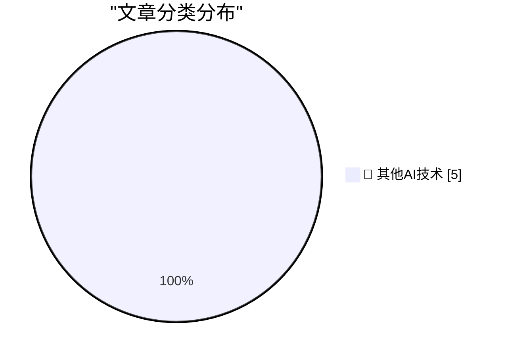

# 📰 AI 博客每日精选 — 2026-10-31

> 来自 98 个技术博客和社交媒体源，AI 精选 Top 5

## 🏆 今日必读

🥇 **Pluralistic: Formalities (31 Oct 2026)**

[Pluralistic: Formalities (31 Oct 2026)](https://pluralistic.net/2026/10/31/burn-berne/) — pluralistic.net · 8 小时前 · 🔬 其他AI技术

> Pluralistic: Formalities (31 Oct 2026)

🥈 **Gig Review: The Witcher in Concert ★★★★☆**

[Gig Review: The Witcher in Concert ★★★★☆](https://shkspr.mobi/blog/2026/10/gig-review-the-witcher-in-concert/) — shkspr.mobi · 11 小时前 · 🔬 其他AI技术

> Gig Review: The Witcher in Concert ★★★★☆

🥉 **Notes from October 2026**

[Notes from October 2026](https://evanhahn.com/notes-from-october-2026/) — evanhahn.com · 17 小时前 · 🔬 其他AI技术

> Notes from October 2026

4️⃣ **This Week in Package Management: 31 October 2026**

[This Week in Package Management: 31 October 2026](https://nesbitt.io/2026/10/31/this-week-in-package-management.html) — nesbitt.io · 13 小时前 · 🔬 其他AI技术

> This Week in Package Management: 31 October 2026

5️⃣ **Johnston’s Electric Trains, St. Louis**

[Johnston’s Electric Trains, St. Louis](https://dfarq.homeip.net/johnstons-electric-trains-st-louis/?utm_source=rss&#038;utm_medium=rss&#038;utm_campaign=johnstons-electric-trains-st-louis) — dfarq.homeip.net · 12 小时前 · 🔬 其他AI技术

> Johnston’s Electric Trains, St. Louis

---

## 📊 数据概览

| 扫描源 | 抓取文章 | 时间范围 | 精选 |
|:---:|:---:|:---:|:---:|
| 65/98 | 2041 篇 → 5 篇 | 24h | **5 篇** |

### 分类分布

---

====================

## 🔬 其他AI技术

### 1. Pluralistic: Formalities (31 Oct 2026)

[Pluralistic: Formalities (31 Oct 2026)](https://pluralistic.net/2026/10/31/burn-berne/) — **pluralistic.net** · 8 小时前 · ⭐ 15/25

> Pluralistic: Formalities (31 Oct 2026)

📌 其他AI技术

---

### 2. Gig Review: The Witcher in Concert ★★★★☆

[Gig Review: The Witcher in Concert ★★★★☆](https://shkspr.mobi/blog/2026/10/gig-review-the-witcher-in-concert/) — **shkspr.mobi** · 11 小时前 · ⭐ 15/25

> Gig Review: The Witcher in Concert ★★★★☆

📌 其他AI技术

---

### 3. Notes from October 2026

[Notes from October 2026](https://evanhahn.com/notes-from-october-2026/) — **evanhahn.com** · 17 小时前 · ⭐ 15/25

> Notes from October 2026

📌 其他AI技术

---

### 4. This Week in Package Management: 31 October 2026

[This Week in Package Management: 31 October 2026](https://nesbitt.io/2026/10/31/this-week-in-package-management.html) — **nesbitt.io** · 13 小时前 · ⭐ 15/25

> This Week in Package Management: 31 October 2026

📌 其他AI技术

---

### 5. Johnston’s Electric Trains, St. Louis

[Johnston’s Electric Trains, St. Louis](https://dfarq.homeip.net/johnstons-electric-trains-st-louis/?utm_source=rss&#038;utm_medium=rss&#038;utm_campaign=johnstons-electric-trains-st-louis) — **dfarq.homeip.net** · 12 小时前 · ⭐ 15/25

> Johnston’s Electric Trains, St. Louis

📌 其他AI技术

---

====================

*生成于 2026-10-31 23:56 | 扫描 65 源 → 获取 2041 篇 → 精选 5 篇*
*基于 [Hacker News Popularity Contest 2025](https://refactoringenglish.com/tools/hn-popularity/) RSS 源列表，由 [Andrej Karpathy](https://x.com/karpathy) 推荐*
*由「懂点儿AI」制作，欢迎关注同名微信公众号获取更多 AI 实用技巧 💡*
