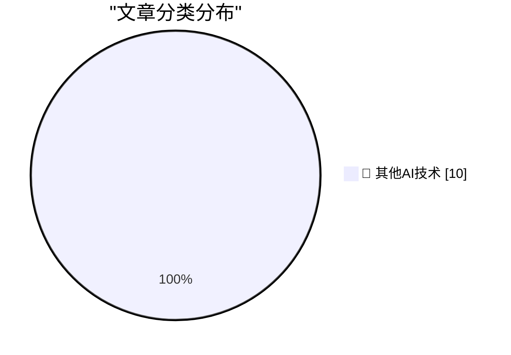

# 📰 AI 博客每日精选 — 2026-11-03

> 来自 98 个技术博客和社交媒体源，AI 精选 Top 10

## 🏆 今日必读

🥇 **LLMs are not superhuman at reading and writing neural network weights**

[LLMs are not superhuman at reading and writing neural network weights](https://seangoedecke.com/llms-are-not-superhuman-at-reading-and-writing-neural-network-weights/) — seangoedecke.com · 2 小时前 · 🔬 其他AI技术

> LLMs are not superhuman at reading and writing neural network weights

🥈 **Audience capture**

[Audience capture](https://seangoedecke.com/audience-capture/) — seangoedecke.com · 2 小时前 · 🔬 其他AI技术

> Audience capture

🥉 **Apple Announces Record $114.5B Fourth-Quarter Results**

[Apple Announces Record $114.5B Fourth-Quarter Results](https://sixcolors.com/post/2026/11/apple-announces-record-114-5b-fourth-quarter-results/) — daringfireball.net · 2 小时前 · 🔬 其他AI技术

> Apple Announces Record $114.5B Fourth-Quarter Results

4️⃣ **[Sponsor] OurCal**

[[Sponsor] OurCal](https://ourcal.com/?utm_source=daringfireball&amp;utm_medium=sponsorship&amp;utm_content=rssitem) — daringfireball.net · 4 小时前 · 🔬 其他AI技术

> [Sponsor] OurCal

5️⃣ **Prove you are not a child**

[Prove you are not a child](https://idiallo.com/blog/prove-you-are-not-a-child) — idiallo.com · 2 小时前 · 🔬 其他AI技术

> Prove you are not a child

---

## 📊 数据概览

| 扫描源 | 抓取文章 | 时间范围 | 精选 |
|:---:|:---:|:---:|:---:|
| 65/98 | 2042 篇 → 10 篇 | 24h | **10 篇** |

### 分类分布

---

====================

## 🔬 其他AI技术

### 1. LLMs are not superhuman at reading and writing neural network weights

[LLMs are not superhuman at reading and writing neural network weights](https://seangoedecke.com/llms-are-not-superhuman-at-reading-and-writing-neural-network-weights/) — **seangoedecke.com** · 2 小时前 · ⭐ 15/25

> LLMs are not superhuman at reading and writing neural network weights

📌 其他AI技术

---

### 2. Audience capture

[Audience capture](https://seangoedecke.com/audience-capture/) — **seangoedecke.com** · 2 小时前 · ⭐ 15/25

> Audience capture

📌 其他AI技术

---

### 3. Apple Announces Record $114.5B Fourth-Quarter Results

[Apple Announces Record $114.5B Fourth-Quarter Results](https://sixcolors.com/post/2026/11/apple-announces-record-114-5b-fourth-quarter-results/) — **daringfireball.net** · 2 小时前 · ⭐ 15/25

> Apple Announces Record $114.5B Fourth-Quarter Results

📌 其他AI技术

---

### 4. [Sponsor] OurCal

[[Sponsor] OurCal](https://ourcal.com/?utm_source=daringfireball&amp;utm_medium=sponsorship&amp;utm_content=rssitem) — **daringfireball.net** · 4 小时前 · ⭐ 15/25

> [Sponsor] OurCal

📌 其他AI技术

---

### 5. Prove you are not a child

[Prove you are not a child](https://idiallo.com/blog/prove-you-are-not-a-child) — **idiallo.com** · 2 小时前 · ⭐ 15/25

> Prove you are not a child

📌 其他AI技术

---

### 6. Pluralistic: Autodoxing (02 Nov 2026)

[Pluralistic: Autodoxing (02 Nov 2026)](https://pluralistic.net/2026/11/02/agony-verification/) — **pluralistic.net** · 18 小时前 · ⭐ 15/25

> Pluralistic: Autodoxing (02 Nov 2026)

📌 其他AI技术

---

### 7. Lorem Ipsum Dot Gov Dot UK

[Lorem Ipsum Dot Gov Dot UK](https://shkspr.mobi/blog/2026/11/lorem-ipsum-dot-gov-dot-uk/) — **shkspr.mobi** · 14 小时前 · ⭐ 15/25

> Lorem Ipsum Dot Gov Dot UK

📌 其他AI技术

---

### 8. Sneaking into the auditorium for the Windows 2000 launch rehearsal

[Sneaking into the auditorium for the Windows 2000 launch rehearsal](https://devblogs.microsoft.com/oldnewthing/20261102-00/?p=112818/) — **devblogs.microsoft.com/oldnewthing** · 11 小时前 · ⭐ 15/25

> Sneaking into the auditorium for the Windows 2000 launch rehearsal

📌 其他AI技术

---

### 9. Etoys.com and its rapid rise and fall

[Etoys.com and its rapid rise and fall](https://dfarq.homeip.net/etoys-com-and-its-rapid-rise-and-fall/?utm_source=rss&#038;utm_medium=rss&#038;utm_campaign=etoys-com-and-its-rapid-rise-and-fall) — **dfarq.homeip.net** · 14 小时前 · ⭐ 15/25

> Etoys.com and its rapid rise and fall

📌 其他AI技术

---

### 10. How to install an app on your Commodore 64

[How to install an app on your Commodore 64](https://anildash.com/2026/10/08/install-an-app-commodore-64/) — **anildash.com** · 1 小时前 · ⭐ 15/25

> How to install an app on your Commodore 64

📌 其他AI技术

---

====================

*生成于 2026-11-03 02:45 | 扫描 65 源 → 获取 2042 篇 → 精选 10 篇*
*基于 [Hacker News Popularity Contest 2025](https://refactoringenglish.com/tools/hn-popularity/) RSS 源列表，由 [Andrej Karpathy](https://x.com/karpathy) 推荐*
*由「懂点儿AI」制作，欢迎关注同名微信公众号获取更多 AI 实用技巧 💡*
