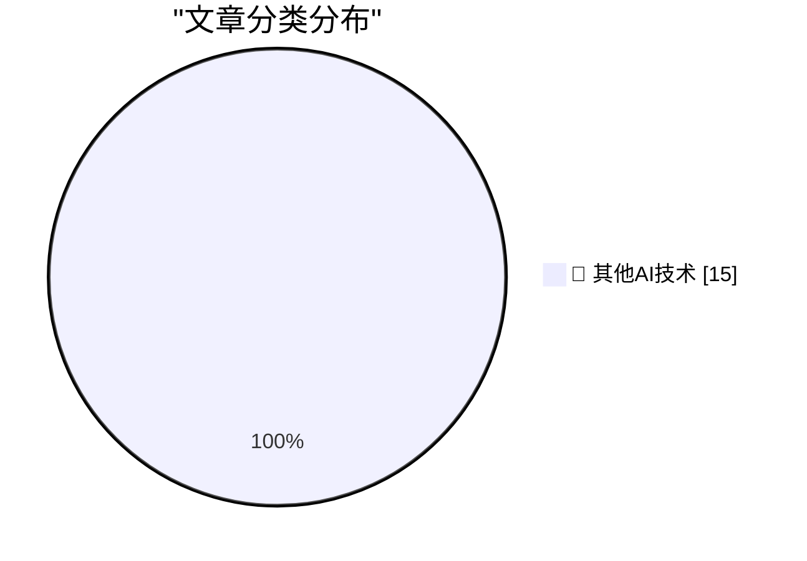

# 📰 AI 博客每日精选 — 2026-11-04

> 来自 98 个技术博客和社交媒体源，AI 精选 Top 15

## 🏆 今日必读

🥇 **Apple Begins Opening Siri AI to Developers**

[Apple Begins Opening Siri AI to Developers](https://developer.apple.com/news/?id=gdk2umrf) — daringfireball.net · 1 小时前 · 🔬 其他AI技术

> Apple Begins Opening Siri AI to Developers

🥈 **iPad Mini (A20 Pro) Review Roundup**

[iPad Mini (A20 Pro) Review Roundup](https://www.techmeme.com/261103/p15#a261103p15) — daringfireball.net · 1 小时前 · 🔬 其他AI技术

> iPad Mini (A20 Pro) Review Roundup

🥉 **MKBHD on the New A20 Pro iPad Mini**

[MKBHD on the New A20 Pro iPad Mini](https://www.youtube.com/watch?v=g6Die8gVFn0) — daringfireball.net · 1 小时前 · 🔬 其他AI技术

> MKBHD on the New A20 Pro iPad Mini

4️⃣ **Safari 27.3 Beta Adds Vertical Tabs and Adaptive Dark Mode**

[Safari 27.3 Beta Adds Vertical Tabs and Adaptive Dark Mode](https://www.macrumors.com/2026/11/03/ios-27-3-safari/) — daringfireball.net · 5 小时前 · 🔬 其他AI技术

> Safari 27.3 Beta Adds Vertical Tabs and Adaptive Dark Mode

5️⃣ **The New York Times (et al.) Sues Brave for Copyright Infringement, Selling Scraped Content to AI Companies for Model Training**

[The New York Times (et al.) Sues Brave for Copyright Infringement, Selling Scraped Content to AI Companies for Model Training](https://www.theverge.com/tech/1024588/brave-lawsuit-ai-scraping-new-york-times) — daringfireball.net · 9 小时前 · 🔬 其他AI技术

> The New York Times (et al.) Sues Brave for Copyright Infringement, Selling Scraped Content to AI Companies for Model Training

---

## 📊 数据概览

| 扫描源 | 抓取文章 | 时间范围 | 精选 |
|:---:|:---:|:---:|:---:|
| 65/98 | 2043 篇 → 16 篇 | 24h | **15 篇** |

### 分类分布

---

====================

## 🔬 其他AI技术

### 1. Apple Begins Opening Siri AI to Developers

[Apple Begins Opening Siri AI to Developers](https://developer.apple.com/news/?id=gdk2umrf) — **daringfireball.net** · 1 小时前 · ⭐ 15/25

> Apple Begins Opening Siri AI to Developers

📌 其他AI技术

---

### 2. iPad Mini (A20 Pro) Review Roundup

[iPad Mini (A20 Pro) Review Roundup](https://www.techmeme.com/261103/p15#a261103p15) — **daringfireball.net** · 1 小时前 · ⭐ 15/25

> iPad Mini (A20 Pro) Review Roundup

📌 其他AI技术

---

### 3. MKBHD on the New A20 Pro iPad Mini

[MKBHD on the New A20 Pro iPad Mini](https://www.youtube.com/watch?v=g6Die8gVFn0) — **daringfireball.net** · 1 小时前 · ⭐ 15/25

> MKBHD on the New A20 Pro iPad Mini

📌 其他AI技术

---

### 4. Safari 27.3 Beta Adds Vertical Tabs and Adaptive Dark Mode

[Safari 27.3 Beta Adds Vertical Tabs and Adaptive Dark Mode](https://www.macrumors.com/2026/11/03/ios-27-3-safari/) — **daringfireball.net** · 5 小时前 · ⭐ 15/25

> Safari 27.3 Beta Adds Vertical Tabs and Adaptive Dark Mode

📌 其他AI技术

---

### 5. The New York Times (et al.) Sues Brave for Copyright Infringement, Selling Scraped Content to AI Companies for Model Training

[The New York Times (et al.) Sues Brave for Copyright Infringement, Selling Scraped Content to AI Companies for Model Training](https://www.theverge.com/tech/1024588/brave-lawsuit-ai-scraping-new-york-times) — **daringfireball.net** · 9 小时前 · ⭐ 15/25

> The New York Times (et al.) Sues Brave for Copyright Infringement, Selling Scraped Content to AI Companies for Model Training

📌 其他AI技术

---

### 6. Steve Jobs on His Final Quarterly Analyst Call: ‘We Think the Open Versus Closed Argument Is Just a Smokescreen’

[Steve Jobs on His Final Quarterly Analyst Call: ‘We Think the Open Versus Closed Argument Is Just a Smokescreen’](https://www.macworld.com/article/208438/jobs_transcript.html) — **daringfireball.net** · 9 小时前 · ⭐ 15/25

> Steve Jobs on His Final Quarterly Analyst Call: ‘We Think the Open Versus Closed Argument Is Just a Smokescreen’

📌 其他AI技术

---

### 7. Chance Miller Reviews the New A20 Pro iPad Mini

[Chance Miller Reviews the New A20 Pro iPad Mini](https://9to5mac.com/2026/11/03/new-ipad-mini-a20-pro-review/) — **daringfireball.net** · 10 小时前 · ⭐ 15/25

> Chance Miller Reviews the New A20 Pro iPad Mini

📌 其他AI技术

---

### 8. Apple’s Analyst Calls Have Been Scripted for Decades

[Apple’s Analyst Calls Have Been Scripted for Decades](https://9to5mac.com/2026/11/03/apple-ceo-john-ternus-criticized-for-scripted-approach-to-first-earnings-call/) — **daringfireball.net** · 10 小时前 · ⭐ 15/25

> Apple’s Analyst Calls Have Been Scripted for Decades

📌 其他AI技术

---

### 9. Apple’s New iPhone Release Schedule Seems to Pay Off

[Apple’s New iPhone Release Schedule Seems to Pay Off](https://x.com/asymco/status/2117379158087278697) — **daringfireball.net** · 10 小时前 · ⭐ 15/25

> Apple’s New iPhone Release Schedule Seems to Pay Off

📌 其他AI技术

---

### 10. Pluralistic: Separable (03 Nov 2026)

[Pluralistic: Separable (03 Nov 2026)](https://pluralistic.net/2026/11/03/nobody-is-home/) — **pluralistic.net** · 10 小时前 · ⭐ 15/25

> Pluralistic: Separable (03 Nov 2026)

📌 其他AI技术

---

### 11. Just a little AI resistance, as a treat

[Just a little AI resistance, as a treat](https://shkspr.mobi/blog/2026/11/just-a-little-ai-resistance-as-a-treat/) — **shkspr.mobi** · 12 小时前 · ⭐ 15/25

> Just a little AI resistance, as a treat

📌 其他AI技术

---

### 12. How do you implement a random-access database when you don’t have random-access external storage?

[How do you implement a random-access database when you don’t have random-access external storage?](https://devblogs.microsoft.com/oldnewthing/20261103-00/?p=112825/) — **devblogs.microsoft.com/oldnewthing** · 10 小时前 · ⭐ 15/25

> How do you implement a random-access database when you don’t have random-access external storage?

📌 其他AI技术

---

### 13. New Article, Annual LFP Charity Discount

[New Article, Annual LFP Charity Discount](https://buttondown.com/hillelwayne/archive/new-article-annual-lfp-charity-discount/) — **buttondown.com/hillelwayne** · 6 小时前 · ⭐ 15/25

> New Article, Annual LFP Charity Discount

📌 其他AI技术

---

### 14. Running Dry

[Running Dry](https://www.wheresyoured.at/running-dry/) — **wheresyoured.at** · 7 小时前 · ⭐ 15/25

> Running Dry

📌 其他AI技术

---

### 15. Charles Tandy, the mastermind behind Radio Shack

[Charles Tandy, the mastermind behind Radio Shack](https://dfarq.homeip.net/charles-tandy-the-mastermind-behind-radio-shack/?utm_source=rss&#038;utm_medium=rss&#038;utm_campaign=charles-tandy-the-mastermind-behind-radio-shack) — **dfarq.homeip.net** · 13 小时前 · ⭐ 15/25

> Charles Tandy, the mastermind behind Radio Shack

📌 其他AI技术

---

====================

*生成于 2026-11-04 01:01 | 扫描 65 源 → 获取 2043 篇 → 精选 15 篇*
*基于 [Hacker News Popularity Contest 2025](https://refactoringenglish.com/tools/hn-popularity/) RSS 源列表，由 [Andrej Karpathy](https://x.com/karpathy) 推荐*
*由「懂点儿AI」制作，欢迎关注同名微信公众号获取更多 AI 实用技巧 💡*
