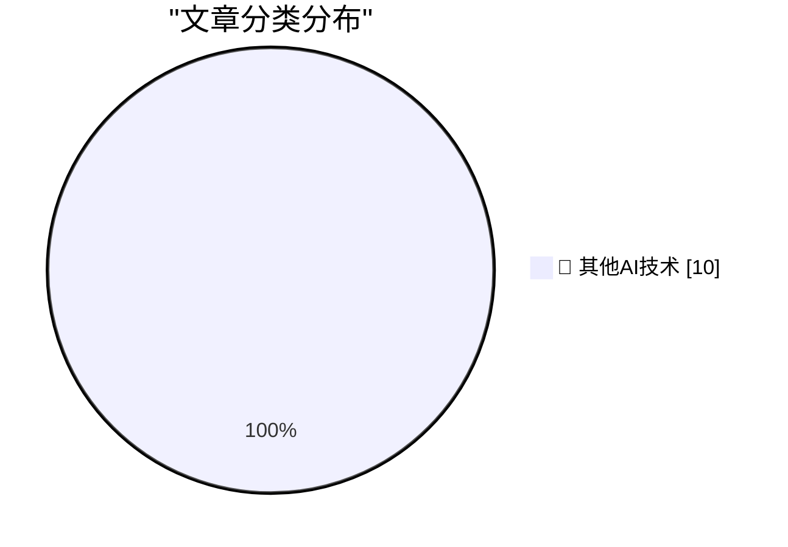

# 📰 AI 博客每日精选 — 2026-11-05

> 来自 98 个技术博客和社交媒体源，AI 精选 Top 10

## 🏆 今日必读

🥇 **This Election Will Not Look Surprising in History**

[This Election Will Not Look Surprising in History](https://apple.news/Afq6SKrYkTcCEHrCEQmxm5A?web_embed_link=aHR0cHM6Ly9uZXdzLWFzc2V0cy5hcHBsZS5jb20vZW1iZWRzLzY2ZDQzYzg0LTMyMWYtNGQ0Ny05Mzk4LWE3NjE3NDgwZWE2Yi9pbmRleC5odG1sI2NvbnRleHQ9TU9EQUwmc3RpY2t5PWZhbHNlJmVmZmVjdD1ub25lJmxpZ2h0X2JnX2NvbG9yPWU5ZWNmMiZkYXJrX2JnX2NvbG9yPTJkM2Q1NCZzY29wZT11cyZvcmlnaW49c2hhcnJvdyZsaXZlYWN0aXZpdGllcz10cnVlJm5mZl9jaWQ9NTZjMjQ1OTQtNDIxNC00NDM0LTlhNTgtNWE1YTIxM2ZkMTBi) — daringfireball.net · 10 小时前 · 🔬 其他AI技术

> This Election Will Not Look Surprising in History

🥈 **‘Political Reckoning Shatters Trump’s Grip on Washington’**

[‘Political Reckoning Shatters Trump’s Grip on Washington’](https://www.wsj.com/politics/elections/a-political-reckoning-shatters-trumps-grip-on-washington-bd3c7705?st=xABDit) — daringfireball.net · 10 小时前 · 🔬 其他AI技术

> ‘Political Reckoning Shatters Trump’s Grip on Washington’

🥉 **Goodhart's Law, but We Already Spent All Our Money**

[Goodhart's Law, but We Already Spent All Our Money](https://idiallo.com/blog/we-spent-all-our-money-goodharts-law) — idiallo.com · 17 小时前 · 🔬 其他AI技术

> Goodhart's Law, but We Already Spent All Our Money

4️⃣ **Pluralistic: The AI fatfinger economy has come for my receipts app (04 Nov 2026)**

[Pluralistic: The AI fatfinger economy has come for my receipts app (04 Nov 2026)](https://pluralistic.net/2026/11/04/genius-scan-is-neither/) — pluralistic.net · 13 小时前 · 🔬 其他AI技术

> Pluralistic: The AI fatfinger economy has come for my receipts app (04 Nov 2026)

5️⃣ **Book Review: Practice by Rosalind Brown ★★★★☆**

[Book Review: Practice by Rosalind Brown ★★★★☆](https://shkspr.mobi/blog/2026/11/book-review-practice-by-rosalind-brown/) — shkspr.mobi · 12 小时前 · 🔬 其他AI技术

> Book Review: Practice by Rosalind Brown ★★★★☆

---

## 📊 数据概览

| 扫描源 | 抓取文章 | 时间范围 | 精选 |
|:---:|:---:|:---:|:---:|
| 65/98 | 2043 篇 → 10 篇 | 24h | **10 篇** |

### 分类分布

---

====================

## 🔬 其他AI技术

### 1. This Election Will Not Look Surprising in History

[This Election Will Not Look Surprising in History](https://apple.news/Afq6SKrYkTcCEHrCEQmxm5A?web_embed_link=aHR0cHM6Ly9uZXdzLWFzc2V0cy5hcHBsZS5jb20vZW1iZWRzLzY2ZDQzYzg0LTMyMWYtNGQ0Ny05Mzk4LWE3NjE3NDgwZWE2Yi9pbmRleC5odG1sI2NvbnRleHQ9TU9EQUwmc3RpY2t5PWZhbHNlJmVmZmVjdD1ub25lJmxpZ2h0X2JnX2NvbG9yPWU5ZWNmMiZkYXJrX2JnX2NvbG9yPTJkM2Q1NCZzY29wZT11cyZvcmlnaW49c2hhcnJvdyZsaXZlYWN0aXZpdGllcz10cnVlJm5mZl9jaWQ9NTZjMjQ1OTQtNDIxNC00NDM0LTlhNTgtNWE1YTIxM2ZkMTBi) — **daringfireball.net** · 10 小时前 · ⭐ 15/25

> This Election Will Not Look Surprising in History

📌 其他AI技术

---

### 2. ‘Political Reckoning Shatters Trump’s Grip on Washington’

[‘Political Reckoning Shatters Trump’s Grip on Washington’](https://www.wsj.com/politics/elections/a-political-reckoning-shatters-trumps-grip-on-washington-bd3c7705?st=xABDit) — **daringfireball.net** · 10 小时前 · ⭐ 15/25

> ‘Political Reckoning Shatters Trump’s Grip on Washington’

📌 其他AI技术

---

### 3. Goodhart's Law, but We Already Spent All Our Money

[Goodhart's Law, but We Already Spent All Our Money](https://idiallo.com/blog/we-spent-all-our-money-goodharts-law) — **idiallo.com** · 17 小时前 · ⭐ 15/25

> Goodhart's Law, but We Already Spent All Our Money

📌 其他AI技术

---

### 4. Pluralistic: The AI fatfinger economy has come for my receipts app (04 Nov 2026)

[Pluralistic: The AI fatfinger economy has come for my receipts app (04 Nov 2026)](https://pluralistic.net/2026/11/04/genius-scan-is-neither/) — **pluralistic.net** · 13 小时前 · ⭐ 15/25

> Pluralistic: The AI fatfinger economy has come for my receipts app (04 Nov 2026)

📌 其他AI技术

---

### 5. Book Review: Practice by Rosalind Brown ★★★★☆

[Book Review: Practice by Rosalind Brown ★★★★☆](https://shkspr.mobi/blog/2026/11/book-review-practice-by-rosalind-brown/) — **shkspr.mobi** · 12 小时前 · ⭐ 15/25

> Book Review: Practice by Rosalind Brown ★★★★☆

📌 其他AI技术

---

### 6. There are things with ranks, but it’s not always clear what the ranks mean

[There are things with ranks, but it’s not always clear what the ranks mean](https://devblogs.microsoft.com/oldnewthing/20261104-00/?p=112830/) — **devblogs.microsoft.com/oldnewthing** · 10 小时前 · ⭐ 15/25

> There are things with ranks, but it’s not always clear what the ranks mean

📌 其他AI技术

---

### 7. This Week in Source Control: 4 November 2026

[This Week in Source Control: 4 November 2026](https://nesbitt.io/2026/11/04/this-week-in-source-control.html) — **nesbitt.io** · 15 小时前 · ⭐ 15/25

> This Week in Source Control: 4 November 2026

📌 其他AI技术

---

### 8. “It Gives Great Demo”

[“It Gives Great Demo”](https://blog.jim-nielsen.com/2026/it-gives-great-demo/) — **blog.jim-nielsen.com** · 6 小时前 · ⭐ 15/25

> “It Gives Great Demo”

📌 其他AI技术

---

### 9. The first Compaq computer

[The first Compaq computer](https://dfarq.homeip.net/first-compaq-computer/?utm_source=rss&#038;utm_medium=rss&#038;utm_campaign=first-compaq-computer) — **dfarq.homeip.net** · 13 小时前 · ⭐ 15/25

> The first Compaq computer

📌 其他AI技术

---

### 10. How to install an app on your Commodore 64

[How to install an app on your Commodore 64](https://anildash.com/2026/10/08/install-an-app-commodore-64/) — **anildash.com** · 1 小时前 · ⭐ 15/25

> How to install an app on your Commodore 64

📌 其他AI技术

---

====================

*生成于 2026-11-05 01:16 | 扫描 65 源 → 获取 2043 篇 → 精选 10 篇*
*基于 [Hacker News Popularity Contest 2025](https://refactoringenglish.com/tools/hn-popularity/) RSS 源列表，由 [Andrej Karpathy](https://x.com/karpathy) 推荐*
*由「懂点儿AI」制作，欢迎关注同名微信公众号获取更多 AI 实用技巧 💡*
