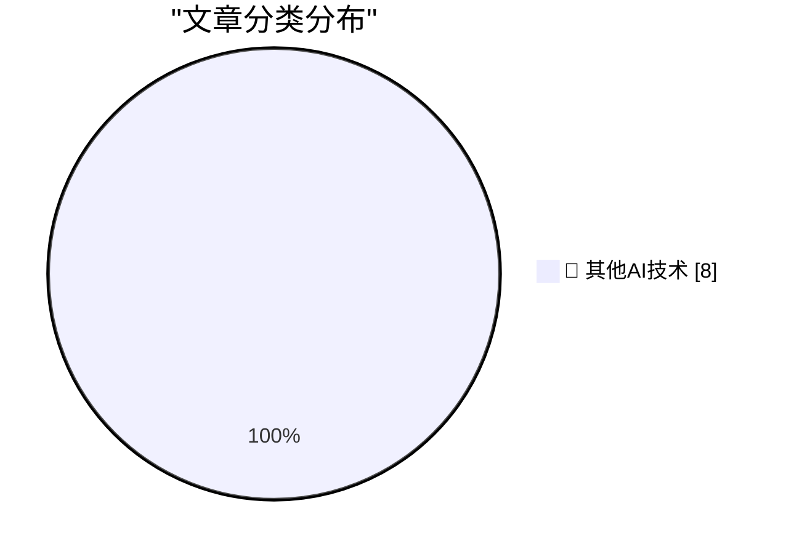

# 📰 AI 博客每日精选 — 2026-11-06

> 来自 98 个技术博客和社交媒体源，AI 精选 Top 8

## 🏆 今日必读

🥇 **A database is a store for global variables**

[A database is a store for global variables](https://seangoedecke.com/a-database-is-a-store-for-global-variables/) — seangoedecke.com · 1 小时前 · 🔬 其他AI技术

> A database is a store for global variables

🥈 **Salon Ceases Publication**

[Salon Ceases Publication](https://www.salon.com/2026/11/05/goodbye-from-salon/) — daringfireball.net · 3 小时前 · 🔬 其他AI技术

> Salon Ceases Publication

🥉 **Meta Releases Mac Version of Edits**

[Meta Releases Mac Version of Edits](https://edits.instagram.com/blog/edits-desktop-video-editor/) — daringfireball.net · 4 小时前 · 🔬 其他AI技术

> Meta Releases Mac Version of Edits

4️⃣ **It's unbreakable in theory**

[It's unbreakable in theory](https://idiallo.com/byte-size/unbreakable-in-theory) — idiallo.com · 5 小时前 · 🔬 其他AI技术

> It's unbreakable in theory

5️⃣ **Pluralistic: Without CDA 230, Facebook will own the internet forever (05 Nov 2026)**

[Pluralistic: Without CDA 230, Facebook will own the internet forever (05 Nov 2026)](https://pluralistic.net/2026/11/05/see-you-in-court/) — pluralistic.net · 16 小时前 · 🔬 其他AI技术

> Pluralistic: Without CDA 230, Facebook will own the internet forever (05 Nov 2026)

---

## 📊 数据概览

| 扫描源 | 抓取文章 | 时间范围 | 精选 |
|:---:|:---:|:---:|:---:|
| 64/98 | 2034 篇 → 8 篇 | 24h | **8 篇** |

### 分类分布

---

====================

## 🔬 其他AI技术

### 1. A database is a store for global variables

[A database is a store for global variables](https://seangoedecke.com/a-database-is-a-store-for-global-variables/) — **seangoedecke.com** · 1 小时前 · ⭐ 15/25

> A database is a store for global variables

📌 其他AI技术

---

### 2. Salon Ceases Publication

[Salon Ceases Publication](https://www.salon.com/2026/11/05/goodbye-from-salon/) — **daringfireball.net** · 3 小时前 · ⭐ 15/25

> Salon Ceases Publication

📌 其他AI技术

---

### 3. Meta Releases Mac Version of Edits

[Meta Releases Mac Version of Edits](https://edits.instagram.com/blog/edits-desktop-video-editor/) — **daringfireball.net** · 4 小时前 · ⭐ 15/25

> Meta Releases Mac Version of Edits

📌 其他AI技术

---

### 4. It's unbreakable in theory

[It's unbreakable in theory](https://idiallo.com/byte-size/unbreakable-in-theory) — **idiallo.com** · 5 小时前 · ⭐ 15/25

> It's unbreakable in theory

📌 其他AI技术

---

### 5. Pluralistic: Without CDA 230, Facebook will own the internet forever (05 Nov 2026)

[Pluralistic: Without CDA 230, Facebook will own the internet forever (05 Nov 2026)](https://pluralistic.net/2026/11/05/see-you-in-court/) — **pluralistic.net** · 16 小时前 · ⭐ 15/25

> Pluralistic: Without CDA 230, Facebook will own the internet forever (05 Nov 2026)

📌 其他AI技术

---

### 6. Gadget Review: Tozo NC9 Pro Bluetooth Headphones ★★★★⯪

[Gadget Review: Tozo NC9 Pro Bluetooth Headphones ★★★★⯪](https://shkspr.mobi/blog/2026/11/gadget-review-tozo-nc9-pro-bluetooth-headphones/) — **shkspr.mobi** · 12 小时前 · ⭐ 15/25

> Gadget Review: Tozo NC9 Pro Bluetooth Headphones ★★★★⯪

📌 其他AI技术

---

### 7. The benchmark where AIs have to lie to win

[The benchmark where AIs have to lie to win](https://www.dwarkesh.com/p/clocktower) — **dwarkesh.com** · 4 小时前 · ⭐ 15/25

> The benchmark where AIs have to lie to win

📌 其他AI技术

---

### 8. Micron Computers’ rise and fall

[Micron Computers’ rise and fall](https://dfarq.homeip.net/micron-computers-rise-and-fall/?utm_source=rss&#038;utm_medium=rss&#038;utm_campaign=micron-computers-rise-and-fall) — **dfarq.homeip.net** · 13 小时前 · ⭐ 15/25

> Micron Computers’ rise and fall

📌 其他AI技术

---

====================

*生成于 2026-11-06 01:20 | 扫描 64 源 → 获取 2034 篇 → 精选 8 篇*
*基于 [Hacker News Popularity Contest 2025](https://refactoringenglish.com/tools/hn-popularity/) RSS 源列表，由 [Andrej Karpathy](https://x.com/karpathy) 推荐*
*由「懂点儿AI」制作，欢迎关注同名微信公众号获取更多 AI 实用技巧 💡*
