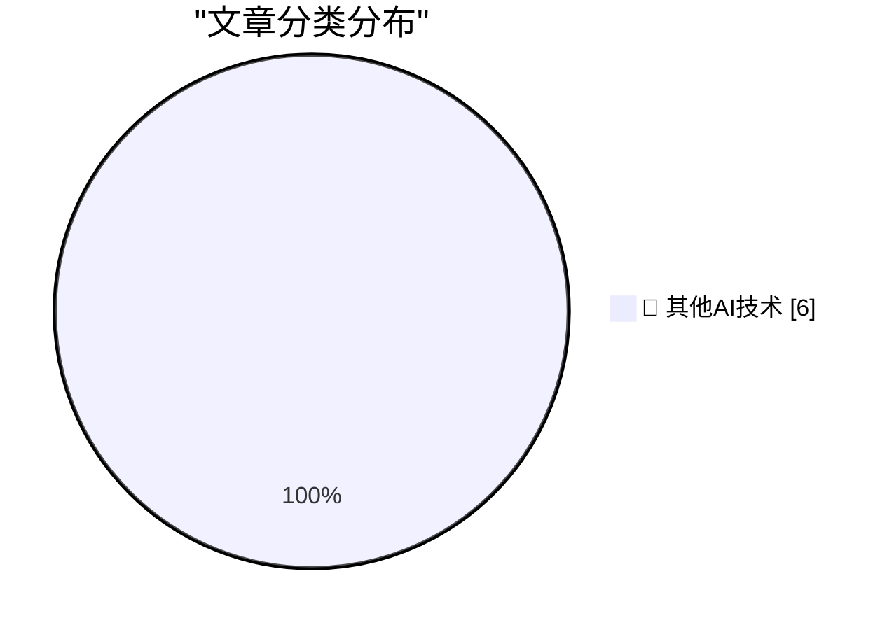

# 📰 AI 博客每日精选 — 2026-11-08

> 来自 98 个技术博客和社交媒体源，AI 精选 Top 6

## 🏆 今日必读

🥇 **Yours Truly on Full Stack Creator, Talking About the New MacBook Pros With PROLED XDR Displays**

[Yours Truly on Full Stack Creator, Talking About the New MacBook Pros With PROLED XDR Displays](https://www.youtube.com/watch?v=f2GZtWuUPl0) — daringfireball.net · 2 小时前 · 🔬 其他AI技术

> Yours Truly on Full Stack Creator, Talking About the New MacBook Pros With PROLED XDR Displays

🥈 **Pluralistic: JS Tan and Clarissa Redwine's "Against Tech Oligarchy" (07 Nov 2026)**

[Pluralistic: JS Tan and Clarissa Redwine's "Against Tech Oligarchy" (07 Nov 2026)](https://pluralistic.net/2026/11/07/aeiou-but-sometimes-why/) — pluralistic.net · 11 小时前 · 🔬 其他AI技术

> Pluralistic: JS Tan and Clarissa Redwine's "Against Tech Oligarchy" (07 Nov 2026)

🥉 **Book Review: When the Dust Settles - Stories of Love, Loss and Hope from an Expert in Disaster by Lucy Easthope ★★★★★**

[Book Review: When the Dust Settles - Stories of Love, Loss and Hope from an Expert in Disaster by Lucy Easthope ★★★★★](https://shkspr.mobi/blog/2026/11/book-review-when-the-dust-settles-stories-of-love-loss-and-hope-from-an-expert-in-disaster-by-lucy-easthope/) — shkspr.mobi · 11 小时前 · 🔬 其他AI技术

> Book Review: When the Dust Settles - Stories of Love, Loss and Hope from an Expert in Disaster by Lucy Easthope ★★★★★

4️⃣ **This Week in Package Management: 7 November 2026**

[This Week in Package Management: 7 November 2026](https://nesbitt.io/2026/11/07/this-week-in-package-management.html) — nesbitt.io · 14 小时前 · 🔬 其他AI技术

> This Week in Package Management: 7 November 2026

5️⃣ **Marx diesel freight train set 9613**

[Marx diesel freight train set 9613](https://dfarq.homeip.net/marx-diesel-freight-train-set-9613/?utm_source=rss&#038;utm_medium=rss&#038;utm_campaign=marx-diesel-freight-train-set-9613) — dfarq.homeip.net · 12 小时前 · 🔬 其他AI技术

> Marx diesel freight train set 9613

---

## 📊 数据概览

| 扫描源 | 抓取文章 | 时间范围 | 精选 |
|:---:|:---:|:---:|:---:|
| 64/98 | 2036 篇 → 6 篇 | 24h | **6 篇** |

### 分类分布

---

====================

## 🔬 其他AI技术

### 1. Yours Truly on Full Stack Creator, Talking About the New MacBook Pros With PROLED XDR Displays

[Yours Truly on Full Stack Creator, Talking About the New MacBook Pros With PROLED XDR Displays](https://www.youtube.com/watch?v=f2GZtWuUPl0) — **daringfireball.net** · 2 小时前 · ⭐ 15/25

> Yours Truly on Full Stack Creator, Talking About the New MacBook Pros With PROLED XDR Displays

📌 其他AI技术

---

### 2. Pluralistic: JS Tan and Clarissa Redwine's "Against Tech Oligarchy" (07 Nov 2026)

[Pluralistic: JS Tan and Clarissa Redwine's "Against Tech Oligarchy" (07 Nov 2026)](https://pluralistic.net/2026/11/07/aeiou-but-sometimes-why/) — **pluralistic.net** · 11 小时前 · ⭐ 15/25

> Pluralistic: JS Tan and Clarissa Redwine's "Against Tech Oligarchy" (07 Nov 2026)

📌 其他AI技术

---

### 3. Book Review: When the Dust Settles - Stories of Love, Loss and Hope from an Expert in Disaster by Lucy Easthope ★★★★★

[Book Review: When the Dust Settles - Stories of Love, Loss and Hope from an Expert in Disaster by Lucy Easthope ★★★★★](https://shkspr.mobi/blog/2026/11/book-review-when-the-dust-settles-stories-of-love-loss-and-hope-from-an-expert-in-disaster-by-lucy-easthope/) — **shkspr.mobi** · 11 小时前 · ⭐ 15/25

> Book Review: When the Dust Settles - Stories of Love, Loss and Hope from an Expert in Disaster by Lucy Easthope ★★★★★

📌 其他AI技术

---

### 4. This Week in Package Management: 7 November 2026

[This Week in Package Management: 7 November 2026](https://nesbitt.io/2026/11/07/this-week-in-package-management.html) — **nesbitt.io** · 14 小时前 · ⭐ 15/25

> This Week in Package Management: 7 November 2026

📌 其他AI技术

---

### 5. Marx diesel freight train set 9613

[Marx diesel freight train set 9613](https://dfarq.homeip.net/marx-diesel-freight-train-set-9613/?utm_source=rss&#038;utm_medium=rss&#038;utm_campaign=marx-diesel-freight-train-set-9613) — **dfarq.homeip.net** · 12 小时前 · ⭐ 15/25

> Marx diesel freight train set 9613

📌 其他AI技术

---

### 6. Upgrade diary: HP Elitedesk 800 G4

[Upgrade diary: HP Elitedesk 800 G4](https://dfarq.homeip.net/upgrade-diary-hp-elitedesk-800-g4/?utm_source=rss&#038;utm_medium=rss&#038;utm_campaign=upgrade-diary-hp-elitedesk-800-g4) — **dfarq.homeip.net** · 12 小时前 · ⭐ 15/25

> Upgrade diary: HP Elitedesk 800 G4

📌 其他AI技术

---

====================

*生成于 2026-11-08 00:09 | 扫描 64 源 → 获取 2036 篇 → 精选 6 篇*
*基于 [Hacker News Popularity Contest 2025](https://refactoringenglish.com/tools/hn-popularity/) RSS 源列表，由 [Andrej Karpathy](https://x.com/karpathy) 推荐*
*由「懂点儿AI」制作，欢迎关注同名微信公众号获取更多 AI 实用技巧 💡*
