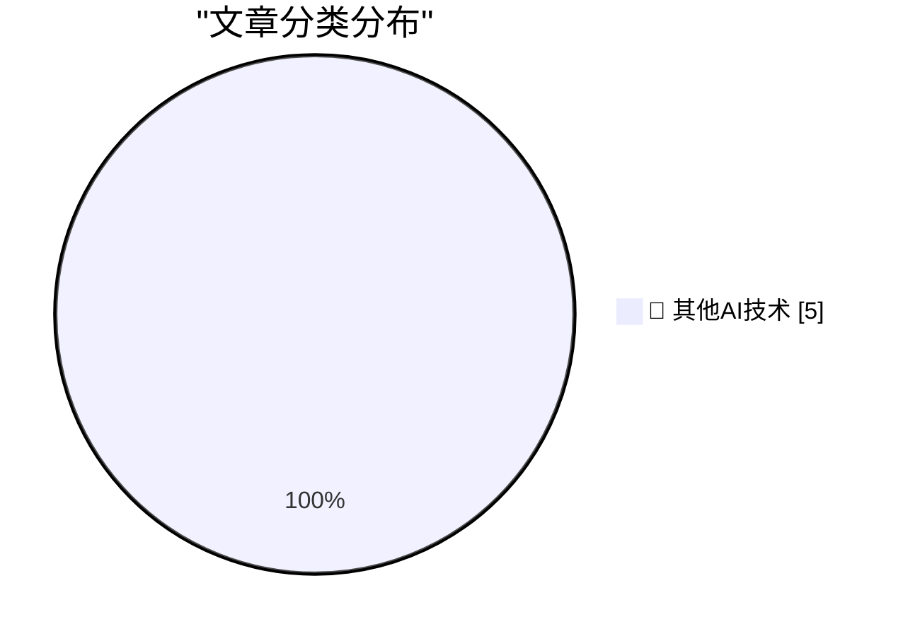

# 📰 AI 博客每日精选 — 2026-11-09

> 来自 98 个技术博客和社交媒体源，AI 精选 Top 5

## 🏆 今日必读

🥇 **Jensen Huang Betrayed Nvidia, Not Just His Family**

[Jensen Huang Betrayed Nvidia, Not Just His Family](https://www.nytimes.com/2026/11/06/us/politics/chinese-spy-agency-nvidia-jensen-huang.html?unlocked_article_code=1.O1E.DRyO.9mNcxhaxhtlI) — daringfireball.net · 31 分钟前 · 🔬 其他AI技术

> Jensen Huang Betrayed Nvidia, Not Just His Family

🥈 **Nvidia CEO Jensen Huang Was Banging a Chinese Spy, Who Was Feeding Information Back to Beijing**

[Nvidia CEO Jensen Huang Was Banging a Chinese Spy, Who Was Feeding Information Back to Beijing](https://www.nytimes.com/2026/11/08/technology/nvidia-investigation-jensen-huang-china.html?unlocked_article_code=1.O1E.Soow.6UjrM7Ch-C8L) — daringfireball.net · 2 小时前 · 🔬 其他AI技术

> Nvidia CEO Jensen Huang Was Banging a Chinese Spy, Who Was Feeding Information Back to Beijing

🥉 **Some thoughts on restaurant menu QR codes**

[Some thoughts on restaurant menu QR codes](https://shkspr.mobi/blog/2026/11/some-thoughts-on-restaurant-menu-qr-codes/) — shkspr.mobi · 11 小时前 · 🔬 其他AI技术

> Some thoughts on restaurant menu QR codes

4️⃣ **The problem with Micron MT 4264 RAM**

[The problem with Micron MT 4264 RAM](https://dfarq.homeip.net/the-problem-with-micron-mt-4264-ram/?utm_source=rss&#038;utm_medium=rss&#038;utm_campaign=the-problem-with-micron-mt-4264-ram) — dfarq.homeip.net · 12 小时前 · 🔬 其他AI技术

> The problem with Micron MT 4264 RAM

5️⃣ **Is AI crashing?**

[Is AI crashing?](https://dfarq.homeip.net/is-ai-crashing/?utm_source=rss&#038;utm_medium=rss&#038;utm_campaign=is-ai-crashing) — dfarq.homeip.net · 12 小时前 · 🔬 其他AI技术

> Is AI crashing?

---

## 📊 数据概览

| 扫描源 | 抓取文章 | 时间范围 | 精选 |
|:---:|:---:|:---:|:---:|
| 64/98 | 2037 篇 → 5 篇 | 24h | **5 篇** |

### 分类分布

---

====================

## 🔬 其他AI技术

### 1. Jensen Huang Betrayed Nvidia, Not Just His Family

[Jensen Huang Betrayed Nvidia, Not Just His Family](https://www.nytimes.com/2026/11/06/us/politics/chinese-spy-agency-nvidia-jensen-huang.html?unlocked_article_code=1.O1E.DRyO.9mNcxhaxhtlI) — **daringfireball.net** · 31 分钟前 · ⭐ 15/25

> Jensen Huang Betrayed Nvidia, Not Just His Family

📌 其他AI技术

---

### 2. Nvidia CEO Jensen Huang Was Banging a Chinese Spy, Who Was Feeding Information Back to Beijing

[Nvidia CEO Jensen Huang Was Banging a Chinese Spy, Who Was Feeding Information Back to Beijing](https://www.nytimes.com/2026/11/08/technology/nvidia-investigation-jensen-huang-china.html?unlocked_article_code=1.O1E.Soow.6UjrM7Ch-C8L) — **daringfireball.net** · 2 小时前 · ⭐ 15/25

> Nvidia CEO Jensen Huang Was Banging a Chinese Spy, Who Was Feeding Information Back to Beijing

📌 其他AI技术

---

### 3. Some thoughts on restaurant menu QR codes

[Some thoughts on restaurant menu QR codes](https://shkspr.mobi/blog/2026/11/some-thoughts-on-restaurant-menu-qr-codes/) — **shkspr.mobi** · 11 小时前 · ⭐ 15/25

> Some thoughts on restaurant menu QR codes

📌 其他AI技术

---

### 4. The problem with Micron MT 4264 RAM

[The problem with Micron MT 4264 RAM](https://dfarq.homeip.net/the-problem-with-micron-mt-4264-ram/?utm_source=rss&#038;utm_medium=rss&#038;utm_campaign=the-problem-with-micron-mt-4264-ram) — **dfarq.homeip.net** · 12 小时前 · ⭐ 15/25

> The problem with Micron MT 4264 RAM

📌 其他AI技术

---

### 5. Is AI crashing?

[Is AI crashing?](https://dfarq.homeip.net/is-ai-crashing/?utm_source=rss&#038;utm_medium=rss&#038;utm_campaign=is-ai-crashing) — **dfarq.homeip.net** · 12 小时前 · ⭐ 15/25

> Is AI crashing?

📌 其他AI技术

---

====================

*生成于 2026-11-09 00:28 | 扫描 64 源 → 获取 2037 篇 → 精选 5 篇*
*基于 [Hacker News Popularity Contest 2025](https://refactoringenglish.com/tools/hn-popularity/) RSS 源列表，由 [Andrej Karpathy](https://x.com/karpathy) 推荐*
*由「懂点儿AI」制作，欢迎关注同名微信公众号获取更多 AI 实用技巧 💡*
