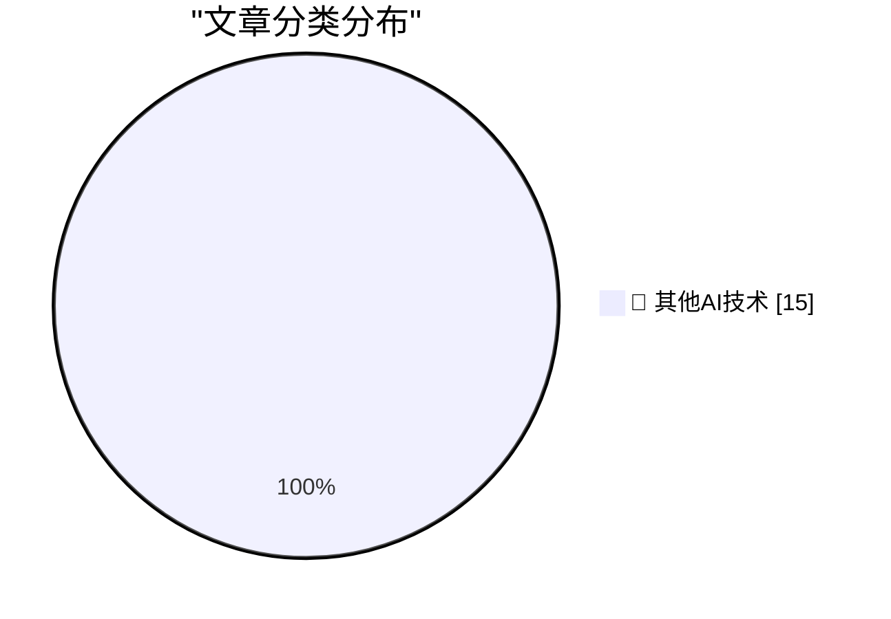

# 📰 AI 博客每日精选 — 2026-11-11

> 来自 98 个技术博客和社交媒体源，AI 精选 Top 15

## 🏆 今日必读

🥇 **Glue work is still harmful in the age of AI**

[Glue work is still harmful in the age of AI](https://seangoedecke.com/glue-work-is-still-harmful-in-the-age-of-ai/) — seangoedecke.com · 59 分钟前 · 🔬 其他AI技术

> Glue work is still harmful in the age of AI

🥈 **Gary Marcus: ‘Just Say No to Anthropic’s IPO’**

[Gary Marcus: ‘Just Say No to Anthropic’s IPO’](https://garymarcus.substack.com/p/just-say-no-to-anthropics-ipo?r=3k69a0) — daringfireball.net · 2 小时前 · 🔬 其他AI技术

> Gary Marcus: ‘Just Say No to Anthropic’s IPO’

🥉 **Altar II Keyboard on Kickstarter**

[Altar II Keyboard on Kickstarter](https://www.kickstarter.com/projects/electronicamaterials/altar-ii/) — daringfireball.net · 4 小时前 · 🔬 其他AI技术

> Altar II Keyboard on Kickstarter

4️⃣ **Bloomberg: ‘Nvidia Intervened in U.S. Probe of Megaspeed Chip Smuggling’**

[Bloomberg: ‘Nvidia Intervened in U.S. Probe of Megaspeed Chip Smuggling’](https://www.bloomberg.com/news/articles/2026-11-09/nvidia-intervened-in-us-probe-of-megaspeed-chip-smuggling) — daringfireball.net · 7 小时前 · 🔬 其他AI技术

> Bloomberg: ‘Nvidia Intervened in U.S. Probe of Megaspeed Chip Smuggling’

5️⃣ **Regarding Graveyards and Indispensable Men**

[Regarding Graveyards and Indispensable Men](https://www.youtube.com/watch?v=vydmUCGQnyI) — daringfireball.net · 7 小时前 · 🔬 其他AI技术

> Regarding Graveyards and Indispensable Men

---

## 📊 数据概览

| 扫描源 | 抓取文章 | 时间范围 | 精选 |
|:---:|:---:|:---:|:---:|
| 64/98 | 2038 篇 → 18 篇 | 24h | **15 篇** |

### 分类分布

---

====================

## 🔬 其他AI技术

### 1. Glue work is still harmful in the age of AI

[Glue work is still harmful in the age of AI](https://seangoedecke.com/glue-work-is-still-harmful-in-the-age-of-ai/) — **seangoedecke.com** · 59 分钟前 · ⭐ 15/25

> Glue work is still harmful in the age of AI

📌 其他AI技术

---

### 2. Gary Marcus: ‘Just Say No to Anthropic’s IPO’

[Gary Marcus: ‘Just Say No to Anthropic’s IPO’](https://garymarcus.substack.com/p/just-say-no-to-anthropics-ipo?r=3k69a0) — **daringfireball.net** · 2 小时前 · ⭐ 15/25

> Gary Marcus: ‘Just Say No to Anthropic’s IPO’

📌 其他AI技术

---

### 3. Altar II Keyboard on Kickstarter

[Altar II Keyboard on Kickstarter](https://www.kickstarter.com/projects/electronicamaterials/altar-ii/) — **daringfireball.net** · 4 小时前 · ⭐ 15/25

> Altar II Keyboard on Kickstarter

📌 其他AI技术

---

### 4. Bloomberg: ‘Nvidia Intervened in U.S. Probe of Megaspeed Chip Smuggling’

[Bloomberg: ‘Nvidia Intervened in U.S. Probe of Megaspeed Chip Smuggling’](https://www.bloomberg.com/news/articles/2026-11-09/nvidia-intervened-in-us-probe-of-megaspeed-chip-smuggling) — **daringfireball.net** · 7 小时前 · ⭐ 15/25

> Bloomberg: ‘Nvidia Intervened in U.S. Probe of Megaspeed Chip Smuggling’

📌 其他AI技术

---

### 5. Regarding Graveyards and Indispensable Men

[Regarding Graveyards and Indispensable Men](https://www.youtube.com/watch?v=vydmUCGQnyI) — **daringfireball.net** · 7 小时前 · ⭐ 15/25

> Regarding Graveyards and Indispensable Men

📌 其他AI技术

---

### 6. Steven Levy on John Ternus

[Steven Levy on John Ternus](https://www.wired.com/story/i-spent-30-minutes-with-apples-ceo-now-i-know-why-john-ternus-got-the-job/) — **daringfireball.net** · 8 小时前 · ⭐ 15/25

> Steven Levy on John Ternus

📌 其他AI技术

---

### 7. OurCal

[OurCal](https://ourcal.com/?utm_source=daringfireball&amp;utm_medium=sponsorship&amp;utm_content=post-thankyou) — **daringfireball.net** · 9 小时前 · ⭐ 15/25

> OurCal

📌 其他AI技术

---

### 8. Safari 27.3 Adds Support for Global Privacy Control

[Safari 27.3 Adds Support for Global Privacy Control](https://pxlnv.com/linklog/safari-global-privacy-control/) — **daringfireball.net** · 10 小时前 · ⭐ 15/25

> Safari 27.3 Adds Support for Global Privacy Control

📌 其他AI技术

---

### 9. ‘A Scandal at the Center of the Economy’

[‘A Scandal at the Center of the Economy’](https://www.theatlantic.com/technology/2026/11/jensen-huang-chinese-spy/689357/?gift=aQyUJR7AIw1mJWdQ6Ed6yPI8n1FlV88MR9f9IZruvFA&amp;) — **daringfireball.net** · 10 小时前 · ⭐ 15/25

> ‘A Scandal at the Center of the Economy’

📌 其他AI技术

---

### 10. U.S. Commerce Dept. Inquiry Into Megaspeed Was Halted After Nvidia Name-Dropped Trump Appointee

[U.S. Commerce Dept. Inquiry Into Megaspeed Was Halted After Nvidia Name-Dropped Trump Appointee](https://www.nytimes.com/2026/11/09/business/economy/nvidia-megaspeed-investigation-huang.html?unlocked_article_code=1.PVE.GxBL.iBpBoc8Y4tnb) — **daringfireball.net** · 10 小时前 · ⭐ 15/25

> U.S. Commerce Dept. Inquiry Into Megaspeed Was Halted After Nvidia Name-Dropped Trump Appointee

📌 其他AI技术

---

### 11. [Sponsor] WorkOS: Let Agents Use Your Tools Without Giving Them Free Rein

[[Sponsor] WorkOS: Let Agents Use Your Tools Without Giving Them Free Rein](https://www.workos.com/airlock?utm_source=daringfireball&amp;utm_medium=newsletter&amp;utm_campaign=q42026) — **daringfireball.net** · 20 小时前 · ⭐ 15/25

> [Sponsor] WorkOS: Let Agents Use Your Tools Without Giving Them Free Rein

📌 其他AI技术

---

### 12. Pluralistic: The EU should go big and hard over border IT failure (10 Nov 2026)

[Pluralistic: The EU should go big and hard over border IT failure (10 Nov 2026)](https://pluralistic.net/2026/11/10/worst-of-all-worlds/) — **pluralistic.net** · 7 小时前 · ⭐ 15/25

> Pluralistic: The EU should go big and hard over border IT failure (10 Nov 2026)

📌 其他AI技术

---

### 13. Book Review: The Unfinished Harauld Hughes - Richard Ayoade ★★★⯪☆

[Book Review: The Unfinished Harauld Hughes - Richard Ayoade ★★★⯪☆](https://shkspr.mobi/blog/2026/11/book-review-the-unfinished-harauld-hughes-richard-ayoade/) — **shkspr.mobi** · 12 小时前 · ⭐ 15/25

> Book Review: The Unfinished Harauld Hughes - Richard Ayoade ★★★⯪☆

📌 其他AI技术

---

### 14. Microsoft employee price list from 1987

[Microsoft employee price list from 1987](https://devblogs.microsoft.com/oldnewthing/20261110-00/?p=112843/) — **devblogs.microsoft.com/oldnewthing** · 9 小时前 · ⭐ 15/25

> Microsoft employee price list from 1987

📌 其他AI技术

---

### 15. 20 years of blogging

[20 years of blogging](https://www.gilesthomas.com/2026/11/20-years-of-blogging) — **gilesthomas.com** · 1 小时前 · ⭐ 15/25

> 20 years of blogging

📌 其他AI技术

---

====================

*生成于 2026-11-11 00:59 | 扫描 64 源 → 获取 2038 篇 → 精选 15 篇*
*基于 [Hacker News Popularity Contest 2025](https://refactoringenglish.com/tools/hn-popularity/) RSS 源列表，由 [Andrej Karpathy](https://x.com/karpathy) 推荐*
*由「懂点儿AI」制作，欢迎关注同名微信公众号获取更多 AI 实用技巧 💡*
