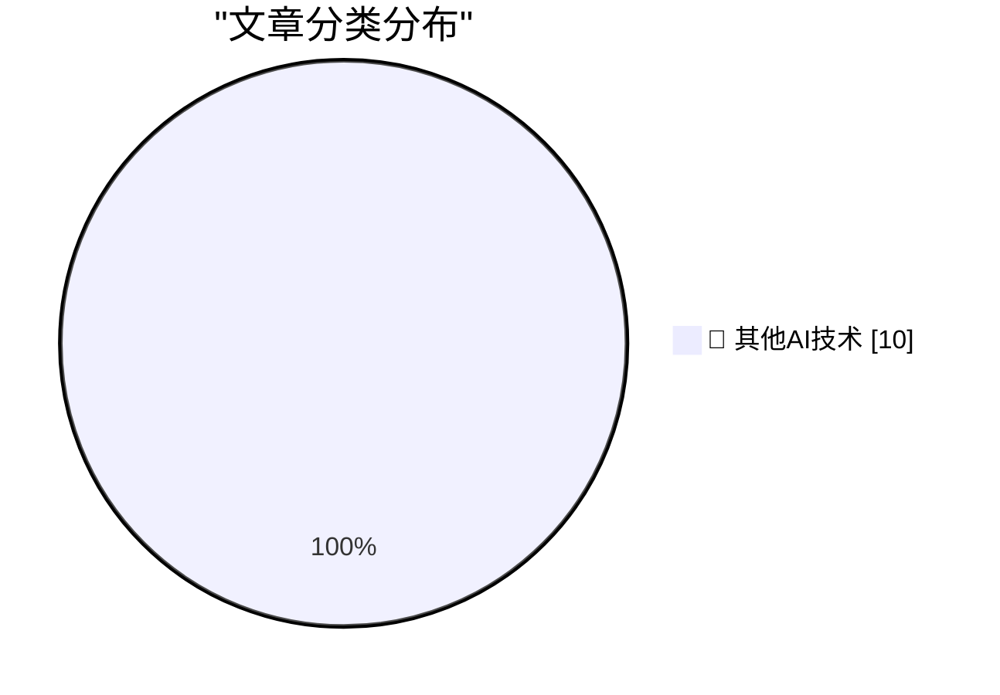

# 📰 AI 博客每日精选 — 2026-11-12

> 来自 98 个技术博客和社交媒体源，AI 精选 Top 10

## 🏆 今日必读

🥇 **Apple Shutters Their Longstanding ‘Apple Support Community’**

[Apple Shutters Their Longstanding ‘Apple Support Community’](https://sixcolors.com/link/2026/11/ding-dong-the-apple-support-community-is-dead/) — daringfireball.net · 6 小时前 · 🔬 其他AI技术

> Apple Shutters Their Longstanding ‘Apple Support Community’

🥈 **Austin Mann’s iPhone Duo Review**

[Austin Mann’s iPhone Duo Review](https://www.austinmann.com/trek/iphone-duo) — daringfireball.net · 7 小时前 · 🔬 其他AI技术

> Austin Mann’s iPhone Duo Review

🥉 **Quinn Nelson: ‘The iPhone Duo Doesn’t Feel Like an iPhone’**

[Quinn Nelson: ‘The iPhone Duo Doesn’t Feel Like an iPhone’](https://www.youtube.com/watch?v=cxjdVVVryC4) — daringfireball.net · 7 小时前 · 🔬 其他AI技术

> Quinn Nelson: ‘The iPhone Duo Doesn’t Feel Like an iPhone’

4️⃣ **‘Dangerous or Unusual’**

[‘Dangerous or Unusual’](https://www.nytimes.com/interactive/2026/11/10/us/supreme-court-guns-misquote.html?unlocked_article_code=1.PlE.-Nhp.CaLpsgMqdWf3) — daringfireball.net · 7 小时前 · 🔬 其他AI技术

> ‘Dangerous or Unusual’

5️⃣ **HowTo: Fix Eufy HomeBase 2 Storage Full Issues**

[HowTo: Fix Eufy HomeBase 2 Storage Full Issues](https://shkspr.mobi/blog/2026/11/howto-fix-eufy-homebase-2-storage-full-issues/) — shkspr.mobi · 13 小时前 · 🔬 其他AI技术

> HowTo: Fix Eufy HomeBase 2 Storage Full Issues

---

## 📊 数据概览

| 扫描源 | 抓取文章 | 时间范围 | 精选 |
|:---:|:---:|:---:|:---:|
| 64/98 | 2029 篇 → 10 篇 | 24h | **10 篇** |

### 分类分布

---

====================

## 🔬 其他AI技术

### 1. Apple Shutters Their Longstanding ‘Apple Support Community’

[Apple Shutters Their Longstanding ‘Apple Support Community’](https://sixcolors.com/link/2026/11/ding-dong-the-apple-support-community-is-dead/) — **daringfireball.net** · 6 小时前 · ⭐ 15/25

> Apple Shutters Their Longstanding ‘Apple Support Community’

📌 其他AI技术

---

### 2. Austin Mann’s iPhone Duo Review

[Austin Mann’s iPhone Duo Review](https://www.austinmann.com/trek/iphone-duo) — **daringfireball.net** · 7 小时前 · ⭐ 15/25

> Austin Mann’s iPhone Duo Review

📌 其他AI技术

---

### 3. Quinn Nelson: ‘The iPhone Duo Doesn’t Feel Like an iPhone’

[Quinn Nelson: ‘The iPhone Duo Doesn’t Feel Like an iPhone’](https://www.youtube.com/watch?v=cxjdVVVryC4) — **daringfireball.net** · 7 小时前 · ⭐ 15/25

> Quinn Nelson: ‘The iPhone Duo Doesn’t Feel Like an iPhone’

📌 其他AI技术

---

### 4. ‘Dangerous or Unusual’

[‘Dangerous or Unusual’](https://www.nytimes.com/interactive/2026/11/10/us/supreme-court-guns-misquote.html?unlocked_article_code=1.PlE.-Nhp.CaLpsgMqdWf3) — **daringfireball.net** · 7 小时前 · ⭐ 15/25

> ‘Dangerous or Unusual’

📌 其他AI技术

---

### 5. HowTo: Fix Eufy HomeBase 2 Storage Full Issues

[HowTo: Fix Eufy HomeBase 2 Storage Full Issues](https://shkspr.mobi/blog/2026/11/howto-fix-eufy-homebase-2-storage-full-issues/) — **shkspr.mobi** · 13 小时前 · ⭐ 15/25

> HowTo: Fix Eufy HomeBase 2 Storage Full Issues

📌 其他AI技术

---

### 6. Why Am I So Tired If AI Is Doing All the Work?

[Why Am I So Tired If AI Is Doing All the Work?](https://terriblesoftware.org/2026/11/11/why-am-i-so-tired-if-ai-is-doing-all-the-work/) — **terriblesoftware.org** · 7 小时前 · ⭐ 15/25

> Why Am I So Tired If AI Is Doing All the Work?

📌 其他AI技术

---

### 7. This Week in Source Control: 11 November 2026

[This Week in Source Control: 11 November 2026](https://nesbitt.io/2026/11/11/this-week-in-source-control.html) — **nesbitt.io** · 16 小时前 · ⭐ 15/25

> This Week in Source Control: 11 November 2026

📌 其他AI技术

---

### 8. Possible Futures

[Possible Futures](https://borretti.me/article/possible-futures) — **borretti.me** · 13 小时前 · ⭐ 15/25

> Possible Futures

📌 其他AI技术

---

### 9. Microsoft Windows first announced Nov 10, 1983

[Microsoft Windows first announced Nov 10, 1983](https://dfarq.homeip.net/microsoft-windows-first-announced-nov-10-1983/?utm_source=rss&#038;utm_medium=rss&#038;utm_campaign=microsoft-windows-first-announced-nov-10-1983) — **dfarq.homeip.net** · 14 小时前 · ⭐ 15/25

> Microsoft Windows first announced Nov 10, 1983

📌 其他AI技术

---

### 10. Monads in Lean

[Monads in Lean](https://eli.thegreenplace.net/2026/monads-in-lean/) — **eli.thegreenplace.net** · 22 小时前 · ⭐ 15/25

> Monads in Lean

📌 其他AI技术

---

====================

*生成于 2026-11-12 02:05 | 扫描 64 源 → 获取 2029 篇 → 精选 10 篇*
*基于 [Hacker News Popularity Contest 2025](https://refactoringenglish.com/tools/hn-popularity/) RSS 源列表，由 [Andrej Karpathy](https://x.com/karpathy) 推荐*
*由「懂点儿AI」制作，欢迎关注同名微信公众号获取更多 AI 实用技巧 💡*
