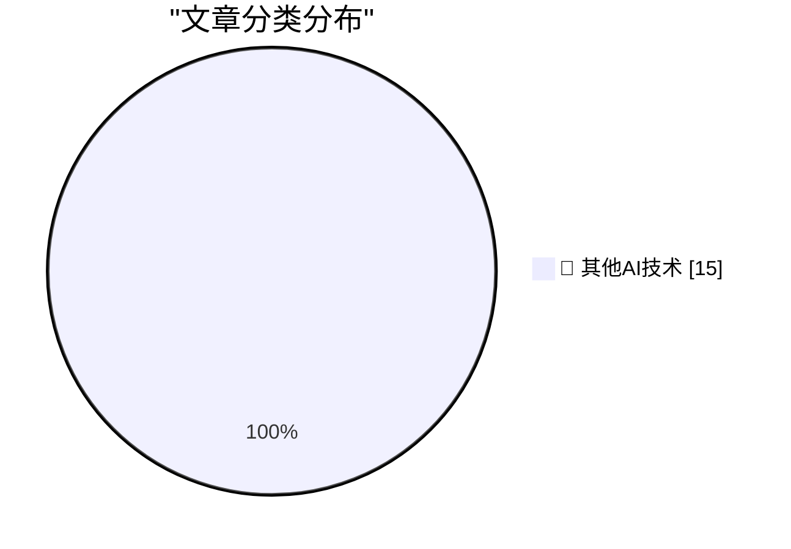

# 📰 AI 博客每日精选 — 2026-11-13

> 来自 98 个技术博客和社交媒体源，AI 精选 Top 15

## 🏆 今日必读

🥇 **Jensen Huang Agrees to Testify Before Congress, But Not Publicly (Yet)**

[Jensen Huang Agrees to Testify Before Congress, But Not Publicly (Yet)](https://techcrunch.com/2026/11/12/jensen-huang-agrees-to-testify-before-congress/) — daringfireball.net · 4 小时前 · 🔬 其他AI技术

> Jensen Huang Agrees to Testify Before Congress, But Not Publicly (Yet)

🥈 **Scott Colom Flips Mississippi**

[Scott Colom Flips Mississippi](https://talkingpointsmemo.com/live-blog/new-congress-gets-underway-with-hegseth-impeachment-effort) — daringfireball.net · 4 小时前 · 🔬 其他AI技术

> Scott Colom Flips Mississippi

🥉 **The Dream of Quibi Lives On**

[The Dream of Quibi Lives On](https://www.nbcuniversal.com/article/peacock-extends-its-vertical-video-leadership-reimagined-mobile-experience) — daringfireball.net · 4 小时前 · 🔬 其他AI技术

> The Dream of Quibi Lives On

4️⃣ **And Every New Boy That You Meet / He Doesn’t Know the Real Surprise**

[And Every New Boy That You Meet / He Doesn’t Know the Real Surprise](https://www.wsj.com/tech/ai/a-mystery-businessman-introduced-jensen-huang-to-his-paramourher-husband-1ec3b581?st=yBFeMY) — daringfireball.net · 4 小时前 · 🔬 其他AI技术

> And Every New Boy That You Meet / He Doesn’t Know the Real Surprise

5️⃣ **Reuters Raises the Jensen Huang Affair Tally to Three**

[Reuters Raises the Jensen Huang Affair Tally to Three](https://www.reuters.com/technology/former-nvidia-ceo-huang-had-relationship-with-second-employee-sources-say-2026-11-12/) — daringfireball.net · 5 小时前 · 🔬 其他AI技术

> Reuters Raises the Jensen Huang Affair Tally to Three

---

## 📊 数据概览

| 扫描源 | 抓取文章 | 时间范围 | 精选 |
|:---:|:---:|:---:|:---:|
| 64/98 | 2029 篇 → 19 篇 | 24h | **15 篇** |

### 分类分布

---

====================

## 🔬 其他AI技术

### 1. Jensen Huang Agrees to Testify Before Congress, But Not Publicly (Yet)

[Jensen Huang Agrees to Testify Before Congress, But Not Publicly (Yet)](https://techcrunch.com/2026/11/12/jensen-huang-agrees-to-testify-before-congress/) — **daringfireball.net** · 4 小时前 · ⭐ 15/25

> Jensen Huang Agrees to Testify Before Congress, But Not Publicly (Yet)

📌 其他AI技术

---

### 2. Scott Colom Flips Mississippi

[Scott Colom Flips Mississippi](https://talkingpointsmemo.com/live-blog/new-congress-gets-underway-with-hegseth-impeachment-effort) — **daringfireball.net** · 4 小时前 · ⭐ 15/25

> Scott Colom Flips Mississippi

📌 其他AI技术

---

### 3. The Dream of Quibi Lives On

[The Dream of Quibi Lives On](https://www.nbcuniversal.com/article/peacock-extends-its-vertical-video-leadership-reimagined-mobile-experience) — **daringfireball.net** · 4 小时前 · ⭐ 15/25

> The Dream of Quibi Lives On

📌 其他AI技术

---

### 4. And Every New Boy That You Meet / He Doesn’t Know the Real Surprise

[And Every New Boy That You Meet / He Doesn’t Know the Real Surprise](https://www.wsj.com/tech/ai/a-mystery-businessman-introduced-jensen-huang-to-his-paramourher-husband-1ec3b581?st=yBFeMY) — **daringfireball.net** · 4 小时前 · ⭐ 15/25

> And Every New Boy That You Meet / He Doesn’t Know the Real Surprise

📌 其他AI技术

---

### 5. Reuters Raises the Jensen Huang Affair Tally to Three

[Reuters Raises the Jensen Huang Affair Tally to Three](https://www.reuters.com/technology/former-nvidia-ceo-huang-had-relationship-with-second-employee-sources-say-2026-11-12/) — **daringfireball.net** · 5 小时前 · ⭐ 15/25

> Reuters Raises the Jensen Huang Affair Tally to Three

📌 其他AI技术

---

### 6. Trump Weighs in on Huang’s Successor

[Trump Weighs in on Huang’s Successor](https://truthsocial.com/@realDonaldTrump/posts/117604177898784579) — **daringfireball.net** · 8 小时前 · ⭐ 15/25

> Trump Weighs in on Huang’s Successor

📌 其他AI技术

---

### 7. Jensen Huang’s Advice to His Successor: ‘They’ll Just Have to Reshape the Company’

[Jensen Huang’s Advice to His Successor: ‘They’ll Just Have to Reshape the Company’](https://www.ycombinator.com/library/Tq-jensen-huang-the-mindset-that-built-nvidia) — **daringfireball.net** · 9 小时前 · ⭐ 15/25

> Jensen Huang’s Advice to His Successor: ‘They’ll Just Have to Reshape the Company’

📌 其他AI技术

---

### 8. Jensen Huang Resigns From Nvidia

[Jensen Huang Resigns From Nvidia](https://nvidianews.nvidia.com/news/nvidia-announces-ceo-transition) — **daringfireball.net** · 10 小时前 · ⭐ 15/25

> Jensen Huang Resigns From Nvidia

📌 其他AI技术

---

### 9. Semafor: ‘Nvidia Board Preparing to Oust CEO Jensen Huang, Name Interim CEO’

[Semafor: ‘Nvidia Board Preparing to Oust CEO Jensen Huang, Name Interim CEO’](https://www.semafor.com/article/11/11/2026/nvidia-board-preparing-to-oust-ceo-huang-wsj) — **daringfireball.net** · 20 小时前 · ⭐ 15/25

> Semafor: ‘Nvidia Board Preparing to Oust CEO Jensen Huang, Name Interim CEO’

📌 其他AI技术

---

### 10. Nvidia Working With Outside Firm to Identify CEO Candidates

[Nvidia Working With Outside Firm to Identify CEO Candidates](https://www.bloomberg.com/news/articles/2026-11-11/nvidia-working-with-outside-firm-to-identify-ceo-candidates) — **daringfireball.net** · 21 小时前 · ⭐ 15/25

> Nvidia Working With Outside Firm to Identify CEO Candidates

📌 其他AI技术

---

### 11. WSJ: ‘Nvidia Is Preparing to Oust CEO Jensen Huang’

[WSJ: ‘Nvidia Is Preparing to Oust CEO Jensen Huang’](https://www.wsj.com/business/nvidia-is-preparing-to-oust-nvidia-ceo-jensen-huang-30f421ad?st=S84MQZ) — **daringfireball.net** · 21 小时前 · ⭐ 15/25

> WSJ: ‘Nvidia Is Preparing to Oust CEO Jensen Huang’

📌 其他AI技术

---

### 12. Jensen Huang Was Banging an Nvidia Vice President Too

[Jensen Huang Was Banging an Nvidia Vice President Too](https://www.nytimes.com/2026/11/11/technology/jensen-huang-nvidia-affair.html?unlocked_article_code=1.P1E.pIe6.C65KRlbTa4MW) — **daringfireball.net** · 22 小时前 · ⭐ 15/25

> Jensen Huang Was Banging an Nvidia Vice President Too

📌 其他AI技术

---

### 13. So you want to buy AI for your company

[So you want to buy AI for your company](https://idiallo.com/byte-size/buying-ai-for-your-company) — **idiallo.com** · 1 小时前 · ⭐ 15/25

> So you want to buy AI for your company

📌 其他AI技术

---

### 14. Pluralistic: Uber's labor crash (12 Nov 2026)

[Pluralistic: Uber's labor crash (12 Nov 2026)](https://pluralistic.net/2026/11/12/starvation-wages/) — **pluralistic.net** · 4 小时前 · ⭐ 15/25

> Pluralistic: Uber's labor crash (12 Nov 2026)

📌 其他AI技术

---

### 15. Book Review: This Is for Everyone - Tim Berners-Lee ★★★☆☆

[Book Review: This Is for Everyone - Tim Berners-Lee ★★★☆☆](https://shkspr.mobi/blog/2026/11/book-review-this-is-for-everyone-tim-berners-lee/) — **shkspr.mobi** · 13 小时前 · ⭐ 15/25

> Book Review: This Is for Everyone - Tim Berners-Lee ★★★☆☆

📌 其他AI技术

---

====================

*生成于 2026-11-13 01:38 | 扫描 64 源 → 获取 2029 篇 → 精选 15 篇*
*基于 [Hacker News Popularity Contest 2025](https://refactoringenglish.com/tools/hn-popularity/) RSS 源列表，由 [Andrej Karpathy](https://x.com/karpathy) 推荐*
*由「懂点儿AI」制作，欢迎关注同名微信公众号获取更多 AI 实用技巧 💡*
