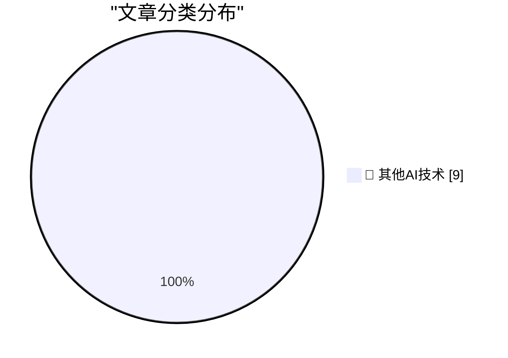

# 📰 AI 博客每日精选 — 2026-11-15

> 来自 98 个技术博客和社交媒体源，AI 精选 Top 9

## 🏆 今日必读

🥇 **Ops needs friction**

[Ops needs friction](https://www.jeffgeerling.com/blog/2026/ops-needs-friction/) — jeffgeerling.com · 8 小时前 · 🔬 其他AI技术

> Ops needs friction

🥈 **Joanna Stern Reviews the HomeView**

[Joanna Stern Reviews the HomeView](https://www.youtube.com/watch?v=yVTcVtLn2o4) — daringfireball.net · 6 小时前 · 🔬 其他AI技术

> Joanna Stern Reviews the HomeView

🥉 **Jason Snell’s HomeView Review**

[Jason Snell’s HomeView Review](https://sixcolors.com/post/2026/11/homeview-review-a-late-arrival-with-promise-but-still-showing-some-seams/) — daringfireball.net · 6 小时前 · 🔬 其他AI技术

> Jason Snell’s HomeView Review

4️⃣ **Patrick McGee on Johny Srouji and Nvidia**

[Patrick McGee on Johny Srouji and Nvidia](https://x.com/patrickmcgee_/status/2120799867140550999) — daringfireball.net · 7 小时前 · 🔬 其他AI技术

> Patrick McGee on Johny Srouji and Nvidia

5️⃣ **Microsoft Says Cloud Outage Was ‘Not Related to Cyber or AI / Agents’**

[Microsoft Says Cloud Outage Was ‘Not Related to Cyber or AI / Agents’](https://x.com/microsoft/status/2121282013600907325) — daringfireball.net · 8 小时前 · 🔬 其他AI技术

> Microsoft Says Cloud Outage Was ‘Not Related to Cyber or AI / Agents’

---

## 📊 数据概览

| 扫描源 | 抓取文章 | 时间范围 | 精选 |
|:---:|:---:|:---:|:---:|
| 68/98 | 2114 篇 → 9 篇 | 24h | **9 篇** |

### 分类分布

---

====================

## 🔬 其他AI技术

### 1. Ops needs friction

[Ops needs friction](https://www.jeffgeerling.com/blog/2026/ops-needs-friction/) — **jeffgeerling.com** · 8 小时前 · ⭐ 15/25

> Ops needs friction

📌 其他AI技术

---

### 2. Joanna Stern Reviews the HomeView

[Joanna Stern Reviews the HomeView](https://www.youtube.com/watch?v=yVTcVtLn2o4) — **daringfireball.net** · 6 小时前 · ⭐ 15/25

> Joanna Stern Reviews the HomeView

📌 其他AI技术

---

### 3. Jason Snell’s HomeView Review

[Jason Snell’s HomeView Review](https://sixcolors.com/post/2026/11/homeview-review-a-late-arrival-with-promise-but-still-showing-some-seams/) — **daringfireball.net** · 6 小时前 · ⭐ 15/25

> Jason Snell’s HomeView Review

📌 其他AI技术

---

### 4. Patrick McGee on Johny Srouji and Nvidia

[Patrick McGee on Johny Srouji and Nvidia](https://x.com/patrickmcgee_/status/2120799867140550999) — **daringfireball.net** · 7 小时前 · ⭐ 15/25

> Patrick McGee on Johny Srouji and Nvidia

📌 其他AI技术

---

### 5. Microsoft Says Cloud Outage Was ‘Not Related to Cyber or AI / Agents’

[Microsoft Says Cloud Outage Was ‘Not Related to Cyber or AI / Agents’](https://x.com/microsoft/status/2121282013600907325) — **daringfireball.net** · 8 小时前 · ⭐ 15/25

> Microsoft Says Cloud Outage Was ‘Not Related to Cyber or AI / Agents’

📌 其他AI技术

---

### 6. Theatre Review: FrankenTacit ★★☆☆☆

[Theatre Review: FrankenTacit ★★☆☆☆](https://shkspr.mobi/blog/2026/11/theatre-review-frankentacit/) — **shkspr.mobi** · 12 小时前 · ⭐ 15/25

> Theatre Review: FrankenTacit ★★☆☆☆

📌 其他AI技术

---

### 7. Spreadsheets and other models of morality

[Spreadsheets and other models of morality](https://blog.coredump.cx/p/spreadsheets-and-other-models-of) — **lcamtuf.substack.com** · 16 小时前 · ⭐ 15/25

> Spreadsheets and other models of morality

📌 其他AI技术

---

### 8. This Week in Package Management: 14 November 2026

[This Week in Package Management: 14 November 2026](https://nesbitt.io/2026/11/14/this-week-in-package-management.html) — **nesbitt.io** · 14 小时前 · ⭐ 15/25

> This Week in Package Management: 14 November 2026

📌 其他AI技术

---

### 9. Vintage computer power centers

[Vintage computer power centers](https://dfarq.homeip.net/vintage-computer-power-centers/?utm_source=rss&#038;utm_medium=rss&#038;utm_campaign=vintage-computer-power-centers) — **dfarq.homeip.net** · 12 小时前 · ⭐ 15/25

> Vintage computer power centers

📌 其他AI技术

---

====================

*生成于 2026-11-15 00:41 | 扫描 68 源 → 获取 2114 篇 → 精选 9 篇*
*基于 [Hacker News Popularity Contest 2025](https://refactoringenglish.com/tools/hn-popularity/) RSS 源列表，由 [Andrej Karpathy](https://x.com/karpathy) 推荐*
*由「懂点儿AI」制作，欢迎关注同名微信公众号获取更多 AI 实用技巧 💡*
