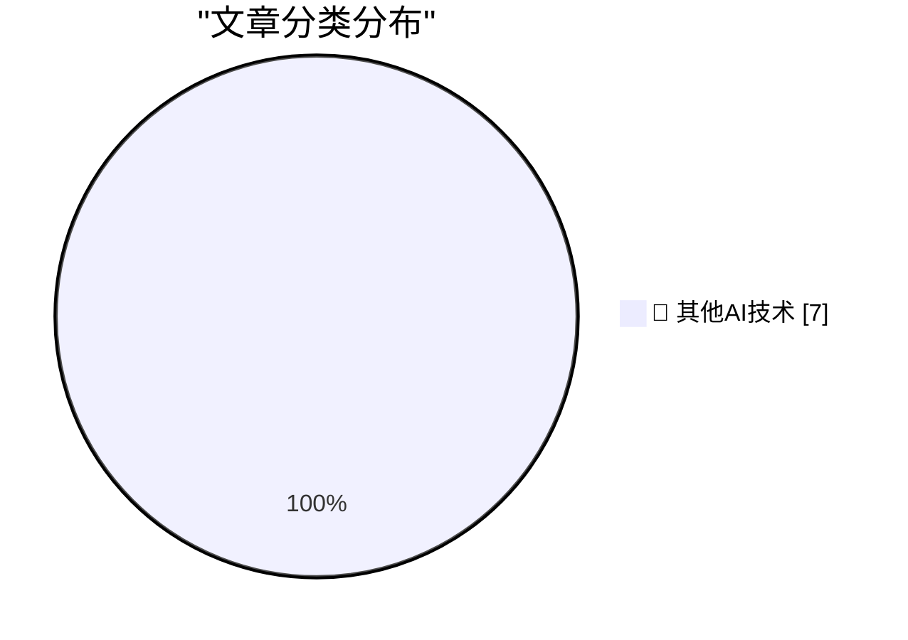

# 📰 AI 博客每日精选 — 2026-11-16

> 来自 98 个技术博客和社交媒体源，AI 精选 Top 7

## 🏆 今日必读

🥇 **The Legion of PCAST**

[The Legion of PCAST](https://www.whitehouse.gov/ostp/presidents-council-of-advisors-on-science-and-technology/) — daringfireball.net · 7 小时前 · 🔬 其他AI技术

> The Legion of PCAST

🥈 **WorkOS: Let Agents Use Your Tools Without Giving Them Free Rein**

[WorkOS: Let Agents Use Your Tools Without Giving Them Free Rein](https://www.workos.com/airlock?utm_source=daringfireball&amp;utm_medium=newsletter&amp;utm_campaign=q42026) — daringfireball.net · 8 小时前 · 🔬 其他AI技术

> WorkOS: Let Agents Use Your Tools Without Giving Them Free Rein

🥉 **People will lose their jobs over GTA 6**

[People will lose their jobs over GTA 6](https://idiallo.com/blog/losing-your-job-over-a-video-game) — idiallo.com · 1 分钟前 · 🔬 其他AI技术

> People will lose their jobs over GTA 6

4️⃣ **Variable Electricity Pricing - the Highs and the Lows**

[Variable Electricity Pricing - the Highs and the Lows](https://shkspr.mobi/blog/2026/11/variable-electricity-pricing-the-highs-and-the-lows/) — shkspr.mobi · 12 小时前 · 🔬 其他AI技术

> Variable Electricity Pricing - the Highs and the Lows

5️⃣ **ASI as a Black Box**

[ASI as a Black Box](https://borretti.me/article/asi-as-a-black-box) — borretti.me · 11 小时前 · 🔬 其他AI技术

> ASI as a Black Box

---

## 📊 数据概览

| 扫描源 | 抓取文章 | 时间范围 | 精选 |
|:---:|:---:|:---:|:---:|
| 63/98 | 2029 篇 → 7 篇 | 24h | **7 篇** |

### 分类分布

---

====================

## 🔬 其他AI技术

### 1. The Legion of PCAST

[The Legion of PCAST](https://www.whitehouse.gov/ostp/presidents-council-of-advisors-on-science-and-technology/) — **daringfireball.net** · 7 小时前 · ⭐ 15/25

> The Legion of PCAST

📌 其他AI技术

---

### 2. WorkOS: Let Agents Use Your Tools Without Giving Them Free Rein

[WorkOS: Let Agents Use Your Tools Without Giving Them Free Rein](https://www.workos.com/airlock?utm_source=daringfireball&amp;utm_medium=newsletter&amp;utm_campaign=q42026) — **daringfireball.net** · 8 小时前 · ⭐ 15/25

> WorkOS: Let Agents Use Your Tools Without Giving Them Free Rein

📌 其他AI技术

---

### 3. People will lose their jobs over GTA 6

[People will lose their jobs over GTA 6](https://idiallo.com/blog/losing-your-job-over-a-video-game) — **idiallo.com** · 1 分钟前 · ⭐ 15/25

> People will lose their jobs over GTA 6

📌 其他AI技术

---

### 4. Variable Electricity Pricing - the Highs and the Lows

[Variable Electricity Pricing - the Highs and the Lows](https://shkspr.mobi/blog/2026/11/variable-electricity-pricing-the-highs-and-the-lows/) — **shkspr.mobi** · 12 小时前 · ⭐ 15/25

> Variable Electricity Pricing - the Highs and the Lows

📌 其他AI技术

---

### 5. ASI as a Black Box

[ASI as a Black Box](https://borretti.me/article/asi-as-a-black-box) — **borretti.me** · 11 小时前 · ⭐ 15/25

> ASI as a Black Box

📌 其他AI技术

---

### 6. Date codes on cardboard boxes

[Date codes on cardboard boxes](https://dfarq.homeip.net/date-codes-on-cardboard-boxes/?utm_source=rss&#038;utm_medium=rss&#038;utm_campaign=date-codes-on-cardboard-boxes) — **dfarq.homeip.net** · 12 小时前 · ⭐ 15/25

> Date codes on cardboard boxes

📌 其他AI技术

---

### 7. What’s Next For Nvidia?

[What’s Next For Nvidia?](https://steveblank.com/2026/11/15/whats-next-for-nvidia/) — **steveblank.com** · 2 小时前 · ⭐ 15/25

> What’s Next For Nvidia?

📌 其他AI技术

---

====================

*生成于 2026-11-16 00:41 | 扫描 63 源 → 获取 2029 篇 → 精选 7 篇*
*基于 [Hacker News Popularity Contest 2025](https://refactoringenglish.com/tools/hn-popularity/) RSS 源列表，由 [Andrej Karpathy](https://x.com/karpathy) 推荐*
*由「懂点儿AI」制作，欢迎关注同名微信公众号获取更多 AI 实用技巧 💡*
