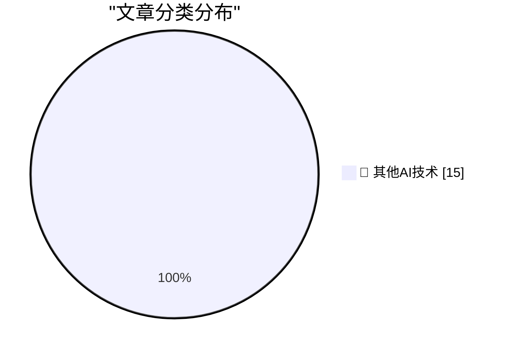

# 📰 AI 博客每日精选 — 2026-11-17

> 来自 98 个技术博客和社交媒体源，AI 精选 Top 15

## 🏆 今日必读

🥇 **Apple Support Document on the New ‘Full Disk Access’ and ‘System & App Protection Override’ Settings in MacOS 27.3 Beta 2**

[Apple Support Document on the New ‘Full Disk Access’ and ‘System & App Protection Override’ Settings in MacOS 27.3 Beta 2](https://support.apple.com/en-us/149699) — daringfireball.net · 1 小时前 · 🔬 其他AI技术

> Apple Support Document on the New ‘Full Disk Access’ and ‘System & App Protection Override’ Settings in MacOS 27.3 Beta 2

🥈 **‘Meet the Anthropic Researcher Behind Silicon Valley’s “Consensual Non-Consent” Orgies’**

[‘Meet the Anthropic Researcher Behind Silicon Valley’s “Consensual Non-Consent” Orgies’](https://freebeacon.com/america/horrifying-meet-the-anthropic-researcher-behind-silicon-valleys-consensual-non-consent-orgies/) — daringfireball.net · 3 小时前 · 🔬 其他AI技术

> ‘Meet the Anthropic Researcher Behind Silicon Valley’s “Consensual Non-Consent” Orgies’

🥉 **[Sponsor] Ivy: The To-do List That Ends**

[[Sponsor] Ivy: The To-do List That Ends](https://apps.apple.com/app/apple-store/id6747921058?pt=1363339&amp;ct=Daring-Fireball-Post&amp;mt=8) — daringfireball.net · 4 小时前 · 🔬 其他AI技术

> [Sponsor] Ivy: The To-do List That Ends

4️⃣ **Developers Continue to Optimize iPhone Apps for the Duo**

[Developers Continue to Optimize iPhone Apps for the Duo](https://x.com/arinwaichulis/status/2122397676767522942) — daringfireball.net · 4 小时前 · 🔬 其他AI技术

> Developers Continue to Optimize iPhone Apps for the Duo

5️⃣ **Irish Goodbye / French Leave / Leave the English Way**

[Irish Goodbye / French Leave / Leave the English Way](https://terriblemaps.co.uk/leaving-a-party-without-saying-goodbye/) — daringfireball.net · 4 小时前 · 🔬 其他AI技术

> Irish Goodbye / French Leave / Leave the English Way

---

## 📊 数据概览

| 扫描源 | 抓取文章 | 时间范围 | 精选 |
|:---:|:---:|:---:|:---:|
| 67/98 | 2084 篇 → 17 篇 | 24h | **15 篇** |

### 分类分布

---

====================

## 🔬 其他AI技术

### 1. Apple Support Document on the New ‘Full Disk Access’ and ‘System & App Protection Override’ Settings in MacOS 27.3 Beta 2

[Apple Support Document on the New ‘Full Disk Access’ and ‘System & App Protection Override’ Settings in MacOS 27.3 Beta 2](https://support.apple.com/en-us/149699) — **daringfireball.net** · 1 小时前 · ⭐ 15/25

> Apple Support Document on the New ‘Full Disk Access’ and ‘System & App Protection Override’ Settings in MacOS 27.3 Beta 2

📌 其他AI技术

---

### 2. ‘Meet the Anthropic Researcher Behind Silicon Valley’s “Consensual Non-Consent” Orgies’

[‘Meet the Anthropic Researcher Behind Silicon Valley’s “Consensual Non-Consent” Orgies’](https://freebeacon.com/america/horrifying-meet-the-anthropic-researcher-behind-silicon-valleys-consensual-non-consent-orgies/) — **daringfireball.net** · 3 小时前 · ⭐ 15/25

> ‘Meet the Anthropic Researcher Behind Silicon Valley’s “Consensual Non-Consent” Orgies’

📌 其他AI技术

---

### 3. [Sponsor] Ivy: The To-do List That Ends

[[Sponsor] Ivy: The To-do List That Ends](https://apps.apple.com/app/apple-store/id6747921058?pt=1363339&amp;ct=Daring-Fireball-Post&amp;mt=8) — **daringfireball.net** · 4 小时前 · ⭐ 15/25

> [Sponsor] Ivy: The To-do List That Ends

📌 其他AI技术

---

### 4. Developers Continue to Optimize iPhone Apps for the Duo

[Developers Continue to Optimize iPhone Apps for the Duo](https://x.com/arinwaichulis/status/2122397676767522942) — **daringfireball.net** · 4 小时前 · ⭐ 15/25

> Developers Continue to Optimize iPhone Apps for the Duo

📌 其他AI技术

---

### 5. Irish Goodbye / French Leave / Leave the English Way

[Irish Goodbye / French Leave / Leave the English Way](https://terriblemaps.co.uk/leaving-a-party-without-saying-goodbye/) — **daringfireball.net** · 4 小时前 · ⭐ 15/25

> Irish Goodbye / French Leave / Leave the English Way

📌 其他AI技术

---

### 6. MacOS Golden Gate 27.3b2 Includes New Privacy Controls for Full Disk Access (and More)

[MacOS Golden Gate 27.3b2 Includes New Privacy Controls for Full Disk Access (and More)](https://9to5mac.com/2026/11/16/macos-27-3-includes-new-privacy-controls-for-full-disk-access-and-more/) — **daringfireball.net** · 6 小时前 · ⭐ 15/25

> MacOS Golden Gate 27.3b2 Includes New Privacy Controls for Full Disk Access (and More)

📌 其他AI技术

---

### 7. ‘Unlock With Front Camera’ — New Feature for iPhone Duo in iOS 27.3 Beta 2

[‘Unlock With Front Camera’ — New Feature for iPhone Duo in iOS 27.3 Beta 2](https://www.macrumors.com/2026/11/16/iphone-duo-face-unlock/) — **daringfireball.net** · 7 小时前 · ⭐ 15/25

> ‘Unlock With Front Camera’ — New Feature for iPhone Duo in iOS 27.3 Beta 2

📌 其他AI技术

---

### 8. Ben Thompson on Nvidia

[Ben Thompson on Nvidia](https://stratechery.com/2026/obituaries/) — **daringfireball.net** · 8 小时前 · ⭐ 15/25

> Ben Thompson on Nvidia

📌 其他AI技术

---

### 9. WSJ: ‘Nvidia’s Days as an Open Checkbook for the AI Economy Are Numbered’

[WSJ: ‘Nvidia’s Days as an Open Checkbook for the AI Economy Are Numbered’](https://www.wsj.com/tech/ai/nvidias-days-as-an-open-checkbook-for-the-ai-economy-are-numbered-90c7b388) — **daringfireball.net** · 9 小时前 · ⭐ 15/25

> WSJ: ‘Nvidia’s Days as an Open Checkbook for the AI Economy Are Numbered’

📌 其他AI技术

---

### 10. Oprah Gives Everyone in Her Audience a ‘Duo iPhone’

[Oprah Gives Everyone in Her Audience a ‘Duo iPhone’](https://youtu.be/j0Rsv1U3Q7A) — **daringfireball.net** · 11 小时前 · ⭐ 15/25

> Oprah Gives Everyone in Her Audience a ‘Duo iPhone’

📌 其他AI技术

---

### 11. Robert Pattinson Is the Next James Bond

[Robert Pattinson Is the Next James Bond](https://variety.com/2026/film/global/robert-pattinson-new-james-bond-007-1236946655/) — **daringfireball.net** · 11 小时前 · ⭐ 15/25

> Robert Pattinson Is the Next James Bond

📌 其他AI技术

---

### 12. Gig Review: ABBA Voyage ★★★★☆

[Gig Review: ABBA Voyage ★★★★☆](https://shkspr.mobi/blog/2026/11/gig-review-abba-voyage/) — **shkspr.mobi** · 14 小时前 · ⭐ 15/25

> Gig Review: ABBA Voyage ★★★★☆

📌 其他AI技术

---

### 13. Is there a case for impeaching Trump over Jensengate?

[Is there a case for impeaching Trump over Jensengate?](https://garymarcus.substack.com/p/is-there-a-case-for-impeaching-trump) — **garymarcus.substack.com** · 7 小时前 · ⭐ 15/25

> Is there a case for impeaching Trump over Jensengate?

📌 其他AI技术

---

### 14. Game over, man?

[Game over, man?](https://garymarcus.substack.com/p/game-over-man) — **garymarcus.substack.com** · 10 小时前 · ⭐ 15/25

> Game over, man?

📌 其他AI技术

---

### 15. Here's how anyone can easily use private, open weight models

[Here's how anyone can easily use private, open weight models](https://micahflee.com/heres-how-anyone-can-easily-use-private-open-weight-models/) — **micahflee.com** · 10 小时前 · ⭐ 15/25

> Here's how anyone can easily use private, open weight models

📌 其他AI技术

---

====================

*生成于 2026-11-17 03:22 | 扫描 67 源 → 获取 2084 篇 → 精选 15 篇*
*基于 [Hacker News Popularity Contest 2025](https://refactoringenglish.com/tools/hn-popularity/) RSS 源列表，由 [Andrej Karpathy](https://x.com/karpathy) 推荐*
*由「懂点儿AI」制作，欢迎关注同名微信公众号获取更多 AI 实用技巧 💡*
