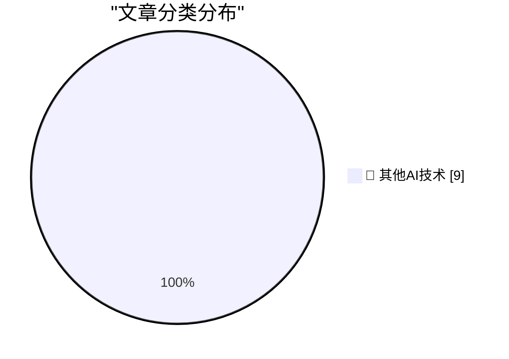

# 📰 AI 博客每日精选 — 2026-11-18

> 来自 98 个技术博客和社交媒体源，AI 精选 Top 9

## 🏆 今日必读

🥇 **SetShot 1.0 (and a Personal Tale of Defaults System Spelunking)**

[SetShot 1.0 (and a Personal Tale of Defaults System Spelunking)](https://tidbits.com/2026/11/13/setshot-1-0-tracks-even-more-macos-settings/) — daringfireball.net · 8 小时前 · 🔬 其他AI技术

> SetShot 1.0 (and a Personal Tale of Defaults System Spelunking)

🥈 **Apple’s Cloud Services Are Having a Bad Day, Including Their Status Page**

[Apple’s Cloud Services Are Having a Bad Day, Including Their Status Page](https://www.macrumors.com/2026/11/17/apple-accounts-experiencing-issues/) — daringfireball.net · 8 小时前 · 🔬 其他AI技术

> Apple’s Cloud Services Are Having a Bad Day, Including Their Status Page

🥉 **Pluralistic: Remembrance of proteins past (17 Nov 2026)**

[Pluralistic: Remembrance of proteins past (17 Nov 2026)](https://pluralistic.net/2026/11/17/mississippi-gosh-darn/) — pluralistic.net · 13 小时前 · 🔬 其他AI技术

> Pluralistic: Remembrance of proteins past (17 Nov 2026)

4️⃣ **How can I ask a second program to show a dialog box as if it were shown by my first program?**

[How can I ask a second program to show a dialog box as if it were shown by my first program?](https://devblogs.microsoft.com/oldnewthing/20261116-01/?p=112863/) — devblogs.microsoft.com/oldnewthing · 20 小时前 · 🔬 其他AI技术

> How can I ask a second program to show a dialog box as if it were shown by my first program?

5️⃣ **Wake up! America’s infrastructure is melting. And AI appears to be partly responsible.**

[Wake up! America’s infrastructure is melting. And AI appears to be partly responsible.](https://garymarcus.substack.com/p/wake-up-americas-infrastructure-is) — garymarcus.substack.com · 12 小时前 · 🔬 其他AI技术

> Wake up! America’s infrastructure is melting. And AI appears to be partly responsible.

---

## 📊 数据概览

| 扫描源 | 抓取文章 | 时间范围 | 精选 |
|:---:|:---:|:---:|:---:|
| 67/98 | 2094 篇 → 9 篇 | 24h | **9 篇** |

### 分类分布

---

====================

## 🔬 其他AI技术

### 1. SetShot 1.0 (and a Personal Tale of Defaults System Spelunking)

[SetShot 1.0 (and a Personal Tale of Defaults System Spelunking)](https://tidbits.com/2026/11/13/setshot-1-0-tracks-even-more-macos-settings/) — **daringfireball.net** · 8 小时前 · ⭐ 15/25

> SetShot 1.0 (and a Personal Tale of Defaults System Spelunking)

📌 其他AI技术

---

### 2. Apple’s Cloud Services Are Having a Bad Day, Including Their Status Page

[Apple’s Cloud Services Are Having a Bad Day, Including Their Status Page](https://www.macrumors.com/2026/11/17/apple-accounts-experiencing-issues/) — **daringfireball.net** · 8 小时前 · ⭐ 15/25

> Apple’s Cloud Services Are Having a Bad Day, Including Their Status Page

📌 其他AI技术

---

### 3. Pluralistic: Remembrance of proteins past (17 Nov 2026)

[Pluralistic: Remembrance of proteins past (17 Nov 2026)](https://pluralistic.net/2026/11/17/mississippi-gosh-darn/) — **pluralistic.net** · 13 小时前 · ⭐ 15/25

> Pluralistic: Remembrance of proteins past (17 Nov 2026)

📌 其他AI技术

---

### 4. How can I ask a second program to show a dialog box as if it were shown by my first program?

[How can I ask a second program to show a dialog box as if it were shown by my first program?](https://devblogs.microsoft.com/oldnewthing/20261116-01/?p=112863/) — **devblogs.microsoft.com/oldnewthing** · 20 小时前 · ⭐ 15/25

> How can I ask a second program to show a dialog box as if it were shown by my first program?

📌 其他AI技术

---

### 5. Wake up! America’s infrastructure is melting. And AI appears to be partly responsible.

[Wake up! America’s infrastructure is melting. And AI appears to be partly responsible.](https://garymarcus.substack.com/p/wake-up-americas-infrastructure-is) — **garymarcus.substack.com** · 12 小时前 · ⭐ 15/25

> Wake up! America’s infrastructure is melting. And AI appears to be partly responsible.

📌 其他AI技术

---

### 6. The NVIDIA Bubble

[The NVIDIA Bubble](https://www.wheresyoured.at/the-nvidia-bubble/) — **wheresyoured.at** · 10 小时前 · ⭐ 15/25

> The NVIDIA Bubble

📌 其他AI技术

---

### 7. My Empire of Sunshine and Roses

[My Empire of Sunshine and Roses](https://geohot.github.io//blog/jekyll/update/2026/11/18/my-empire-of-sunshine-and-roses.html) — **geohot.github.io** · 10 小时前 · ⭐ 15/25

> My Empire of Sunshine and Roses

📌 其他AI技术

---

### 8. Paul Brainerd, creator of desktop publishing

[Paul Brainerd, creator of desktop publishing](https://dfarq.homeip.net/paul-brainerd-creator-of-desktop-publishing/?utm_source=rss&#038;utm_medium=rss&#038;utm_campaign=paul-brainerd-creator-of-desktop-publishing) — **dfarq.homeip.net** · 14 小时前 · ⭐ 15/25

> Paul Brainerd, creator of desktop publishing

📌 其他AI技术

---

### 9. Beyond Linux: A Journey Through the Open Source Ecosystem

[Beyond Linux: A Journey Through the Open Source Ecosystem](https://it-notes.dragas.net/2026/11/17/beyond-linux-a-journey-through-the-open-source-ecosystem/) — **it-notes.dragas.net** · 18 小时前 · ⭐ 15/25

> Beyond Linux: A Journey Through the Open Source Ecosystem

📌 其他AI技术

---

====================

*生成于 2026-11-18 02:42 | 扫描 67 源 → 获取 2094 篇 → 精选 9 篇*
*基于 [Hacker News Popularity Contest 2025](https://refactoringenglish.com/tools/hn-popularity/) RSS 源列表，由 [Andrej Karpathy](https://x.com/karpathy) 推荐*
*由「懂点儿AI」制作，欢迎关注同名微信公众号获取更多 AI 实用技巧 💡*
