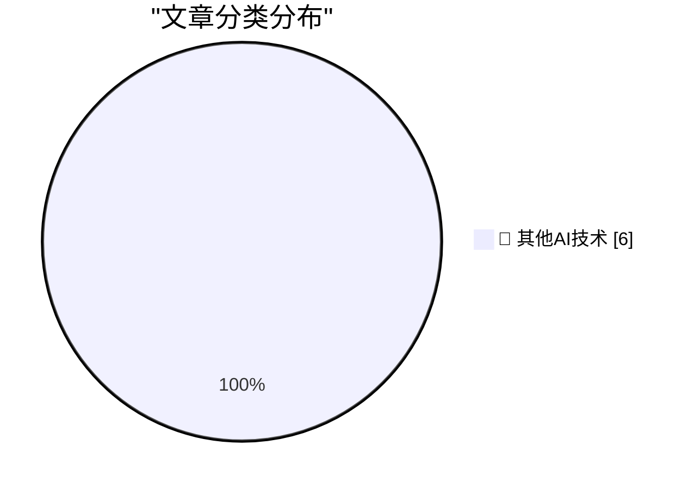

# 📰 AI 博客每日精选 — 2026-11-19

> 来自 98 个技术博客和社交媒体源，AI 精选 Top 6

## 🏆 今日必读

🥇 **★ The 50-Yard Line**

[★ The 50-Yard Line](https://daringfireball.net/2026/11/the_50-yard_line) — daringfireball.net · 5 小时前 · 🔬 其他AI技术

> ★ The 50-Yard Line

🥈 **Jensen Huang Tweets**

[Jensen Huang Tweets](https://x.com/JensenHuang/status/2122726005219737649) — daringfireball.net · 10 小时前 · 🔬 其他AI技术

> Jensen Huang Tweets

🥉 **Pluralistic: Enshittifiers groom us for scammers (18 Nov 2026)**

[Pluralistic: Enshittifiers groom us for scammers (18 Nov 2026)](https://pluralistic.net/2026/11/18/malice-v-incompetence/) — pluralistic.net · 17 小时前 · 🔬 其他AI技术

> Pluralistic: Enshittifiers groom us for scammers (18 Nov 2026)

4️⃣ **Once More Unto The Breach - Another Year In Review**

[Once More Unto The Breach - Another Year In Review](https://shkspr.mobi/blog/2026/11/once-more-unto-the-breach-another-year-in-review/) — shkspr.mobi · 13 小时前 · 🔬 其他AI技术

> Once More Unto The Breach - Another Year In Review

5️⃣ **This Week in Source Control: 18 November 2026**

[This Week in Source Control: 18 November 2026](https://nesbitt.io/2026/11/18/this-week-in-source-control.html) — nesbitt.io · 16 小时前 · 🔬 其他AI技术

> This Week in Source Control: 18 November 2026

---

## 📊 数据概览

| 扫描源 | 抓取文章 | 时间范围 | 精选 |
|:---:|:---:|:---:|:---:|
| 64/98 | 2041 篇 → 6 篇 | 24h | **6 篇** |

### 分类分布

---

====================

## 🔬 其他AI技术

### 1. ★ The 50-Yard Line

[★ The 50-Yard Line](https://daringfireball.net/2026/11/the_50-yard_line) — **daringfireball.net** · 5 小时前 · ⭐ 15/25

> ★ The 50-Yard Line

📌 其他AI技术

---

### 2. Jensen Huang Tweets

[Jensen Huang Tweets](https://x.com/JensenHuang/status/2122726005219737649) — **daringfireball.net** · 10 小时前 · ⭐ 15/25

> Jensen Huang Tweets

📌 其他AI技术

---

### 3. Pluralistic: Enshittifiers groom us for scammers (18 Nov 2026)

[Pluralistic: Enshittifiers groom us for scammers (18 Nov 2026)](https://pluralistic.net/2026/11/18/malice-v-incompetence/) — **pluralistic.net** · 17 小时前 · ⭐ 15/25

> Pluralistic: Enshittifiers groom us for scammers (18 Nov 2026)

📌 其他AI技术

---

### 4. Once More Unto The Breach - Another Year In Review

[Once More Unto The Breach - Another Year In Review](https://shkspr.mobi/blog/2026/11/once-more-unto-the-breach-another-year-in-review/) — **shkspr.mobi** · 13 小时前 · ⭐ 15/25

> Once More Unto The Breach - Another Year In Review

📌 其他AI技术

---

### 5. This Week in Source Control: 18 November 2026

[This Week in Source Control: 18 November 2026](https://nesbitt.io/2026/11/18/this-week-in-source-control.html) — **nesbitt.io** · 16 小时前 · ⭐ 15/25

> This Week in Source Control: 18 November 2026

📌 其他AI技术

---

### 6. Push button telephones introduced November 18, 1963

[Push button telephones introduced November 18, 1963](https://dfarq.homeip.net/push-button-telephones-introduced-november-18-1963/?utm_source=rss&#038;utm_medium=rss&#038;utm_campaign=push-button-telephones-introduced-november-18-1963) — **dfarq.homeip.net** · 14 小时前 · ⭐ 15/25

> Push button telephones introduced November 18, 1963

📌 其他AI技术

---

====================

*生成于 2026-11-19 02:13 | 扫描 64 源 → 获取 2041 篇 → 精选 6 篇*
*基于 [Hacker News Popularity Contest 2025](https://refactoringenglish.com/tools/hn-popularity/) RSS 源列表，由 [Andrej Karpathy](https://x.com/karpathy) 推荐*
*由「懂点儿AI」制作，欢迎关注同名微信公众号获取更多 AI 实用技巧 💡*
