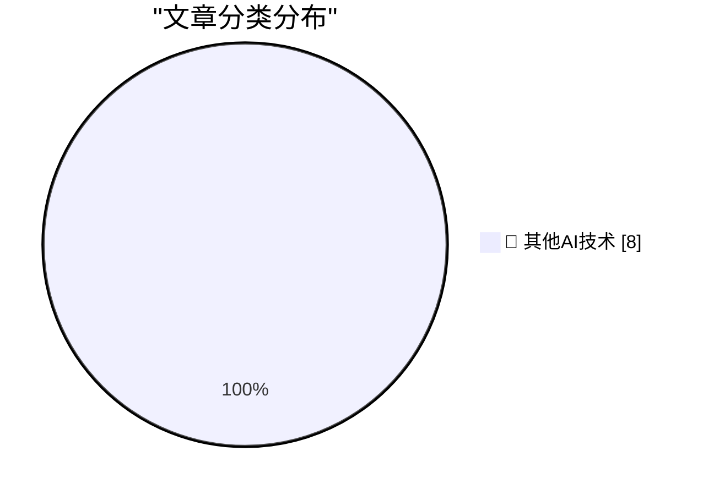

# 📰 AI 博客每日精选 — 2026-11-22

> 来自 98 个技术博客和社交媒体源，AI 精选 Top 8

## 🏆 今日必读

🥇 **To code well, avoid blunders**

[To code well, avoid blunders](https://seangoedecke.com/to-code-well-avoid-blunders/) — seangoedecke.com · 53 分钟前 · 🔬 其他AI技术

> To code well, avoid blunders

🥈 **★ A Week With the New Privacy Controls in MacOS 27.3 Beta 2**

[★ A Week With the New Privacy Controls in MacOS 27.3 Beta 2](https://daringfireball.net/2026/11/a_week_with_the_new_privacy_controls_in_macos_273) — daringfireball.net · 4 小时前 · 🔬 其他AI技术

> ★ A Week With the New Privacy Controls in MacOS 27.3 Beta 2

🥉 **The U.S. — Utterly Predictably — Has Lost Measles Elimination Status Under Trump and RFK Jr.**

[The U.S. — Utterly Predictably — Has Lost Measles Elimination Status Under Trump and RFK Jr.](https://www.wsj.com/health/measles-is-back-it-will-take-years-to-eliminate-it-again-9971736e?st=GKiu3E) — daringfireball.net · 6 小时前 · 🔬 其他AI技术

> The U.S. — Utterly Predictably — Has Lost Measles Elimination Status Under Trump and RFK Jr.

4️⃣ **Apple Documents Extra Apple Intelligence Usage Limits Per iCloud+ Paid Tier**

[Apple Documents Extra Apple Intelligence Usage Limits Per iCloud+ Paid Tier](https://support.apple.com/en-us/127901) — daringfireball.net · 6 小时前 · 🔬 其他AI技术

> Apple Documents Extra Apple Intelligence Usage Limits Per iCloud+ Paid Tier

5️⃣ **Relicensing to CC BY-SA and making it visible in Schema metadata**

[Relicensing to CC BY-SA and making it visible in Schema metadata](https://shkspr.mobi/blog/2026/11/relicensing-to-cc-by-sa-and-making-it-visible-in-schema-metadata/) — shkspr.mobi · 12 小时前 · 🔬 其他AI技术

> Relicensing to CC BY-SA and making it visible in Schema metadata

---

## 📊 数据概览

| 扫描源 | 抓取文章 | 时间范围 | 精选 |
|:---:|:---:|:---:|:---:|
| 64/98 | 2041 篇 → 8 篇 | 24h | **8 篇** |

### 分类分布

---

====================

## 🔬 其他AI技术

### 1. To code well, avoid blunders

[To code well, avoid blunders](https://seangoedecke.com/to-code-well-avoid-blunders/) — **seangoedecke.com** · 53 分钟前 · ⭐ 15/25

> To code well, avoid blunders

📌 其他AI技术

---

### 2. ★ A Week With the New Privacy Controls in MacOS 27.3 Beta 2

[★ A Week With the New Privacy Controls in MacOS 27.3 Beta 2](https://daringfireball.net/2026/11/a_week_with_the_new_privacy_controls_in_macos_273) — **daringfireball.net** · 4 小时前 · ⭐ 15/25

> ★ A Week With the New Privacy Controls in MacOS 27.3 Beta 2

📌 其他AI技术

---

### 3. The U.S. — Utterly Predictably — Has Lost Measles Elimination Status Under Trump and RFK Jr.

[The U.S. — Utterly Predictably — Has Lost Measles Elimination Status Under Trump and RFK Jr.](https://www.wsj.com/health/measles-is-back-it-will-take-years-to-eliminate-it-again-9971736e?st=GKiu3E) — **daringfireball.net** · 6 小时前 · ⭐ 15/25

> The U.S. — Utterly Predictably — Has Lost Measles Elimination Status Under Trump and RFK Jr.

📌 其他AI技术

---

### 4. Apple Documents Extra Apple Intelligence Usage Limits Per iCloud+ Paid Tier

[Apple Documents Extra Apple Intelligence Usage Limits Per iCloud+ Paid Tier](https://support.apple.com/en-us/127901) — **daringfireball.net** · 6 小时前 · ⭐ 15/25

> Apple Documents Extra Apple Intelligence Usage Limits Per iCloud+ Paid Tier

📌 其他AI技术

---

### 5. Relicensing to CC BY-SA and making it visible in Schema metadata

[Relicensing to CC BY-SA and making it visible in Schema metadata](https://shkspr.mobi/blog/2026/11/relicensing-to-cc-by-sa-and-making-it-visible-in-schema-metadata/) — **shkspr.mobi** · 12 小时前 · ⭐ 15/25

> Relicensing to CC BY-SA and making it visible in Schema metadata

📌 其他AI技术

---

### 6. This Week in Package Management: 21 November 2026

[This Week in Package Management: 21 November 2026](https://nesbitt.io/2026/11/21/this-week-in-package-management.html) — **nesbitt.io** · 14 小时前 · ⭐ 15/25

> This Week in Package Management: 21 November 2026

📌 其他AI技术

---

### 7. What three-bolt mount means on a garbage disposal

[What three-bolt mount means on a garbage disposal](https://dfarq.homeip.net/what-three-bolt-mount-means-on-a-garbage-disposal/?utm_source=rss&#038;utm_medium=rss&#038;utm_campaign=what-three-bolt-mount-means-on-a-garbage-disposal) — **dfarq.homeip.net** · 12 小时前 · ⭐ 15/25

> What three-bolt mount means on a garbage disposal

📌 其他AI技术

---

### 8. Notes on the discrete Fourier transform (DFT)

[Notes on the discrete Fourier transform (DFT)](https://eli.thegreenplace.net/2026/notes-on-the-discrete-fourier-transform-dft/) — **eli.thegreenplace.net** · 2 小时前 · ⭐ 15/25

> Notes on the discrete Fourier transform (DFT)

📌 其他AI技术

---

====================

*生成于 2026-11-22 00:53 | 扫描 64 源 → 获取 2041 篇 → 精选 8 篇*
*基于 [Hacker News Popularity Contest 2025](https://refactoringenglish.com/tools/hn-popularity/) RSS 源列表，由 [Andrej Karpathy](https://x.com/karpathy) 推荐*
*由「懂点儿AI」制作，欢迎关注同名微信公众号获取更多 AI 实用技巧 💡*
