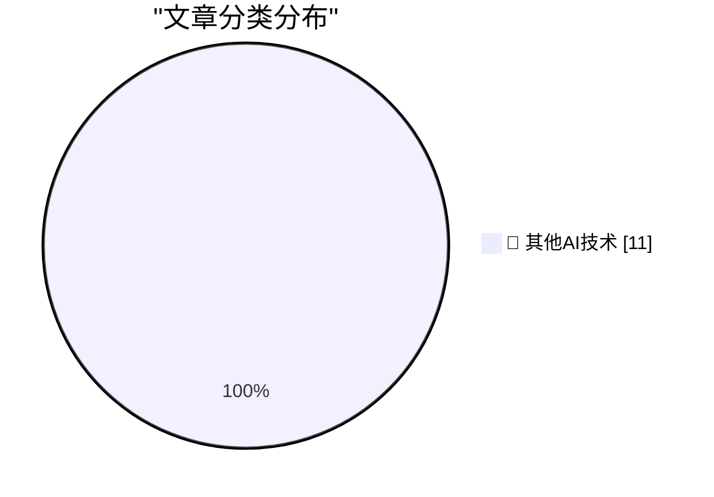

# 📰 AI 博客每日精选 — 2026-11-24

> 来自 98 个技术博客和社交媒体源，AI 精选 Top 11

## 🏆 今日必读

🥇 **[Sponsor] Finalist Daily Planner Meets iPhone Duo**

[[Sponsor] Finalist Daily Planner Meets iPhone Duo](https://www.finalist.works/iphone-duo-planner/?utm_source=df-nov-2026) — daringfireball.net · 5 小时前 · 🔬 其他AI技术

> [Sponsor] Finalist Daily Planner Meets iPhone Duo

🥈 **Jensen Huang Returns to Work**

[Jensen Huang Returns to Work](https://www.businessinsider.com/jensen-huang-returns-to-nvidia-hq-im-terribly-sorry-2026-11) — daringfireball.net · 5 小时前 · 🔬 其他AI技术

> Jensen Huang Returns to Work

🥉 **Donald Trump on Jensen Huang’s Reinstatement at Nvidia**

[Donald Trump on Jensen Huang’s Reinstatement at Nvidia](https://truthsocial.com/@realDonaldTrump/posts/117666713950631493) — daringfireball.net · 11 小时前 · 🔬 其他AI技术

> Donald Trump on Jensen Huang’s Reinstatement at Nvidia

4️⃣ **Semafor: ‘Hours Before Huang’s Reinstatement, Trump Called Nvidia’s Board to Argue for His Return’**

[Semafor: ‘Hours Before Huang’s Reinstatement, Trump Called Nvidia’s Board to Argue for His Return’](https://www.semafor.com/article/11/23/2026/jensen-huang-reinstated-as-nvidia-ceo) — daringfireball.net · 13 小时前 · 🔬 其他AI技术

> Semafor: ‘Hours Before Huang’s Reinstatement, Trump Called Nvidia’s Board to Argue for His Return’

5️⃣ **Government Regulation and Demand**

[Government Regulation and Demand](https://stratechery.com/2026/obituaries/) — daringfireball.net · 13 小时前 · 🔬 其他AI技术

> Government Regulation and Demand

---

## 📊 数据概览

| 扫描源 | 抓取文章 | 时间范围 | 精选 |
|:---:|:---:|:---:|:---:|
| 63/98 | 2013 篇 → 11 篇 | 24h | **11 篇** |

### 分类分布

---

====================

## 🔬 其他AI技术

### 1. [Sponsor] Finalist Daily Planner Meets iPhone Duo

[[Sponsor] Finalist Daily Planner Meets iPhone Duo](https://www.finalist.works/iphone-duo-planner/?utm_source=df-nov-2026) — **daringfireball.net** · 5 小时前 · ⭐ 15/25

> [Sponsor] Finalist Daily Planner Meets iPhone Duo

📌 其他AI技术

---

### 2. Jensen Huang Returns to Work

[Jensen Huang Returns to Work](https://www.businessinsider.com/jensen-huang-returns-to-nvidia-hq-im-terribly-sorry-2026-11) — **daringfireball.net** · 5 小时前 · ⭐ 15/25

> Jensen Huang Returns to Work

📌 其他AI技术

---

### 3. Donald Trump on Jensen Huang’s Reinstatement at Nvidia

[Donald Trump on Jensen Huang’s Reinstatement at Nvidia](https://truthsocial.com/@realDonaldTrump/posts/117666713950631493) — **daringfireball.net** · 11 小时前 · ⭐ 15/25

> Donald Trump on Jensen Huang’s Reinstatement at Nvidia

📌 其他AI技术

---

### 4. Semafor: ‘Hours Before Huang’s Reinstatement, Trump Called Nvidia’s Board to Argue for His Return’

[Semafor: ‘Hours Before Huang’s Reinstatement, Trump Called Nvidia’s Board to Argue for His Return’](https://www.semafor.com/article/11/23/2026/jensen-huang-reinstated-as-nvidia-ceo) — **daringfireball.net** · 13 小时前 · ⭐ 15/25

> Semafor: ‘Hours Before Huang’s Reinstatement, Trump Called Nvidia’s Board to Argue for His Return’

📌 其他AI技术

---

### 5. Government Regulation and Demand

[Government Regulation and Demand](https://stratechery.com/2026/obituaries/) — **daringfireball.net** · 13 小时前 · ⭐ 15/25

> Government Regulation and Demand

📌 其他AI技术

---

### 6. Elon Musk Claims to Be Unfamiliar With MAGA

[Elon Musk Claims to Be Unfamiliar With MAGA](https://www.usatoday.com/story/opinion/columnist/2026/11/19/musk-maga-trump-republicans-billionaires/92855121007/) — **daringfireball.net** · 13 小时前 · ⭐ 15/25

> Elon Musk Claims to Be Unfamiliar With MAGA

📌 其他AI技术

---

### 7. Nvidia Board Reinstates Jensen Huang

[Nvidia Board Reinstates Jensen Huang](https://nvidianews.nvidia.com/news/nvidia-board-reinstates-jensen-huang-as-president-ceo-and-board-director) — **daringfireball.net** · 14 小时前 · ⭐ 15/25

> Nvidia Board Reinstates Jensen Huang

📌 其他AI技术

---

### 8. Pluralistic: The Debt Trap (23 Nov 2026)

[Pluralistic: The Debt Trap (23 Nov 2026)](https://pluralistic.net/2026/11/23/grasshoppers-v-ants/) — **pluralistic.net** · 15 小时前 · ⭐ 15/25

> Pluralistic: The Debt Trap (23 Nov 2026)

📌 其他AI技术

---

### 9. Gadget Review: Cheap Zigbee Environmental Sensors ★★★☆☆

[Gadget Review: Cheap Zigbee Environmental Sensors ★★★☆☆](https://shkspr.mobi/blog/2026/11/gadget-review-cheap-zigbee-environmental-sensors/) — **shkspr.mobi** · 16 小时前 · ⭐ 15/25

> Gadget Review: Cheap Zigbee Environmental Sensors ★★★☆☆

📌 其他AI技术

---

### 10. Am I A Design Engineer?

[Am I A Design Engineer?](https://blog.jim-nielsen.com/2026/am-i-a-design-engineer/) — **blog.jim-nielsen.com** · 10 小时前 · ⭐ 15/25

> Am I A Design Engineer?

📌 其他AI技术

---

### 11. Why the Atari Jaguar is so expensive

[Why the Atari Jaguar is so expensive](https://dfarq.homeip.net/why-the-atari-jaguar-is-so-expensive/?utm_source=rss&#038;utm_medium=rss&#038;utm_campaign=why-the-atari-jaguar-is-so-expensive) — **dfarq.homeip.net** · 17 小时前 · ⭐ 15/25

> Why the Atari Jaguar is so expensive

📌 其他AI技术

---

====================

*生成于 2026-11-24 05:07 | 扫描 63 源 → 获取 2013 篇 → 精选 11 篇*
*基于 [Hacker News Popularity Contest 2025](https://refactoringenglish.com/tools/hn-popularity/) RSS 源列表，由 [Andrej Karpathy](https://x.com/karpathy) 推荐*
*由「懂点儿AI」制作，欢迎关注同名微信公众号获取更多 AI 实用技巧 💡*
