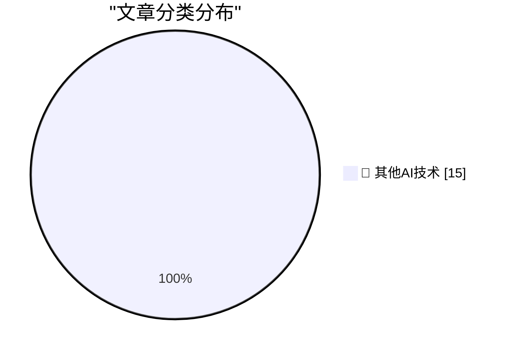

# 📰 AI 博客每日精选 — 2026-11-25

> 来自 98 个技术博客和社交媒体源，AI 精选 Top 15

## 🏆 今日必读

🥇 **Engadget Scoop Claims iPhone 18e Will Have a Camera Plateau**

[Engadget Scoop Claims iPhone 18e Will Have a Camera Plateau](https://www.engadget.com/2325828/new-leaks-reveal-the-iphone-18e-will-have-a-redesigned-camera-plateau/) — daringfireball.net · 4 小时前 · 🔬 其他AI技术

> Engadget Scoop Claims iPhone 18e Will Have a Camera Plateau

🥈 **Trump Made Up to $15M on Nvidia Stock After Huang’s Return**

[Trump Made Up to $15M on Nvidia Stock After Huang’s Return](https://www.theguardian.com/technology/2026/nov/24/donald-trump-nvidia-stock-jensen-huang-stock-market) — daringfireball.net · 4 小时前 · 🔬 其他AI技术

> Trump Made Up to $15M on Nvidia Stock After Huang’s Return

🥉 **Nvidia and Trump’s State Capitalism**

[Nvidia and Trump’s State Capitalism](https://www.wsj.com/opinion/nvidia-jensen-huang-donald-trump-130e644c) — daringfireball.net · 5 小时前 · 🔬 其他AI技术

> Nvidia and Trump’s State Capitalism

4️⃣ **Patriotism, Trump-Style**

[Patriotism, Trump-Style](https://nypost.com/2026/11/23/us-news/trump-suggests-jensen-huang-could-have-moved-to-china-if-not-reinstated-as-nvidia-ceo-sex-sells-fellas/) — daringfireball.net · 5 小时前 · 🔬 其他AI技术

> Patriotism, Trump-Style

5️⃣ **‘The Economy Is a Hostage Situation’**

[‘The Economy Is a Hostage Situation’](https://www.theatlantic.com/technology/2026/11/ai-hostage-economy-nvidia-huang/689552/?gift=aQyUJR7AIw1mJWdQ6Ed6yMQrokNaYAmgr0aVusAzQCY&amp;) — daringfireball.net · 8 小时前 · 🔬 其他AI技术

> ‘The Economy Is a Hostage Situation’

---

## 📊 数据概览

| 扫描源 | 抓取文章 | 时间范围 | 精选 |
|:---:|:---:|:---:|:---:|
| 64/98 | 2043 篇 → 20 篇 | 24h | **15 篇** |

### 分类分布

---

====================

## 🔬 其他AI技术

### 1. Engadget Scoop Claims iPhone 18e Will Have a Camera Plateau

[Engadget Scoop Claims iPhone 18e Will Have a Camera Plateau](https://www.engadget.com/2325828/new-leaks-reveal-the-iphone-18e-will-have-a-redesigned-camera-plateau/) — **daringfireball.net** · 4 小时前 · ⭐ 15/25

> Engadget Scoop Claims iPhone 18e Will Have a Camera Plateau

📌 其他AI技术

---

### 2. Trump Made Up to $15M on Nvidia Stock After Huang’s Return

[Trump Made Up to $15M on Nvidia Stock After Huang’s Return](https://www.theguardian.com/technology/2026/nov/24/donald-trump-nvidia-stock-jensen-huang-stock-market) — **daringfireball.net** · 4 小时前 · ⭐ 15/25

> Trump Made Up to $15M on Nvidia Stock After Huang’s Return

📌 其他AI技术

---

### 3. Nvidia and Trump’s State Capitalism

[Nvidia and Trump’s State Capitalism](https://www.wsj.com/opinion/nvidia-jensen-huang-donald-trump-130e644c) — **daringfireball.net** · 5 小时前 · ⭐ 15/25

> Nvidia and Trump’s State Capitalism

📌 其他AI技术

---

### 4. Patriotism, Trump-Style

[Patriotism, Trump-Style](https://nypost.com/2026/11/23/us-news/trump-suggests-jensen-huang-could-have-moved-to-china-if-not-reinstated-as-nvidia-ceo-sex-sells-fellas/) — **daringfireball.net** · 5 小时前 · ⭐ 15/25

> Patriotism, Trump-Style

📌 其他AI技术

---

### 5. ‘The Economy Is a Hostage Situation’

[‘The Economy Is a Hostage Situation’](https://www.theatlantic.com/technology/2026/11/ai-hostage-economy-nvidia-huang/689552/?gift=aQyUJR7AIw1mJWdQ6Ed6yMQrokNaYAmgr0aVusAzQCY&amp;) — **daringfireball.net** · 8 小时前 · ⭐ 15/25

> ‘The Economy Is a Hostage Situation’

📌 其他AI技术

---

### 6. I Told You to Bet the Over

[I Told You to Bet the Over](https://www.wsj.com/business/nvidia-jensen-huang-white-house-9ad03961?st=HzeUyV) — **daringfireball.net** · 8 小时前 · ⭐ 15/25

> I Told You to Bet the Over

📌 其他AI技术

---

### 7. Restoring a 1982 ‘Star Wars’ Poster From Japan

[Restoring a 1982 ‘Star Wars’ Poster From Japan](https://www.instagram.com/p/DcUk0WjBwVI/) — **daringfireball.net** · 10 小时前 · ⭐ 15/25

> Restoring a 1982 ‘Star Wars’ Poster From Japan

📌 其他AI技术

---

### 8. Enron Employees Give Kenneth Lay a Standing Ovation Upon His Return as CEO in 2001

[Enron Employees Give Kenneth Lay a Standing Ovation Upon His Return as CEO in 2001](https://www.threads.com/@meidastouch/post/DgGKhbTAka5) — **daringfireball.net** · 10 小时前 · ⭐ 15/25

> Enron Employees Give Kenneth Lay a Standing Ovation Upon His Return as CEO in 2001

📌 其他AI技术

---

### 9. David Sacks’s Pool Boy Is Cocky

[David Sacks’s Pool Boy Is Cocky](https://www.threads.com/@karaswisher/post/DgGBe_XI147) — **daringfireball.net** · 11 小时前 · ⭐ 15/25

> David Sacks’s Pool Boy Is Cocky

📌 其他AI技术

---

### 10. Jason Zengerle Profiles Treasury Secretary Scott Bessent for The New Yorker

[Jason Zengerle Profiles Treasury Secretary Scott Bessent for The New Yorker](https://www.newyorker.com/magazine/2026/11/30/scott-bessent-profile) — **daringfireball.net** · 12 小时前 · ⭐ 15/25

> Jason Zengerle Profiles Treasury Secretary Scott Bessent for The New Yorker

📌 其他AI技术

---

### 11. Pluralistic: Free lunches (24 Nov 2026)

[Pluralistic: Free lunches (24 Nov 2026)](https://pluralistic.net/2026/11/24/move-fast-break-kings/) — **pluralistic.net** · 15 小时前 · ⭐ 15/25

> Pluralistic: Free lunches (24 Nov 2026)

📌 其他AI技术

---

### 12. Virgin Media Hub 5 API

[Virgin Media Hub 5 API](https://shkspr.mobi/blog/2026/11/virgin-media-hub-5-api/) — **shkspr.mobi** · 15 小时前 · ⭐ 15/25

> Virgin Media Hub 5 API

📌 其他AI技术

---

### 13. What happens to entries in the CoreApplication Properties when the source apartment shuts down?

[What happens to entries in the CoreApplication Properties when the source apartment shuts down?](https://devblogs.microsoft.com/oldnewthing/20261124-00/?p=112889/) — **devblogs.microsoft.com/oldnewthing** · 12 小时前 · ⭐ 15/25

> What happens to entries in the CoreApplication Properties when the source apartment shuts down?

📌 其他AI技术

---

### 14. Abolish Lock Poisoning

[Abolish Lock Poisoning](https://lucumr.pocoo.org/2026/11/25/poisoning/) — **lucumr.pocoo.org** · 3 小时前 · ⭐ 15/25

> Abolish Lock Poisoning

📌 其他AI技术

---

### 15. Advent of Microarchitecture 2026

[Advent of Microarchitecture 2026](http://xania.org/202611/advent-of-what?utm_source=feed&amp;utm_medium=rss) — **xania.org** · 7 小时前 · ⭐ 15/25

> Advent of Microarchitecture 2026

📌 其他AI技术

---

====================

*生成于 2026-11-25 03:55 | 扫描 64 源 → 获取 2043 篇 → 精选 15 篇*
*基于 [Hacker News Popularity Contest 2025](https://refactoringenglish.com/tools/hn-popularity/) RSS 源列表，由 [Andrej Karpathy](https://x.com/karpathy) 推荐*
*由「懂点儿AI」制作，欢迎关注同名微信公众号获取更多 AI 实用技巧 💡*
