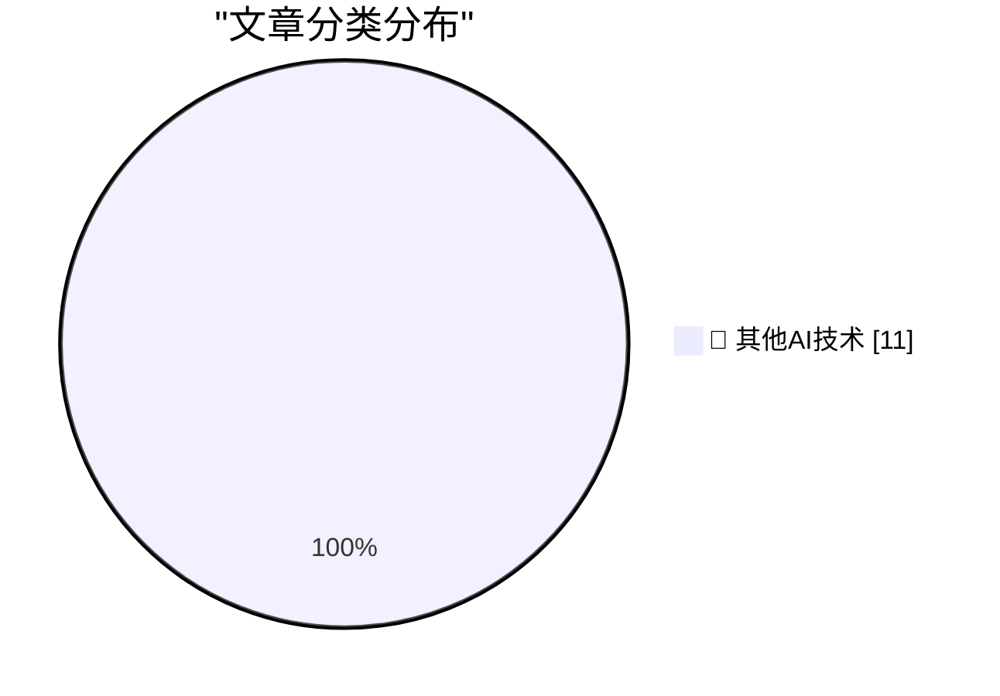

# 📰 AI 博客每日精选 — 2026-11-26

> 来自 98 个技术博客和社交媒体源，AI 精选 Top 11

## 🏆 今日必读

🥇 **Ansible Fails waiting for privilege escalation on Ubuntu 26**

[Ansible Fails waiting for privilege escalation on Ubuntu 26](https://www.jeffgeerling.com/blog/2026/ansible-fails-become-ubuntu2604/) — jeffgeerling.com · 5 小时前 · 🔬 其他AI技术

> Ansible Fails waiting for privilege escalation on Ubuntu 26

🥈 **Electrek Speculates on Trump’s Claim He ‘Protected’ Elon Musk After a ‘Very Tough Incident’ During His First Term**

[Electrek Speculates on Trump’s Claim He ‘Protected’ Elon Musk After a ‘Very Tough Incident’ During His First Term](https://electrek.co/2026/11/24/trump-protected-elon-musk-first-term-tough-incident/) — daringfireball.net · 3 小时前 · 🔬 其他AI技术

> Electrek Speculates on Trump’s Claim He ‘Protected’ Elon Musk After a ‘Very Tough Incident’ During His First Term

🥉 **1Password’s Backend Systems Were Compromised, Revealing Only Customer Account Metadata**

[1Password’s Backend Systems Were Compromised, Revealing Only Customer Account Metadata](https://1password.com/blog/update-on-nov-2026-security-incident) — daringfireball.net · 4 小时前 · 🔬 其他AI技术

> 1Password’s Backend Systems Were Compromised, Revealing Only Customer Account Metadata

4️⃣ **‘Trump Wanted Jensen Huang Back. Now, the President Is Alone in Washington’**

[‘Trump Wanted Jensen Huang Back. Now, the President Is Alone in Washington’](https://www.cnbc.com/2026/11/24/trump-jensen-huang-nvidia.html) — daringfireball.net · 4 小时前 · 🔬 其他AI技术

> ‘Trump Wanted Jensen Huang Back. Now, the President Is Alone in Washington’

5️⃣ **‘The Life of a Composer’**

[‘The Life of a Composer’](https://composer.pablostanley.com/#1) — daringfireball.net · 10 小时前 · 🔬 其他AI技术

> ‘The Life of a Composer’

---

## 📊 数据概览

| 扫描源 | 抓取文章 | 时间范围 | 精选 |
|:---:|:---:|:---:|:---:|
| 64/98 | 2044 篇 → 11 篇 | 24h | **11 篇** |

### 分类分布

---

====================

## 🔬 其他AI技术

### 1. Ansible Fails waiting for privilege escalation on Ubuntu 26

[Ansible Fails waiting for privilege escalation on Ubuntu 26](https://www.jeffgeerling.com/blog/2026/ansible-fails-become-ubuntu2604/) — **jeffgeerling.com** · 5 小时前 · ⭐ 15/25

> Ansible Fails waiting for privilege escalation on Ubuntu 26

📌 其他AI技术

---

### 2. Electrek Speculates on Trump’s Claim He ‘Protected’ Elon Musk After a ‘Very Tough Incident’ During His First Term

[Electrek Speculates on Trump’s Claim He ‘Protected’ Elon Musk After a ‘Very Tough Incident’ During His First Term](https://electrek.co/2026/11/24/trump-protected-elon-musk-first-term-tough-incident/) — **daringfireball.net** · 3 小时前 · ⭐ 15/25

> Electrek Speculates on Trump’s Claim He ‘Protected’ Elon Musk After a ‘Very Tough Incident’ During His First Term

📌 其他AI技术

---

### 3. 1Password’s Backend Systems Were Compromised, Revealing Only Customer Account Metadata

[1Password’s Backend Systems Were Compromised, Revealing Only Customer Account Metadata](https://1password.com/blog/update-on-nov-2026-security-incident) — **daringfireball.net** · 4 小时前 · ⭐ 15/25

> 1Password’s Backend Systems Were Compromised, Revealing Only Customer Account Metadata

📌 其他AI技术

---

### 4. ‘Trump Wanted Jensen Huang Back. Now, the President Is Alone in Washington’

[‘Trump Wanted Jensen Huang Back. Now, the President Is Alone in Washington’](https://www.cnbc.com/2026/11/24/trump-jensen-huang-nvidia.html) — **daringfireball.net** · 4 小时前 · ⭐ 15/25

> ‘Trump Wanted Jensen Huang Back. Now, the President Is Alone in Washington’

📌 其他AI技术

---

### 5. ‘The Life of a Composer’

[‘The Life of a Composer’](https://composer.pablostanley.com/#1) — **daringfireball.net** · 10 小时前 · ⭐ 15/25

> ‘The Life of a Composer’

📌 其他AI技术

---

### 6. 20 Percent He Has Other Problems, Which This Margin Is Too Narrow to Contain

[20 Percent He Has Other Problems, Which This Margin Is Too Narrow to Contain](https://www.wsj.com/politics/policy/trump-says-he-protects-brilliant-ceos-like-elon-musk-and-jensen-huang-b977cfda?st=7ctVgP) — **daringfireball.net** · 10 小时前 · ⭐ 15/25

> 20 Percent He Has Other Problems, Which This Margin Is Too Narrow to Contain

📌 其他AI技术

---

### 7. Pluralistic: New York vs auto-enshittification (25 Nov 2026)

[Pluralistic: New York vs auto-enshittification (25 Nov 2026)](https://pluralistic.net/2026/11/25/empire-state-strikes-back/) — **pluralistic.net** · 13 小时前 · ⭐ 15/25

> Pluralistic: New York vs auto-enshittification (25 Nov 2026)

📌 其他AI技术

---

### 8. Book Review: Slow Gods by Claire North ★★★★⯪

[Book Review: Slow Gods by Claire North ★★★★⯪](https://shkspr.mobi/blog/2026/11/book-review-slow-gods-by-claire-north/) — **shkspr.mobi** · 14 小时前 · ⭐ 15/25

> Book Review: Slow Gods by Claire North ★★★★⯪

📌 其他AI技术

---

### 9. This Week in Source Control: 25 November 2026

[This Week in Source Control: 25 November 2026](https://nesbitt.io/2026/11/25/this-week-in-source-control.html) — **nesbitt.io** · 17 小时前 · ⭐ 15/25

> This Week in Source Control: 25 November 2026

📌 其他AI技术

---

### 10. Have You Tried Using Your Agent?

[Have You Tried Using Your Agent?](https://blog.jim-nielsen.com/2026/have-you-tried-your-agent/) — **blog.jim-nielsen.com** · 8 小时前 · ⭐ 15/25

> Have You Tried Using Your Agent?

📌 其他AI技术

---

### 11. How the Tandy 2000 doomed Tandy computers

[How the Tandy 2000 doomed Tandy computers](https://dfarq.homeip.net/how-the-tandy-2000-doomed-tandy-computers/?utm_source=rss&#038;utm_medium=rss&#038;utm_campaign=how-the-tandy-2000-doomed-tandy-computers) — **dfarq.homeip.net** · 15 小时前 · ⭐ 15/25

> How the Tandy 2000 doomed Tandy computers

📌 其他AI技术

---

====================

*生成于 2026-11-26 03:20 | 扫描 64 源 → 获取 2044 篇 → 精选 11 篇*
*基于 [Hacker News Popularity Contest 2025](https://refactoringenglish.com/tools/hn-popularity/) RSS 源列表，由 [Andrej Karpathy](https://x.com/karpathy) 推荐*
*由「懂点儿AI」制作，欢迎关注同名微信公众号获取更多 AI 实用技巧 💡*
