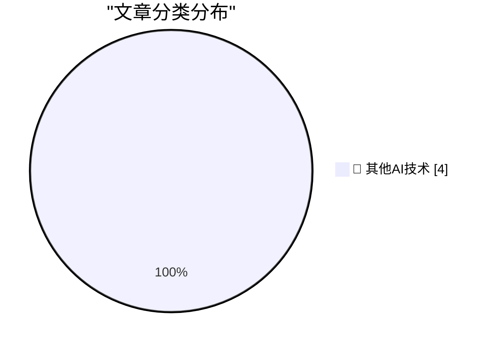

# 📰 AI 博客每日精选 — 2026-11-27

> 来自 98 个技术博客和社交媒体源，AI 精选 Top 4

## 🏆 今日必读

🥇 **Who gets to decide if something is written by AI?**

[Who gets to decide if something is written by AI?](https://seangoedecke.com/who-gets-to-decide-if-something-is-written-by-ai/) — seangoedecke.com · 3 小时前 · 🔬 其他AI技术

> Who gets to decide if something is written by AI?

🥈 **★ Obvious Affordances Are Due for a Comeback**

[★ Obvious Affordances Are Due for a Comeback](https://daringfireball.net/2026/11/obvious_affordances_are_due_for_a_comeback) — daringfireball.net · 12 小时前 · 🔬 其他AI技术

> ★ Obvious Affordances Are Due for a Comeback

🥉 **Pluralistic: Charles Koch is a cult leader (26 Nov 2026)**

[Pluralistic: Charles Koch is a cult leader (26 Nov 2026)](https://pluralistic.net/2026/11/26/science-of-liberty/) — pluralistic.net · 14 小时前 · 🔬 其他AI技术

> Pluralistic: Charles Koch is a cult leader (26 Nov 2026)

4️⃣ **What happens when you put a non-agile object in the CoreApplication Properties?**

[What happens when you put a non-agile object in the CoreApplication Properties?](https://devblogs.microsoft.com/oldnewthing/20261126-00/?p=112899/) — devblogs.microsoft.com/oldnewthing · 12 小时前 · 🔬 其他AI技术

> What happens when you put a non-agile object in the CoreApplication Properties?

---

## 📊 数据概览

| 扫描源 | 抓取文章 | 时间范围 | 精选 |
|:---:|:---:|:---:|:---:|
| 62/98 | 2014 篇 → 4 篇 | 24h | **4 篇** |

### 分类分布

---

====================

## 🔬 其他AI技术

### 1. Who gets to decide if something is written by AI?

[Who gets to decide if something is written by AI?](https://seangoedecke.com/who-gets-to-decide-if-something-is-written-by-ai/) — **seangoedecke.com** · 3 小时前 · ⭐ 15/25

> Who gets to decide if something is written by AI?

📌 其他AI技术

---

### 2. ★ Obvious Affordances Are Due for a Comeback

[★ Obvious Affordances Are Due for a Comeback](https://daringfireball.net/2026/11/obvious_affordances_are_due_for_a_comeback) — **daringfireball.net** · 12 小时前 · ⭐ 15/25

> ★ Obvious Affordances Are Due for a Comeback

📌 其他AI技术

---

### 3. Pluralistic: Charles Koch is a cult leader (26 Nov 2026)

[Pluralistic: Charles Koch is a cult leader (26 Nov 2026)](https://pluralistic.net/2026/11/26/science-of-liberty/) — **pluralistic.net** · 14 小时前 · ⭐ 15/25

> Pluralistic: Charles Koch is a cult leader (26 Nov 2026)

📌 其他AI技术

---

### 4. What happens when you put a non-agile object in the CoreApplication Properties?

[What happens when you put a non-agile object in the CoreApplication Properties?](https://devblogs.microsoft.com/oldnewthing/20261126-00/?p=112899/) — **devblogs.microsoft.com/oldnewthing** · 12 小时前 · ⭐ 15/25

> What happens when you put a non-agile object in the CoreApplication Properties?

📌 其他AI技术

---

====================

*生成于 2026-11-27 03:27 | 扫描 62 源 → 获取 2014 篇 → 精选 4 篇*
*基于 [Hacker News Popularity Contest 2025](https://refactoringenglish.com/tools/hn-popularity/) RSS 源列表，由 [Andrej Karpathy](https://x.com/karpathy) 推荐*
*由「懂点儿AI」制作，欢迎关注同名微信公众号获取更多 AI 实用技巧 💡*
